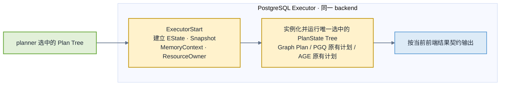
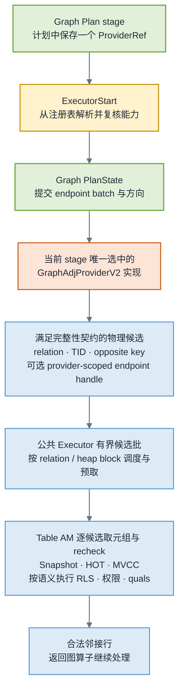
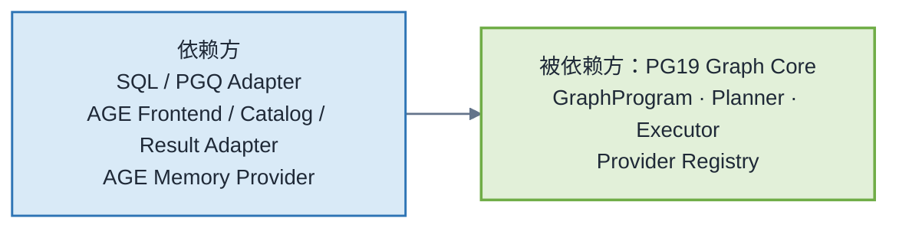
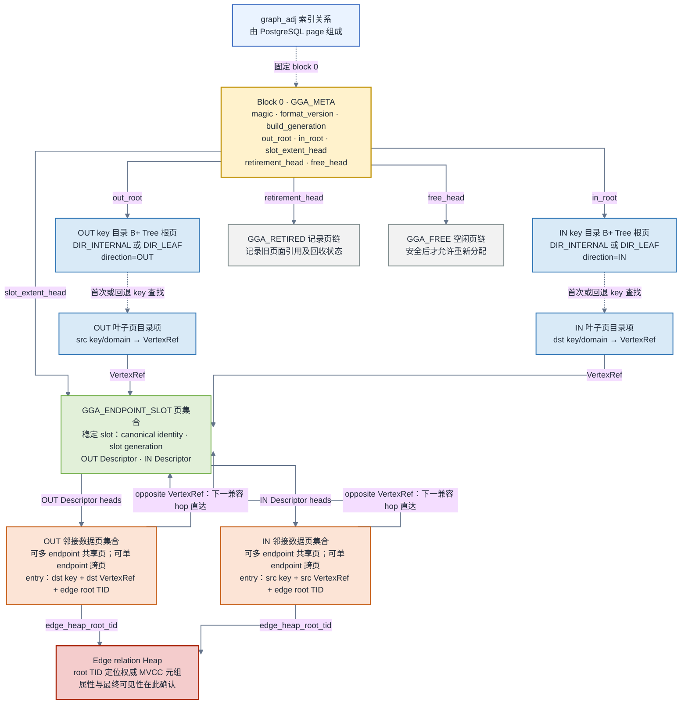
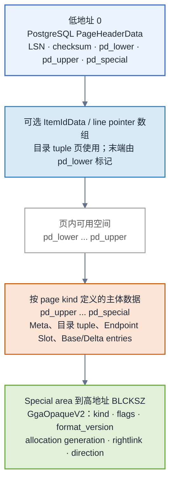
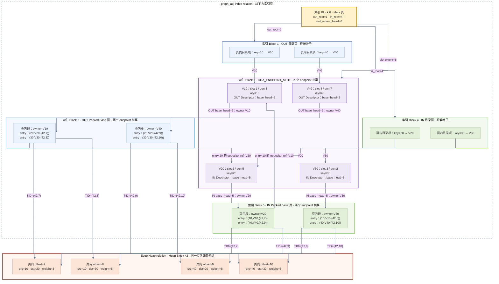
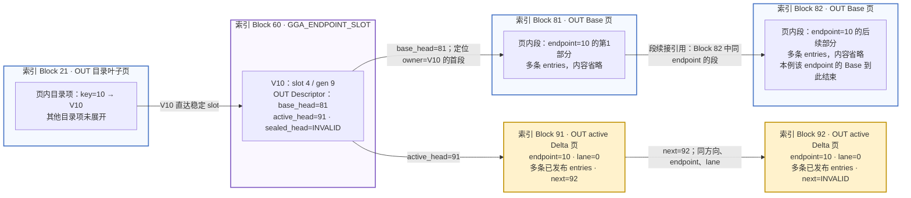
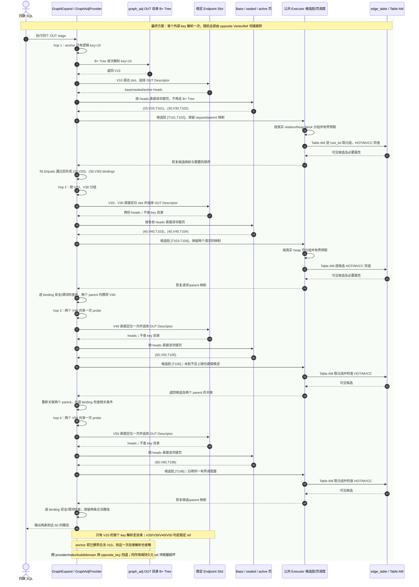

# PostgreSQL 19 原生多跳图执行与 Apache AGE 适配详细设计

> 2026-10-21 状态导航：本文是完整架构目标，不是当前功能清单。当前以公共执行层＋图 B-tree 为主线，M0～M6及限定续做已执行，功能/兼容/四组合通过；AUTO候选过早淘汰已修复，三个无重复场景已有4/8/5个有效轮，完成73728个实际提交事务，但自然CBO全面准确与DML严格零退化仍未签收。当前实现与边界见[组合执行清单第16节](PostgreSQL19原生多跳图执行与AGE适配/设计/图Btree与关系算子组合执行设计.md#16-三项未签收问题的定向续做)和[阶段验收报告第9节](PostgreSQL19原生多跳图执行与AGE适配/报告/图Btree组合执行M0-M6验收报告.md#9-三项未签收问题的后续验证)。正式入口无需LOAD测试模块，AUTO/AGE默认off；下文各日期证据保留为历史，不倒签G1/G2～G6或生产门。

> 文档状态：评审修订后的架构与实施设计稿；功能、存储协议和性能均须经原型验证，未生产准入<br>
> PostgreSQL 基线：PostgreSQL 19 Beta 2，`REL_19_BETA2`，commit `7873db5369b967dd53984df34fd800003410d04f`  
> AGE 基线：Apache AGE 1.8.0 本地 PG19 移植树，HEAD `4d9b250663424ad9c5e2405f6e2d821182eaaef4`；文档审计时已有 15 个修改文件，正式开发前必须冻结 patch digest  
> 整体调整日期：2026-09-05  
> 稳定端点引用方案刷新：2026-09-08；本文已将 `graph_adj` 最终目标统一为“首跳 key 目录解析 + 中间跳 `VertexRef` 直达稳定 Endpoint Slot + 跨作用域/非权威 hint 失效时回退目录”。同索引持久化 ref 的代际冲突视为结构错误，不能静默掩盖。这同时把公共邻接 ABI 提升为 `GraphAdjProviderV2`。  
> 读路径基线补充：2026-09-08；“紧凑页面布局 + 有界批量邻接访问与按页分组回表”提升为必备设计能力，分别进入 Phase 0S、Phase 1 的退出条件；物理编码、容量阈值和批大小仍待原型冻结，不代表已经实现或取得性能成绩。<br>
> 统计实现设计补充：2026-09-08；第 8 章定义逻辑拓扑、物理访问和成本校准三层统计，以及采集、发布、刷新、安全使用与缺失回退协议；最小统计闭环与固定多跳共同进入 G1，不把全部高级统计作为首期前置，也不把公式齐全当作 CBO 已经可用。<br>
> 实施准备补充：[GLM-5 执行包](PostgreSQL19原生多跳图执行与AGE适配/执行包/README.md)已按 2026-09-08 的稳定引用、紧凑页面、基线批回表及本章统计设计刷新为 V2：72 张任务卡、当前参考契约和验收依赖；保留 5 项历史准备完成证据。参考格式仍须 GS-010 冻结字节编码，新图能力均未因此变成已实现；刷新检查见[执行包报告](PostgreSQL19原生多跳图执行与AGE适配/执行包/V2刷新与校验报告.md)。<br>
> 适用范围：PG19 共享图内核、SQL/PGQ 首个前端、AGE 第二前端，以及固定多跳、可达性、最短路径和复杂图模式执行
> 硬约束：`graph_adj` 有效且持续维护时，在冻结的等价 PG19 端点索引基线和支持负载矩阵内，DML 不劣化，尤其 INSERT 吞吐及尾延迟；不能以关闭索引、降低持久性或牺牲查询正确性代替达标

## 0. 结论

本设计采用明确的单向架构决策：

> **先在 PostgreSQL 19 内核建立前端无关的共享图执行能力，再为 Apache AGE 增加适配层；不在 PG19 与 AGE 中建设两套多跳优化器和执行器。**

选择 PG19 内核优先，不是因为原生 SQL/PGQ 已经具备完整遍历能力。实际情况恰好相反：PG19 Beta 2 虽有 `CREATE PROPERTY GRAPH` 和 `GRAPH_TABLE()`，但 `GRAPH_TABLE` 在 rewrite 阶段会展开为普通关系子查询，图拓扑随后从 planner 输入中消失；路径变量、量化路径和 shortest 等语法能力也仍不完整。内核优先的意义在于把以下数据库级能力做成 SQL/PGQ 与 AGE 都能复用的一套公共基础：

1. `GraphPatternProvenance`：保存图变量、方向、量词、路径模式、重复语义和前端来源。
2. `GraphProgram`：把不同前端的图模式统一编译为有依赖关系的 stage/hop 程序。
3. 原生物理算子：`GraphExpandFixed`、`GraphReachability`、`GraphShortestPath`、`GraphPathEnumerate` 和 `GraphPatternIntersect`。
4. 多跳运行时：frontier、visited、binding、push/pull、双向搜索、有界批量邻接探测与按页分组回表、并行、流控和 spill。
5. 可插拔邻接提供者：普通端点 B-tree（覆盖布局可选）、支持稳定 `VertexRef` 中间跳的 `graph_adj` Index AM，以及通过完整性审计的 AGE warm in-memory adjacency。
6. 前端与结果适配：PGQ tuple 输出和 AGE `agtype`/path 输出都在适配边界完成，公共内核不依赖 AGE 私有类型。

AGE 仍然有重要价值：openCypher 入口、既有 graph/label catalog、`graphid`/`agtype` 数据模型，以及已经实现的 VLE/shortest 内存邻接执行。它不应被绕开或删除。AGE 内存图在候选完整性、事务失效和安全协议通过审计后，包装为 `AgeMemAdjProvider`，与普通 B-tree 和 `graph_adj` 在同一代价模型中竞争。静态图、单 backend、缓存已热且复用上下文正确时它可能最快；冷启动、写频繁或多 backend 时必须计入整图装载、重建和总内存成本。未通过完整性/安全门不是“提高成本”，而是禁止生成该候选；AGE 原有 fallback 也不自动成为正确性或资源安全证明。

两条前端路线如下：

```text
PG19 SQL/PGQ -> PGQ Adapter --+
                               +-> GraphPatternProvenance
AGE openCypher -> AGE Adapter -+        -> GraphProgram
                                         -> GraphPath / Graph Plan
                                         -> B-tree | graph_adj | AGE memory
                                         -> PG heap + Snapshot + RLS
                                         -> PGQ tuple | AGE agtype/path
```

交付顺序调整为：冻结功能和读写验收基线 → 最小 `graph_adj` 持续读写原型与最小图执行契约 → 存储正确性及 INSERT 非劣化可行性门 → 固定多跳运行时和存储产品化 → AGE 只读适配 → 搜索语法/算子与高级功能 → 通过审计的 AGE memory 联合 CBO。不能等完整运行时完成后才验证最关键的写入风险；详见第 14 节。

本次评审确定以下边界：

- 主基线是同一 edge heap、同一约束及其他索引下，PG19 维护所需 `start_id`/`end_id` 普通 B-tree 的能力，不是 heap-only，也不是故意增加宽覆盖索引后的弱化基线。
- 以双向 `graph_adj` **替代等价端点索引**为主要验证路线；不是在两个必要 B-tree 之外默认叠加两份图索引。唯一性、主键及不能等价替代的索引必须保留并计入成本。
- 同一个 AM 同时维护 OUT/IN，并不消除两端定位、写入、WAL 和并发控制。共享边记录、批量追加和后台合并都是待测优化，不构成不劣化证明。
- `graph_adj` 的最终性能路径不是“每跳重新下降目录 B+ Tree”。外部 endpoint key 首次解析为索引内稳定 `VertexRef`；同一 provider/index/build/domain 内兼容的后续 stage 使用该引用直达 Endpoint Slot，再选择 OUT/IN Descriptor。跨索引/provider/build、端点域不兼容或非权威 query hint 失效时，以 `opposite_key` 进入目标目录；同作用域邻接项中的持久化 ref 若代际冲突则报结构错误。`opposite_key` 和 Heap root TID 仍分别承担语义恢复与事务 recheck。
- 只从查询 planner 隐藏 `graph_adj` 不会停止 INSERT 维护它；查询 fallback 与物理布局迁移是两件事。
- 紧凑页面布局与有界批量访问/回表是最终方案 B 的基线能力，不再作为产品化之后才考虑的可选优化。前者从 Phase 0S 交付 packed Slot、小邻接共享段和按需分配；后者从 Phase 1 交付 endpoint/ref 分组、候选页调度、Table AM 逐候选检查与 binding 恢复，见第 9.6、10.4.9、15.4.1 节。批大小为 1 是有理由的执行模式，不等于允许省略批调度能力。
- 设计完备性通过协议、能力矩阵和故障/隔离测试证明；性能通过重复的持续负载测试证明。截至本次修订，没有本设计 `graph_adj` 原型的验收数据，不宣称已经达到目标。

本设计不承诺消除结果本身的复杂度。如果查询明确要求枚举 `d^h` 条合法路径，系统至少需要生成这些结果。此时目标是可暂停、有限内存、可 spill、可取消和可观测，而不是把指数级输出宣称为常数成本。

---

## 1. 目标、边界与原则

### 1.1 建设目标

- 在 PG19 内核建立不依赖 SQL/PGQ、openCypher、`graphid` 或 `agtype` 的 `GraphProgram`、planner、executor 和邻接 provider 契约。
- 让 SQL/PGQ 与 AGE 都能在图语义仍然可见时比较现有 fallback 与公共 GraphPath。
- 为固定多跳、可达性、最短路径、路径枚举和分支/环模式提供不同物理实现。
- 将同一 `graph_adj` 内兼容链路的目录树下降收敛到首个 key 解析或跨作用域/非权威 hint 回退；同时降低重复邻接页读取、可共享的 heap 候选检查和中间 binding 物化。
- 将低度邻接的紧凑存储、有界批量邻接读取及按 heap 页分组回表纳入最小交付；降低页空间浪费和重复页面访问，但不以整图常驻、取消回表或省略事务检查作为前提。
- 在稀疏/稠密 frontier、单向/双向搜索、逐点/批量探测和三类邻接提供者之间进行成本选择。
- 保留 PostgreSQL 的 Snapshot、RLS、security barrier、Serializable、WAL、VACUUM、分区和 plan invalidation 语义。
- 保留 AGE 的 openCypher 可见语义与结果格式，并把 AGE relationship uniqueness 准确映射到公共路径模式。
- 同时度量查询收益与缓存构建、backend 总内存、缓存失效、索引维护、写放大和空间占用。
- 将 `graph_adj` 持续维护下的 DML 非劣化设为不可由查询加速抵消的独立准入门；INSERT 单独验证成功提交吞吐、P95/P99、后台维护可收敛性和并发查询性能。
- 为每个计划提供清晰的 EXPLAIN、实际运行指标和 fallback 原因。

### 1.2 非目标

- 不把 AGE 与 PG19 分别实现成两套独立 GraphProgram、CBO 和多跳 executor。
- 不要求 AGE 放弃其现有 VLE/shortest 实现；未接入或不适用的查询继续走 AGE 原路径。
- 不让公共内核直接包含 `graphid`、`agtype`、AGE label inheritance 或 openCypher AST。
- 不把 PostgreSQL 改造成独立的全内存图库，也不引入另一份权威图存储。
- 不绕过 heap、Snapshot、权限或 RLS 读取未授权数据。
- 不在第一阶段支持无界全部路径、`OPTIONAL MATCH`、写入 clause 或全部 openCypher 组合。
- 不用全局 visited 偷换固定路径或全部路径的 bag/binding 语义。
- 不保证静态、全图常驻内存的分析任务一定优于专用图系统。
- 不在查询执行期间自动创建或删除索引。
- 不以不可复现的单次热缓存数字作为产品结论。

### 1.3 核心原则

1. **PG19 core first，AGE adapter second。** 公共能力先在内核形成稳定、版本化契约，AGE 只承担语言、catalog 和结果适配。
2. **一个 IR、一套执行器。** 两个前端 lowering 到同一 `GraphProgram`；禁止长期维护功能等价但行为不同的第二套内核。
3. **关系表是唯一权威数据。** SQL Property Graph 与 AGE label table 最终都建立在普通关系之上。
4. **保留现有计划族，不假定索引永远存在。** fallback 必须使用当前实际可用的访问结构；新增语法没有原生 fallback 时须先交付独立 oracle 和明确拒绝路径。AGE 原路径也不自动构成无缺陷证明。
5. **先区分语义，再选择算法。** fixed、reachability、shortest 和 enumeration 不共用错误的去重规则。
6. **逻辑模式与物理访问分离。** `GraphProgram` 描述 hop 依赖；B-tree、`graph_adj` 或 AGE memory 是 stage 的物理选择。
7. **适配层拥有前端特性。** AST、catalog 映射和结果编码留在各自 adapter；公共 executor 只处理版本化的内部值和语义。
8. **读写与缓存联合准入。** INSERT 非劣化是硬门，不允许用读收益加权抵消；同时报告 DML、WAL、VACUUM、缓存构建/失效、锁争用、总内存和存储代价。
9. **执行期失败不静默换计划。** 仅允许在执行子计划和可能有副作用的表达式之前做 startup capability fallback；“尚未输出”不是充分条件，执行开始后 ERROR 不透明重试。
10. **所有优化可解释。** 前端、provider、计划选择、估算置信度、内存预算、spill 和降级原因均进入 EXPLAIN。
11. **逻辑键与物理快路径并存。** endpoint key 是跨 stage/provider 的语义身份；`VertexRef` 只是由 provider/index/build/domain/slot generation 限定的快速引用。跨作用域或非权威 hint 失效时按 key 回退；同索引同构建内的持久化 ref 冲突报错。任何情况下都不能把裸页地址当永久顶点 ID。
12. **紧凑存储与批量回表是基线，不是语义捷径。** 页面可共享，访问可按页调度；逻辑边、候选版本、request 和 parent binding 不因此合并。小请求与顺序敏感请求可以缩批或保序，必须有可观测原因，不以全量缓存或未经证明的 index-only 掩盖成本。

### 1.4 DML 非劣化契约

“不能比 PG19 原始能力差”在本设计中指：**在事先冻结的支持矩阵内，以正常启用持久性、约束及必要方向索引的 PG19 为对照，候选保持等价事务语义与资源额度，成功完成的业务写入吞吐不低于基线，端到端 P95/P99 不高于基线。** 所有支持场景分别通过，不用平均值覆盖局部退化。

方向、前端和生命周期分开：单向结构对比同方向单 B-tree，双向结构对比两端 B-tree；原生 SQL 对比原生 SQL，AGE 写入对比同一冻结 AGE 前端及其原生端点索引。后者只证明相对 AGE 基线不劣化，不能写成 AGE 端到端开销与裸 PG SQL 相同。稳态、初始化和在线布局迁移各自出具结果，未经迁移门验证不得承诺迁移期也无损。

不得以异步漏边、降低 `fsync`/`synchronous_commit`、关闭约束、移除必要方向、暂停维护、转移到额外硬件或无界积压后台任务换取通过。任何必测负载失败或统计证据不足，结论为 FAIL 或 INCONCLUSIVE，不改写成“基本不劣化”。第 15 节规定指标、零退化容忍度和判定方法；这不是对所有未知硬件和任意负载的数学保证。

---

## 2. PostgreSQL 19 与 Apache AGE 基线

### 2.1 PG19 SQL/PGQ 当前调用链

PostgreSQL 19 Beta 2 的 SQL/PGQ 主要调用链为：

```text
gram.y
  -> transformRangeGraphTable()
     parse_clause.c / parse_graphtable.c
  -> RTE_GRAPH_TABLE + GraphPattern
     parsenodes.h
  -> fireRIRrules()
  -> rewriteGraphTable()
  -> 顶点表、边表、连接条件和普通子查询
  -> RTE_SUBQUERY，graph_pattern 被清空
  -> 普通 PostgreSQL planner
```

源码证据：

- `postgres19/src/backend/rewrite/rewriteGraphTable.c:105-138` 将 `GRAPH_TABLE` 转换为关系子查询。
- 同文件第 127-136 行把 RTE 改为 `RTE_SUBQUERY`，并清空 `graph_pattern` 和图列定义。
- 同文件第 397-414 行生成普通 target list、quals、edge-vertex link quals 和 fromlist。
- `postgres19/src/backend/optimizer/path/allpaths.c:795-802` 断言 planner 不应再看到 `RTE_GRAPH_TABLE`。

这条路径保证了 PostgreSQL 能复用现有 Join、扫描、权限和事务机制，但也过早丢失图拓扑语义。

### 2.2 AGE 当前调用链与可复用资产

AGE 当前 README 声明兼容 PG11～18，因此工作区的 PG19 组合属于本地移植，不应假定上游 ABI 或回归已经覆盖。该移植树当前读取路径也不是一个统一实现：

- 固定长度 `MATCH` 在 `apache-age-pg19-port/src/backend/parser/cypher_clause.c` 的 `transform_match_pattern()` / `make_path_join_quals()` 中转换为 label relation、普通 Join 和 endpoint quals，并由 `prevent_duplicate_edges()` 增加 clause 内 relationship uniqueness 条件。
- AGE 的 `set_rel_pathlist_hook` 主要包装 `CREATE`、`SET`、`DELETE`、`MERGE` 等写入相关 CustomPath；不能依赖该 hook 在普通只读 `MATCH` 已关系化之后恢复完整多跳拓扑。
- VLE 在 `age_vle.c` 中按 openCypher relationship uniqueness 执行 DFS；这一语义应映射为公共 `TRAIL`，不能默认映射为允许重复边的 `WALK`。
- shortest 辅助逻辑基于缓存图执行 BFS，并为 all-shortest 保存 predecessor 集。
- `age_global_graph.c` 在 backend 进程的 `TopMemoryContext` 中维护整图缓存，装载所有顶点和边，构造 OUT/IN/self adjacency，并在 graph version 变化时失效后重建。
- AGE graph 对应独立 schema；vertex label 表核心列为 `id/properties`，edge label 表核心列为 `id/start_id/end_id/properties`。label 创建流程已为 vertex id 和 edge 的 start/end id 建立 B-tree。

这些资产决定了本设计不能简单得出“AGE 无图执行能力”的结论。正确做法是：

1. 复用其 openCypher parser、graph/label catalog 和结果类型；
2. 将可支持的只读模式在 parser transform 仍持有 `cypher_path` 时转换为公共 provenance；
3. 将现有整图缓存包装为有成本、有安全门和有版本的邻接 provider；
4. 未通过语义或安全准入时继续执行 AGE 原有 Join/VLE/shortest 路径。

当前移植树存在 PG19 适配中的本地未提交修改。进入实施前必须先记录 `git status`、commit、patch digest、编译参数与回归结果；本文列出的 AGE 接口是目标设计，不应被误读为当前 1.8.0 已公开提供稳定 ABI。

### 2.3 两种前端的共同问题与差异

显式 h-hop 线性模式通常会关系化为 h 个 edge relation、h+1 个 vertex relation 以及多组连接条件。PGQ rewrite 与 AGE fixed `MATCH` 都可能因此产生：

- 每一跳独立进行 B-tree 根到叶查找；
- 同一 endpoint 被不同 binding 到达时重复读取相同邻接；
- Join 层生成宽中间元组，携带后续并不需要的列；
- planner 为多个 relation 枚举连接切分、方向、算法和参数化路径；
- reachability 无法用 global visited 合并搜索状态；
- shortest path 无法按 BFS level 提前停止；
- 高 overlap 和 supernode 造成基数低估、内存失控和 worker skew。

这些是可能出现的成本，不是 PG19 每条关系计划必然重复执行的工作。原生 `Memoize` 已能缓存参数化扫描结果，Hash Join 等计划也可能消除部分重复探测；基准不得关闭这些能力制造弱对手。新增 runtime 的收益必须相对原生自然选出的合理计划验证，而不是仅对比朴素 Nested Loop。

AGE VLE/shortest 的整图缓存避免了逐跳 B-tree 探测，但代价结构不同：

- cold backend 需要整图装载，而窄查询可能只访问极小子图；
- 缓存按 backend 持有，多连接并发时要计算聚合内存，而不是只看单查询内存；
- 图发生变化后需要版本失效和重建；
- 直接缓存扫描是否完整继承 relation RLS/security 语义必须用源码审计和隔离测试证明，证明前不能默认准入；
- 当前实现不等同于公共 runtime 所要求的 spill、跨 provider CBO 和统一 instrumentation。

因此最优访问路径由工作负载决定：1～2 跳的普通 Join 可能已足够好；通过完整性门的 warm AGE cache 在稳定图、单连接分析中可能最快；普通端点 B-tree 是低维护风险主基线，覆盖布局另行比较；`graph_adj` 是面向冷/窄遍历、并发 backend 和持续更新的待验证方案。planner 必须比较真实可用候选，不能写死单一赢家。

### 2.4 当前功能边界与近期承诺

| 能力 | PG19 Beta 2 | AGE 1.8.0 本地移植 | 公共内核首期处理 |
|---|---|---|---|
| 属性图 DDL/catalog | SQL/PGQ 原生支持 | graph/schema/label catalog | 由 catalog adapter 映射 |
| 固定路径 | `GRAPH_TABLE` 后关系化 | fixed `MATCH` 后关系化 | 首批公共 `GraphExpandFixed` |
| 路径变量/量化路径 | `sql_features.txt` 仍有未支持项 | VLE 已有专用实现 | 后续按语义逐项接入 |
| Reachability | 语法/执行尚不完整 | VLE 可表达部分能力 | 公共 `GraphReachability` |
| Shortest | 标准项尚不完整 | 有缓存图 BFS helper | 公共 `GraphShortestPath`，AGE 原路保留 |
| 复杂 clause/DML | 由 SQL 能力边界决定 | `OPTIONAL MATCH`、`WITH`、写入 clause 等组合丰富 | 不在 AGE adapter 首批范围 |

近期产品入口限定为：

- 第一阶段：SQL/PGQ 显式固定 2～4 hop；
- 第二阶段：SQL/PGQ 显式固定 2～8 hop；
- 第三阶段：AGE 只读固定 `MATCH`，且只接入能完整证明 clause boundary、binding 与结果编码的形状；
- 后续阶段：公共 reachability、shortest、量化路径和复杂模式，并逐项开放 AGE adapter；
- 无界全部路径不进入近期承诺。

内部 IR 从第一版就区分完整语义和前端来源，避免增加 AGE 或新语法时推翻 executor。

### 2.5 功能交付闭环与状态

以下是必须交付的能力矩阵，不是当前已实现清单。每一行都要有可运行入口、语义 fingerprint、EXPLAIN 证据及独立正确性用例；只提供内部算子或回退原路径不能算该项加速能力已交付。

| 功能 | 用户入口及必须补齐的前端工作 | 执行/访问要求 | 验证与准入 |
|---|---|---|---|
| 固定多跳 | PGQ 显式 fixed pattern；AGE 只读 fixed `MATCH` | `GraphExpandFixed`，B-tree/`graph_adj` | 原生关系计划 + 小图枚举；保留 bag 和 uniqueness scope |
| 有界可达性 | PGQ 量化/存在性表达需扩展 parser、analyzer；AGE 对应 VLE 子集需证明 lowering | `GraphReachability`，含深度/模式状态的精确 visited | 恰好两跳、非零下界、多源配对、不可达等独立 oracle |
| 无权 shortest | PGQ search prefix 和路径变量尚需实现；AGE helper 逐项映射 | 分层 BFS，分别实现 ANY/ALL 输出及终止证明 | 非首遇会合、等长平行边、零跳、同源同目标 |
| 有界全路径 | 量化路径、路径变量、路径模式和返回类型共同交付 | `GraphPathEnumerate`，path-local state、spill | WALK/TRAIL/ACYCLIC/SIMPLE 分别枚举比较，不截断 |
| 分支/环/交集 | 先支持现有 fixed 语法可表达的子集 | `GraphPatternIntersect` 或等价 Join | 共享变量约束、平行边多重性、空结果 |
| 普通关系访问 | `WHERE start_id = $1`、`WHERE end_id = $1`、两端条件和参数化 Join | `graph_adj` 标准 Index AM 扫描，不依赖图语法 | 去掉等价端点 B-tree 后逐条验证；第 10.14 节 |
| 事务化维护 | 原生 INSERT/UPDATE/DELETE/COPY/ON CONFLICT；AGE 原写入入口 | 同一 heap 事务驱动双向维护、HOT、WAL、VACUUM | 第 10～11 节协议与第 15 节 DML 硬门 |

PGQ 新语法的交付至少涉及 `gram.y`、`parsenodes.h`、`parse_graphtable.c`、provenance/lowering、结果类型、错误信息及回归文件。不能把新语法送回当前不支持它的 PG19 rewrite 当作 fallback；开发阶段可用独立参考实现或严格等价的递归 SQL 作 oracle，未交付的用户构造明确拒绝。负权 shortest、无界全部路径及完整 openCypher 写入 clause 优化不因本矩阵自动扩入近期范围。

---

## 3. 查询语义与正确性契约

### 3.1 查询类别

| 查询类别 | 结果语义 | 可合并的搜索状态 | 目标物理算子 |
|---|---|---|---|
| 固定长度模式 | 输出所有合法变量 binding，保留重复 | 只能共享邻接探测，不能全局去重结果 | `GraphExpandFixed` |
| 可达性 `ANY` | 判断或返回可达 endpoint 集 | 仅可合并未来合法延续等价的状态 | `GraphReachability` |
| `ANY SHORTEST` | 返回一条或一组最短距离结果 | 可按 BFS level 定型 visited | `GraphShortestPath` |
| `ALL SHORTEST` | 返回全部最短路径 | visited 需保留 predecessor DAG | `GraphShortestPath` |
| 有界全部路径 | 枚举所有满足 path mode 的路径 | 必须保留 path-local state | `GraphPathEnumerate` |
| 分支、环、菱形模式 | 输出满足全部共享变量约束的 binding | 可做多路邻接交集和因子化 | `GraphPatternIntersect` |

### 3.2 Binding 与搜索状态必须分离

系统内部至少维护三个概念：

- **frontier endpoint**：下一跳需要展开的不同端点。
- **path binding**：从起点到当前 stage 的合法变量绑定，具有多重性。
- **visited state**：仅在语义允许时表示已经完成或已经发现的搜索状态。

如果三条合法路径到达同一顶点：

- fixed/path enumeration 默认仍应产生三条 binding；
- reachability 仅在 origin、模式和深度约束允许时合并搜索状态，不能默认只保留一个 endpoint；
- all-shortest 需要保留所有最短 predecessor；
- probe sharing 可以只读取一次邻接，但输出时必须恢复三条 binding 的多重性。

### 3.3 路径模式

`GraphProgram` 必须为每个 path pattern 显式记录：

```text
path_constraint[k].mode       = WALK | TRAIL | ACYCLIC | SIMPLE
path_constraint[k].scope_ids  = 受该唯一性规则约束的 edge/vertex stage
path_constraint[k].scope_kind = PATH | PATTERN | CLAUSE
result_mode                    = ALL_BINDINGS | REACHABLE_SET | ANY_SHORTEST | ALL_SHORTEST
direction                      = OUT | IN | UNDIRECTED
lower_hops                     = 非负整数
upper_hops                     = 有界整数或受能力门控制
```

- `WALK` 允许重复顶点和边。
- `TRAIL` 不允许同一路径重复边。
- `ACYCLIC` 不允许同一路径重复顶点。
- `SIMPLE` 的规范化语义允许首尾顶点相同，其他顶点不得重复；必须额外记录闭环已完成状态，不能把闭环继续作为普通中间状态展开。不得把“完全无重复顶点”也命名为 `SIMPLE`。
- 单路径程序可以把 `path_mode` 作为 shorthand；多 path/clause 程序必须使用显式 `path_constraints`，不能把一种前端的 uniqueness scope 扩大到整个 query block。
- fixed binding 不能因为内部 probe 去重而改变输出行数。
- 路径方向、label/type、局部谓词和跨变量谓词必须保持原始语义。
- 空路径、self-loop、parallel edge、NULL 属性和重复 edge key 都必须进入测试矩阵。

路径模式名称不是跨语言等价性的充分证据。以上是公共 IR 的显式定义；前端必须核对自己的规范和实现，按需保留额外约束。`SIMPLE` 与 `ACYCLIC` 的差别亦可参考 [Oracle PGQL 路径模式说明](https://docs.oracle.com/en/database/oracle/property-graph/26.1/spgdg/supported-pgql-features-and-limitations-graph-server-pgx.html)，但该文档不替代 PGQ/openCypher 各自的语义审计。

### 3.4 前端语义映射

公共内核只接受规范化后的明确语义，不根据前端名称猜测规则。adapter 必须生成一份可审计的映射记录：

| 前端构造 | 公共表示 | 必须保留的约束 |
|---|---|---|
| SQL/PGQ fixed pattern | `ALL_BINDINGS` + 明确 hop | 标准定义的 binding、多重性与方向 |
| SQL/PGQ 后续量化构造 | 对应 result/path mode | 仅在该标准构造已完整 lowering 时准入 |
| AGE fixed `MATCH` | `ALL_BINDINGS` + 显式 uniqueness scope | relationship uniqueness、clause boundary、变量作用域、方向和结果列 |
| AGE VLE | 通常为 `TRAIL` | 同一路径 relationship uniqueness；不能降成 `WALK` |
| AGE shortest helper | `ANY_SHORTEST` 或 `ALL_SHORTEST` + 经审计的路径约束 | 当前 BFS 的 visited/前驱语义、零跳/同端点、最短层确认和路径返回形态；不直接套用 SIMPLE 名称 |
| AGE graph/path 值 | 内部 binding/path + AGE result adapter | `agtype` 和 AGE path 构造只发生在输出边界 |

公共表示中的顶点、边与 endpoint key 以 PG 类型 OID、collation、Datum/null 和稳定 relation identity 表示。它不得包含 `graphid` 位布局、`agtype` 容器、AGE AST 指针或 label inheritance 规则。AGE Catalog Adapter 负责把 graph/label 映射为 base relation、key 列和类型；AGE Result Adapter 负责把公共结果重新编码为用户预期的 AGE 值。

`OPTIONAL MATCH` 的 null extension、`WITH` 的投影/聚合边界、correlated subquery、variable-length lower/upper bound、predicate placement 和写入 clause 都是语义边界。首期 adapter 只接受已证明等价的只读 fixed `MATCH` 子集；其余形状继续走 AGE 原路径，并报告具体拒绝原因。

同一业务查询只有在两种前端表达的语义确实重叠时才做跨前端逐行比较。不能拿 SQL/PGQ 的默认 path mode 替代 openCypher relationship uniqueness，也不能凭经验猜 AGE uniqueness 跨多个 pattern/clause 的作用域；adapter 必须从当前 AGE 语义与回归证据建立 `scope_ids`。

### 3.5 输出顺序

除 SQL 显式 `ORDER BY` 外，图算子不得承诺稳定输出顺序。内部改变 anchor、方向、frontier 结构或并行度可以改变物理到达顺序，但不能改变结果集合和 binding 多重性。

如果上层要求排序、`LIMIT` 或 `WITH TIES`，由 PostgreSQL 已有 Sort、Incremental Sort、Limit 等节点处理。图算子只有在能够证明产生所需 pathkey 时才可以声明有序输出。

### 3.6 图计划准入

第一阶段只在以下条件同时满足时生成公共图路径：

- query block 为只读查询；
- 图对象和底层 relation OID 可稳定解析；
- frontend adapter、catalog provider 和 result adapter 的 ABI/version 可验证；
- 路径长度在当前能力范围内；
- label、type、方向和 key 映射可转换为已支持 stage；
- clause boundary、变量作用域、多重性与 path mode 可完整证明；
- 所需谓词不含破坏重排安全性的 volatile 或 security-barrier 依赖；
- 路径模式和结果模式由目标物理算子完整支持；
- 至少存在一个满足 Snapshot/RLS 契约且可估价的邻接 provider；
- 估计内存不超过硬预算，或节点具备已验证的 spill 路径。

任何检查失败时都保留前端现有计划：SQL/PGQ 使用关系化子查询，AGE 使用原有 Join/VLE/shortest。fallback 必须等价，不得把不支持的 path mode 降级成较弱语义，也不得因公共路径不可用而改变 AGE 返回类型。

### 3.7 资源契约

多跳查询需要显式全局预算：

```text
graph.work_mem
graph.max_expanded_edges
graph.max_path_bindings
graph.max_hops
graph.max_runtime_ms
graph.spill_enabled
```

预算属于整个 Graph Plan，不默认复制给每个并行 worker。provider 自身的常驻状态也必须计入：AGE memory 至少报告本 backend 缓存、本次构建峰值和实例内估算聚合缓存。exact 查询达到资源上限时只能 spill、继续等待资源或明确报错，不能静默返回部分结果。

---

## 4. 总体架构

本章采用“一张总图、三张子图”的表达方式。总图只保留端到端主流程；规划选择、共享 Executor、邻接访问三个容易混淆的部分分别展开，避免把候选计划、运行时分支和物理访问层画在同一张图中。

### 4.1 总图：主要流程

```mermaid
%%{init: {
  "theme": "base",
  "flowchart": { "curve": "stepAfter", "htmlLabels": true },
  "themeVariables": {
    "fontFamily": "Segoe UI, Microsoft YaHei, Arial, sans-serif",
    "fontSize": "14px",
    "lineColor": "#64748B",
    "primaryTextColor": "#1F2937"
  }
}}%%
flowchart LR
  FRONTENDS["① 查询前端<br/>SQL / PGQ · AGE openCypher"]
  ADAPTERS["② 前端适配<br/>保留原有查询表达<br/>另附图模式语义"]
  PLANNER_OVERVIEW["③ PostgreSQL Planner<br/>原有计划族 + 可选 GraphPath<br/>选择一棵完整 Plan Tree"]
  EXEC_OVERVIEW["④ PostgreSQL Executor<br/>运行选中的 PlanState<br/>按需调用 AM / Provider / AGE Cache"]
  RESULT_OVERVIEW["⑤ 前端结果<br/>PGQ tuple · AGE agtype / path"]

  FRONTENDS --> ADAPTERS --> PLANNER_OVERVIEW --> EXEC_OVERVIEW --> RESULT_OVERVIEW

  classDef frontend fill:#EAF3FF,stroke:#4472C4,stroke-width:1.5px,color:#1F2937;
  classDef adapter fill:#D9EAF7,stroke:#2F75B5,stroke-width:1.8px,color:#1F2937;
  classDef core fill:#E2F0D9,stroke:#70AD47,stroke-width:1.8px,color:#1F2937;
  classDef executor fill:#FFF2CC,stroke:#BF9000,stroke-width:1.5px,color:#1F2937;
  classDef result fill:#DDEBF7,stroke:#5B9BD5,stroke-width:1.5px,color:#1F2937;

  class FRONTENDS frontend;
  class ADAPTERS adapter;
  class PLANNER_OVERVIEW core;
  class EXEC_OVERVIEW executor;
  class RESULT_OVERVIEW result;

  linkStyle default stroke:#64748B,stroke-width:1.4px
```



总图只表达五步责任链。这里的“保留原有查询表达”是指 PGQ 继续生成现有关系化 Query，AGE 继续生成现有 Join、可变长或最短路径函数调用表达，使 PostgreSQL planner 仍能生成原有计划候选；“另附图模式语义”是指在原始图语法被关系化改写丢失前，将点、边、方向、变量、跳数和路径语义保存为 `GraphPatternProvenance`。它只是供 planner 构造 `GraphProgram` 和 `GraphPath` 的语义描述，不是另一棵可执行 Plan。planner 随后选择一棵完整 Plan Tree，由同一个 PostgreSQL Executor 运行。数据访问被画在 Executor 方框内部，因为 Table/Index AM、邻接 Provider 和 AGE Cache 都是 PlanState 按需调用的访问能力，不是 Executor 之后的独立执行阶段。

### 4.2 子图一：规划期候选生成与选择

```mermaid
%%{init: {
  "theme": "base",
  "flowchart": { "curve": "stepAfter", "htmlLabels": true },
  "themeVariables": {
    "fontFamily": "Segoe UI, Microsoft YaHei, Arial, sans-serif",
    "fontSize": "14px",
    "lineColor": "#64748B",
    "primaryTextColor": "#1F2937"
  }
}}%%
flowchart LR
  QUERY["当前语句<br/>PGQ 或 AGE"] --> ADAPTER["当前前端的<br/>Frontend Adapter"]

  ADAPTER --> ORIGINAL_INPUT["保留原有查询表达"]
  ORIGINAL_INPUT --> ORIGINAL_PLAN["当前前端的<br/>原有计划候选"]
  ORIGINAL_PLAN --> COMBINE["Planner 可组合性检查"]

  ADAPTER --> GRAPH_INPUT["另附图模式语义<br/>Provenance → GraphProgram"]
  GRAPH_INPUT --> GATE["GraphPath 生成条件<br/>（硬门）"]
  GATE --> GRAPH_PATH["公共 GraphPath 候选<br/>含各 stage 的 ProviderRef"]
  GRAPH_PATH --> COMBINE

  COMBINE --> COST["完整计划成本比较"]
  COST --> CHOSEN["选中的完整<br/>Plan Tree"]

  classDef frontend fill:#EAF3FF,stroke:#4472C4,stroke-width:1.5px,color:#1F2937;
  classDef adapter fill:#D9EAF7,stroke:#2F75B5,stroke-width:1.5px,color:#1F2937;
  classDef original fill:#F2F2F2,stroke:#7F8C8D,stroke-width:1.5px,color:#1F2937;
  classDef core fill:#E2F0D9,stroke:#70AD47,stroke-width:1.8px,color:#1F2937;
  classDef decision fill:#FFF2CC,stroke:#BF9000,stroke-width:1.8px,color:#1F2937;
  classDef chosen fill:#DDEBF7,stroke:#5B9BD5,stroke-width:2px,color:#1F2937;

  class QUERY frontend;
  class ADAPTER adapter;
  class ORIGINAL_INPUT,ORIGINAL_PLAN original;
  class GRAPH_INPUT,GRAPH_PATH core;
  class GATE,COMBINE,COST decision;
  class CHOSEN chosen;

  linkStyle default stroke:#64748B,stroke-width:1.4px
```



为避免两套前端连线交叉，图中“当前前端”在进入时已经确定，PGQ 与 AGE 的具体映射改用下表表达：

| 当前入口 | 灰色原有分支 | 绿色图语义分支 |
|---|---|---|
| SQL/PGQ | `rewriteGraphTable()` 后的关系化 Query | rewrite 前的 `GraphPattern`、方向、变量、跳数和输出映射 |
| AGE openCypher | 现有关系 Join、可变长或最短路径函数调用表达 | `cypher_path`、变量、方向、跳数、重复语义和 clause boundary |

一条语句只使用表中的一行。Frontend Adapter 同时保留灰色原有分支并生成绿色图语义分支；两条线分别形成原有计划候选和可选 `GraphPath` 候选，再进入同一个 PostgreSQL planner。`GraphPath` 生成条件不满足时绿色分支终止，灰色候选仍可被选择；生成了 `GraphPath` 也不代表它必胜。planner 先检查候选能否与外围计划正确组合，再比较完整计划成本。规划结果是一棵完整 Plan Tree，执行中不再重新做这次成本选择。

图中的三个判定阶段不能混为一谈：

| 阶段 | 实际问题 | 不通过或处理结果 |
|---|---|---|
| `GraphPath` 生成条件（硬门） | 公共图执行是否能与当前查询保持语义等价，并满足 provider 能力、MVCC/RLS/权限及资源可控要求 | 任一必需条件失败就不生成 `GraphPath`；这不是“把成本调高”，配置也不能强行越过 |
| Planner 可组合性检查 | 候选能否在不改变语义的前提下放入外围关系计划，例如 Join 顺序、外连接边界、LATERAL/`required_outer`、参数化、安全屏障和 AGE clause boundary 是否允许 | 不合法的组合位置被丢弃，候选可在其他合法位置继续参与规划；若无合法位置，则该候选退出 |
| 成本比较 | 在已准入且可合法组合的完整计划之间，哪一个估算成本最低 | 选择成本胜出的完整 Plan Tree；这里才会出现原有计划或公共 GraphPath 的成本胜负 |

### 4.3 子图二：共享 Executor 中的执行路径



三种选中结果不再画成扇出线，因为 planner 已经在执行前确定唯一 Plan Tree。它们在同一 Executor 中的差别如下：

| planner 选中的计划族 | 同一 PostgreSQL Executor 中实际运行的节点 | 结果构造 |
|---|---|---|
| 公共 Graph Plan | Graph PlanState；图算子按需调用邻接 Provider | 当前前端 Result Adapter 将 binding/path 转为 PGQ tuple 或 AGE `agtype`/path |
| PGQ 原有计划 | 普通 Join、Scan、Filter、Project 等 PlanState | PGQ 原有 tuple 投影 |
| AGE 原有计划 | 普通关系 PlanState，或调用 AGE 现有可变长/最短路径函数的节点 | AGE 原有 `agtype`/path 构造 |

无论表中哪一行被选中，都共享当前 backend 的 `EState`、Snapshot、MemoryContext 和 ResourceOwner 生命周期。邻接 Provider 的调用细节放在下一张单向流程图中。

### 4.4 子图三：邻接 Provider 与底层访问实现



图中只保留单向运行链。`GraphAdjProviderV2` 是邻接访问专用接口，但不专属于 `graph_adj`；V2 相对旧参考 V1 增加可选 provider-scoped endpoint handle 输入/输出。具体实现与物理候选源用表格表达：

| `ProviderRef` 解析到的实现 | 物理候选源 | 访问含义 |
|---|---|---|
| `BtreeAdjProvider` | 普通端点 B-tree | 经标准 Index AM 定位；非覆盖时由后续 Table AM recheck 回表取另一端和属性 |
| `GraphAdjIndexProvider` | `graph_adj` 二级 Index AM | 首个/回退 key 经目录解析，兼容中间跳用 `VertexRef` 直达稳定 Endpoint Slot；随后返回连续邻接候选 |
| `AgeMemAdjProvider` | AGE backend cache | 只有候选完整性、snapshot、失效和安全契约通过审计后才可准入 |

不同执行分支是否经过邻接 Provider 如下：

| 执行分支 | 实际访问路径 | 经过 `GraphAdjProviderV2` |
|---|---|---|
| 公共 Graph Plan | Graph PlanState → 选中的 provider → 物理候选 → Table AM recheck | 是 |
| PGQ 原有计划或 AGE fixed `MATCH` | 普通关系 PlanState → 标准 Table/Index AM → B-tree、`graph_adj` 或 heap | 否 |
| AGE 原有可变长/最短路径 | AGE 现有函数节点 → AGE cache | 否 |

规划期为每个 stage 写入一个 `ProviderRef`，Executor startup 解析并校验一个实现，执行中不在三个实现之间随意切换。provider 必须先证明它对当前请求返回完整候选集合；公共 Executor 将需要回表的候选放入有界批，在语义允许时按 relation/heap 页组织访问，再根据当前 Snapshot、HOT、MVCC、RLS、权限和 quals 完成逐候选及逐 binding 检查。“逐条 recheck”规定检查粒度，不要求逐条随机访问页面；其批调度、保序和缩批规则见第 9.6 节。回表只能删除 false positive，不能补回 provider 漏掉的边。关系 heap 始终是权威事务数据，`graph_adj` 是二级 Index AM，AGE cache 是派生状态。

公共 binding 中的 endpoint 仍以 catalog 声明的逻辑 key 表示；provider 可以附带一个有作用域的物理 handle。`graph_adj` 返回的 handle 包含 provider、index relation、index build generation、endpoint domain、slot id、slot generation 和 provenance，只允许交给兼容的后续 `GraphAdjIndexProvider` stage。它既不是跨 provider ABI 的通用顶点 ID，也不能代替 key、snapshot 或 relation mapping。

### 4.5 架构决策与依赖方向

依赖只能从 frontend/provider 指向 PG19 公共契约：



PG19 graph core 不 include AGE 头文件、不解析 `cypher_path`、不构造 `agtype`，也不假设 AGE label table 的继承布局。AGE 通过版本化注册接口提供 catalog、result 和可选 adjacency callbacks。计划中保存可序列化的 `GraphProviderRef`、能力版本和 generation，不保存 extension 函数指针；executor startup 再从注册表解析 callbacks。

这种依赖方向使公共内核可同时服务 SQL/PGQ 与 AGE。若反过来先把核心做进 AGE，后续支持 SQL/PGQ 时仍需把 planner、runtime、统计和访问接口抽回内核，形成重复迁移。只有在禁止修改 PG core、且目标仅为短期 openCypher 演示时，才允许用 AGE CustomScan 做有明确淘汰计划的原型；它不是产品架构。

### 4.6 两级优化边界

优化过程分为两级：

1. **图内部优化**
   - 选择 anchor；
   - 选择正向、反向或双向；
   - 选择 fixed、reachability、shortest、enumeration 或 intersection；
   - 选择 pipelined、batched、push 或 pull；
   - 选择 B-tree、`graph_adj` 或 AGE memory；
   - 估计 frontier、binding、examined edges、provider startup、总内存和 spill。
2. **图与外围关系代数优化**
   - 将 GraphPath 与普通 JoinPath 组合；
   - 决定普通关系过滤在图节点外部还是可安全下推；
   - 比较前端原有完整计划与公共图计划；
   - 保留参数化、分区裁剪和并行候选。

图内部计划不能绕过 PostgreSQL 的 join legality、lateral dependency、security level 和 parameterization 约束。AGE clause boundary 也不能为了扩大图子计划而跨越 `OPTIONAL MATCH`、`WITH`、聚合、subquery 或 DML 的语义屏障。

### 4.7 组件边界

| 组件 | 归属 | 职责 |
|---|---|---|
| PGQ Parser/Analyzer | PG19 | 产生 `GraphPattern` 与用户可见列 |
| PGQ Frontend Adapter | PG19 | 在 rewrite 前生成公共 provenance，保留关系化 fallback |
| AGE Parser/Transform | AGE | 解析 openCypher，继续生成现有 fallback |
| AGE Frontend Adapter | AGE | 在 `cypher_path` 尚可见时做语义准入与公共 provenance |
| Graph Catalog Provider | frontend/extension | graph、label/type、base relation、endpoint key 映射 |
| Graph normalizer/planner | PG19 core | 构造唯一 `GraphProgram`，生成并估价 GraphPath |
| Graph executor | PG19 core | 管理 frontier、binding、visited、并行与 spill |
| Adjacency Provider Registry | PG19 core | 注册、能力协商、成本与运行时扫描契约 |
| B-tree / `graph_adj` provider | PG19 core | 逐点/批量事务化邻接访问；`graph_adj` 负责 key→ref、稳定 Slot 直达、跨作用域/hint 回退与持久化 ref 完整性检查 |
| AGE memory provider | AGE | 复用缓存所有权；先修正并验证完整性/失效协议，再注册 wrapper，不复制第二份整图 |
| Result Adapter | frontend/extension | 公共 binding/path 转 PGQ tuple 或 AGE `agtype`/path |
| Statistics/Advisor | PG19 core + provider | 拓扑、provider 状态、读写/缓存成本与建议 |

### 4.8 Fallback 所有权

每个 adapter 在提交公共 provenance 的同时登记自己的 fallback identity：

- PGQ fallback 是 `rewriteGraphTable()` 产生的关系子查询；
- AGE fixed `MATCH` fallback 是现有 transform 生成的 Join/quals；
- AGE VLE/shortest fallback 是现有函数和缓存图执行路径；
- fallback plan 仍由原前端拥有，公共内核不得尝试重新解释其结果类型。

planner 可以不生成 GraphPath，也可以让 GraphPath 在成本竞争中落败。startup fallback 仅在尚未执行子计划、volatile/有副作用表达式和结果 adapter 前，经非 ERROR 的 capability 检查发现不匹配时使用；备用计划必须预先验证同一 snapshot、权限、参数及输出语义。仅“尚未输出行”不足以安全重跑。执行开始后的 ERROR、资源耗尽或运行时 ABI 异常直接报错，不捕获后透明换计划。

关系计划族保留不等于原有 B-tree 物理副本保留。替换布局后 fallback 只能选择仍存在的索引（包括经标准 AM 访问的 `graph_adj`）或表扫描。查询切换不能停止写入维护，物理回退与在线迁移见第 10.14 节。

### 4.9 最终产品形态

| 部署形态 | 可用前端 | 可用 provider | 依赖 |
|---|---|---|---|
| patched PG19 | SQL/PGQ | B-tree、`graph_adj` | 不依赖 AGE |
| patched PG19 + AGE | SQL/PGQ、openCypher | B-tree、`graph_adj`、通过审计后的 AGE memory | AGE 仅向 core 注册 adapter/provider |
| 未打 core patch 的 PG19 + AGE | AGE 现有能力 | AGE 原 Join/VLE/shortest | 不属于本设计的完整产品能力 |

推荐交付物是一套带公共图 core 的 PG19 二进制，AGE 作为可选扩展安装。安装 AGE 不改变 SQL/PGQ 路径的正确性或必选依赖；不安装 AGE 时 core 不应出现未解析符号、空 provider 或额外后台进程。

---

## 5. 统一图语义保留与前端适配

### 5.1 公共 provenance 契约

`GraphPatternProvenance` 是前端与公共 planner 之间的只读、可复制、可失效 sidecar。建议字段：

```c
typedef enum GraphFrontendKind
{
    GRAPH_FRONTEND_SQL_PGQ,
    GRAPH_FRONTEND_AGE
} GraphFrontendKind;

typedef enum GraphProviderKind
{
    GRAPH_PROVIDER_FRONTEND,
    GRAPH_PROVIDER_CATALOG,
    GRAPH_PROVIDER_RESULT,
    GRAPH_PROVIDER_ADJACENCY
} GraphProviderKind;

typedef struct GraphProviderRef
{
    GraphProviderKind kind;
    Oid         owner_extension_oid; /* InvalidOid 表示 PG core 内置 */
    NameData    provider_name;
    uint32      abi_version;
} GraphProviderRef;

typedef struct GraphPatternProvenance
{
    GraphFrontendKind frontend_kind;
    GraphProviderRef frontend_provider;
    GraphProviderRef catalog_provider;
    GraphProviderRef result_adapter;
    Oid         graph_oid;
    Index       graph_rti;
    List       *variables;
    List       *elements;
    List       *path_patterns;
    List       *local_quals;
    List       *cross_quals;
    List       *output_map;
    Bitmapset  *required_outer;
    uint64      semantic_fingerprint;
    uint32      semantic_version;
    uint32      provider_abi_version;
    uint64      catalog_generation;
} GraphPatternProvenance;
```

注册表 key 为 `(kind, owner_extension_oid, provider_name)`。PG core 内置 provider 使用 `InvalidOid` 加保留名称；extension provider 必须能从 `pg_extension` 验证 owner。cached plan 对 owner extension 建 dependency，DROP/UPDATE EXTENSION 或 ABI 变化触发重验，避免一个 OID 无法区分 AGE 的 catalog、result 和 adjacency 三种 callback。

每个 element 至少记录：

- vertex 或 edge 角色及前端变量 identity；
- 规范化 label/type identity；
- base relation OID、RTI 和所需列；
- source/destination key 的 PG 类型、opclass、collation 和 null 规则；
- OUT、IN 或 UNDIRECTED；
- 原始变量和关系化 fallback 中 Var 的映射；
- local qual、cross qual、security qual 的来源和 security level；
- 是否参与用户输出；
- path/result mode、hop 范围和重复语义；
- clause boundary 与 required outer。

全篇按下表唯一解释“点/边身份”和“物理地址”，避免把 SQL 值、`VertexRef` 与 TID 混成一个 ID：

| 对象 | 规范化身份 | 生命周期与用途 |
|---|---|---|
| graph | catalog provider identity + `graph_oid` | 区分 PGQ Property Graph 与 AGE graph 的 catalog 命名空间 |
| 逻辑 vertex | graph identity + canonical vertex element/domain + catalog 声明的完整 key values/nulls | 用于相等、hash、visited、跨 provider 传递和结果语义；同一语义 endpoint 的 OUT/IN 映射须归一到同一 domain/key |
| 逻辑 edge | graph identity + canonical edge element + catalog 声明的完整 edge key | 用于 TRAIL、路径输出和平行边区分；若前端只提供行身份，adapter 必须给出与当前语句/快照一致的规范化 edge identity，不能只拿裸 `ctid` 冒充永久业务 ID |
| 物理 edge candidate | `edge_relid + heap root TID`，再由 Table AM/Snapshot 解析可见版本 | 只用于索引候选定位和同一请求内 base/delta 物理副本去重；VACUUM/HOT/REINDEX 后不能当永久逻辑 edge identity |
| `GraphEndpointHandle` / `VertexRef` | provider/index/build/domain/slot generation 限定的加速引用 | 只用于兼容 stage 的 Slot 直达，不参与 SQL 相等、visited、最终输出或跨索引身份判断 |
| binding/path instance | 逻辑点边身份 + stage/origin/depth/parent/path-history 状态 | 即使 endpoint 相同，两条 parent binding 或两条平行边仍可能是不同合法结果，不能因 probe sharing 被去重 |

因此，查询中唯一表示一个点或边，使用的是 catalog 定义的**逻辑身份**；`VertexRef` 和 root TID 只是各自作用域内的物理加速器。catalog 若不能为某个声明支持的语义给出完整、可比较的点/边身份，planner 必须拒绝相应 GraphPath，而不是猜测。

sidecar 不能携带 parser memory context 中的裸指针、AGE `cypher_path` 指针、extension callback 指针或 `agtype` 值。所有节点必须支持 copy/equal/out 和受控序列化。

### 5.2 PGQ Frontend Adapter

第一版不改变 `rewriteGraphTable()` 的用户可见输出：

1. 在 `GraphPattern` 被清空前构造公共 provenance；
2. 继续生成现有关系化等价子查询；
3. 建立 provenance element 到 rewrite 后 relation/Var/qual 的稳定映射；
4. planner 同时看到关系 fallback 与可选 GraphProgram；
5. 映射不完整时只保留关系计划。

这样可以先验证公共 IR、executor 与成本模型，而不把正确性依赖切换到新节点。

### 5.3 AGE Frontend Adapter

AGE adapter 必须接在 `transform_match_pattern()` 持有完整 `cypher_path`、变量表和 clause context 的位置，而不是只依赖关系化完成后的 `set_rel_pathlist_hook` 猜回拓扑。首期流程为：

1. 检查只读 fixed `MATCH`、变量作用域、方向、label/type、谓词和返回表达式；
2. 通过 AGE catalog callbacks 将 graph/label 映射为 relation OID 与 `id/start_id/end_id` key；
3. 将 openCypher relationship uniqueness 显式写为 `TRAIL`；
4. 建立 AGE 变量到 fallback Query Var、公共 binding slot 与 result column 的三方映射；
5. 继续执行现有 transform，完整保留原 Join fallback；
6. 将 provenance 挂接到生成的 Query，交给同一个 PG19 graph planner。

首期拒绝 `OPTIONAL MATCH`、跨 `WITH`/聚合边界、correlated subquery、VLE、shortest helper、写入 clause 和无法证明等价的 `agtype` 表达式。后续接入 VLE/shortest 时，应先把它们映射到公共 result/path mode，再让现有 AGE 路径作为竞争者；不能同时让 AGE 与 core 对同一个子模式各执行一次。

### 5.4 Catalog、result 与 provider 注册

PG19 core 提供版本化注册表，AGE 在 extension 初始化时注册能力：

```c
typedef struct GraphCatalogProviderV1
{
    uint32 abi_version;
    bool (*resolve_graph)(Oid graph_oid, GraphCatalogDesc *out);
    bool (*resolve_element)(Oid graph_oid, GraphElementId id,
                            GraphElementDesc *out);
    uint64 (*current_generation)(Oid graph_oid);
} GraphCatalogProviderV1;

typedef struct GraphResultAdapterV1
{
    uint32 abi_version;
    TupleDesc (*describe_result)(const GraphProgram *program);
    Datum (*materialize_value)(GraphValueKind kind,
                               const GraphInternalValue *value,
                               bool *isnull);
} GraphResultAdapterV1;
```

真实接口还需传入 `MemoryContext`、`EState`、collation、error context 和安全上下文。上例只定义职责边界。注册失败、ABI 不匹配或 extension 未加载时，cached plan 必须失效或回到前端 fallback，不能调用旧地址。

### 5.5 Sidecar 生命周期

sidecar 必须跟随以下改写正确更新：

- subquery pull-up；
- RTI 重编号；
- Var 替换；
- view 展开；
- partition routing；
- security-barrier 包装；
- prepared plan 参数化；
- extension/catalog generation 变化；
- plan cache invalidation。

sidecar 只帮助 planner 生成等价 alternative，不参与定义用户可见语义。语义来自对应语言契约；PGQ 关系化子查询与 AGE 原路径是适用范围内的差分基线，仍需独立 oracle 检查已有缺陷。如果任何映射在改写后无法证明完整，planner 不生成 GraphPath，并在调试 EXPLAIN 中报告前端、阶段和原因。

### 5.6 长期形态

长期可以让 `RTE_GRAPH_TABLE`、新的 `LogicalGraphMatch` 或 extension 提交的等价逻辑节点进入 planner，在生成 relation 和路径后再 lowering。这样能避免先完整展开 Join 再尝试恢复图模式。

该改造会触及 `allpaths.c`、`prepjointree.c`、join search、setrefs、权限处理和扩展 ABI。建议先由 sidecar 路线证明 PGQ 与 AGE 两个前端都能稳定复用，再升级逻辑节点；升级后仍保留 provenance 作为审计、fallback 映射和 EXPLAIN 来源。

---

## 6. GraphProgram 与计划枚举

### 6.1 规范化逻辑图

planner 先通过 `catalog_provider` 解析前端 graph/label，再将 provenance 转换为规范化图：

- 节点：vertex variable、edge variable 和外围 relation；
- 图边：endpoint 连接、方向和 type；
- 谓词：vertex local、edge local、跨变量、路径级和 security；
- 依赖：变量绑定顺序、lateral 参数和 required outer；
- 输出：用户请求的变量、属性和路径对象。

规范化必须识别：

- 线性链；
- 双端已绑定链；
- 分支和菱形；
- 环和闭合边；
- 多个共享变量的子模式；
- 与外围关系表连接的 anchor 候选。

SQL/PGQ catalog provider 从 Property Graph catalog 解析 element table 和 key mapping；AGE catalog provider 从 graph schema、label metadata 与继承关系解析实际 relation。两者产出的规范化 element 必须使用相同的 PG relation/type/key 描述。provider 解析结果带 generation，DDL 或 extension upgrade 后不得继续复用旧映射。

AGE 查询不要求额外创建一份 SQL Property Graph，PGQ 查询也不要求复制成 AGE label table；两个 catalog adapter 可以直接描述各自已有关系。若希望同一批关系同时从两种语言访问，必须由显式 catalog mapping 证明 element/key identity，不能根据 schema 或表名自动猜测。

### 6.2 GraphProgram IR

```c
typedef enum GraphStageKind
{
    GRAPH_STAGE_VERTEX_ANCHOR,
    GRAPH_STAGE_EDGE_EXPAND,
    GRAPH_STAGE_EDGE_CHECK,
    GRAPH_STAGE_VERTEX_CHECK,
    GRAPH_STAGE_INTERSECT
} GraphStageKind;

typedef enum GraphPathMode
{
    GRAPH_PATH_WALK,
    GRAPH_PATH_TRAIL,
    GRAPH_PATH_ACYCLIC,
    GRAPH_PATH_SIMPLE
} GraphPathMode;

typedef struct GraphStage
{
    GraphStageKind kind;
    int             stage_id;
    int             input_var;
    int             edge_var;
    int             output_var;
    int             path_constraint_id;
    Oid             element_oid;
    Oid             edge_relid;
    Oid             vertex_relid;
    GraphDirection  direction;
    GraphAccessCaps required_access_caps;
    List           *key_exprs;
    List           *local_quals;
    List           *cross_quals;
    Bitmapset      *required_vars;
    bool            output_edge;
    bool            output_vertex;
} GraphStage;

typedef struct GraphProgram
{
    GraphFrontendKind frontend_kind;
    GraphProviderRef frontend_provider;
    GraphProviderRef catalog_provider;
    GraphProviderRef result_adapter;
    Oid             graph_oid;
    GraphResultMode result_mode;
    GraphPathMode   default_path_mode;
    int             min_hops;
    int             max_hops;
    List           *path_constraints;
    GraphSearchSpec *search_spec; /* fixed 可空；搜索模式/边界/状态合并规则 */
    List           *stages;
    List           *stage_order;
    List           *output_map;
    Bitmapset      *required_outer;
    uint64          semantic_fingerprint;
    uint32          semantic_version;
    uint32          provider_abi_version;
    uint64          catalog_generation;
} GraphProgram;
```

`stages` 保存逻辑模式；`stage_order` 是选定的物理执行顺序。只有 `required_vars` 已绑定的 stage 才能调度。具体 adjacency provider 属于物理 GraphPath/Graph Plan，不写入逻辑 stage，从而允许同一个 `GraphProgram` 比较不同 provider，甚至在不同 stage 使用不同 provider。

公共 IR 中不能出现 AGE `graphid`、`agtype` 或 AST 节点。AGE 的 graph/label identity 通过 provider OID + graph/element OID 表示；值比较使用 catalog adapter 给出的 PG type、equality/hash support 与 collation。

`GraphSearchSpec` 必须显式承载 pattern automaton/transition（含 label/方向/谓词）、accepting states、每路径量词范围、origin/target 绑定与输出配对、path-history 约束，以及获准采用的 visited key/支配规则。不是仅添加一个 `max_hops` 字段就完成量化/shortest 支持；字段、序列化和前端语义测试随搜索入口共同交付。没有安全合并规则时使用精确历史状态，不让 executor 根据前端名猜测。

### 6.3 五类物理算子

#### 6.3.1 `GraphExpandFixed`

适用于显式固定长度路径，按 adapter 已确定的 path mode 保留每条合法 binding。

可选执行形态：

- pipelined DFS：一条 binding 尽快穿过全部 stage，首行快、峰值中间状态小；
- batched level expansion：按 stage 汇聚 endpoint，适合高 overlap、批量探测和预取；
- hybrid：在批次边界依据 `bindings/distinct_endpoints` 调节 batch 大小。

不得使用 global visited 删除合法 binding。

#### 6.3.2 `GraphReachability`

适用于只关心 endpoint 是否可达或可达集合的查询。

- 仅在下述状态等价条件成立时允许 global visited；
- 支持单源、多源、单目标和多目标；
- 单目标可在发现并按语义确认后提前停止；
- 可在 sparse push 与 dense pull 间切换；
- 两端均绑定时可选择双向搜索。

多源和多目标若输出需要区分 source-target 对，visited 必须保留 origin 标签或分批执行，不能把所有来源混成一个集合。

visited key 至少包含语义所需的 `(origin, vertex_identity, pattern_state, depth_state)`；只有证明更短状态支配较长状态的全部合法后续时，才能省略 depth。反例：存在 `s→t` 和 `s→a→t`，查询恰好两跳可达；若第一跳访问 t 就将其全局封闭，第二跳会错误漏报。正下界、精确长度、交替 label/方向的模式都必须保留相应状态。TRAIL/ACYCLIC/SIMPLE 的路径历史不可默认合并；不能证明支配关系时转为保留历史的精确搜索或不生成该候选。最终 endpoint 去重与内部 visited 是两个阶段。

#### 6.3.3 `GraphShortestPath`

- 无权图采用分层 BFS；
- 双端已绑定时比较单向与双向 BFS；
- `ANY SHORTEST` 可在最短层确定后停止；
- `ALL SHORTEST` 保存 predecessor DAG，并在搜索完成后枚举全部最短路径；
- 带权非负边在后续阶段采用 Dijkstra；
- 负权边和负环不进入近期范围。

基础快路径先限于已证明可用顶点/模式状态支配的无权搜索。带正下界、路径历史条件的“最短合法路径”不能通过先求普通最短再过滤代替。`ALL SHORTEST` 的前驱记录包含 edge identity，等长平行边不得只按 predecessor vertex 合并；双向终止及路径拼接见第 9.5 节。

#### 6.3.4 `GraphPathEnumerate`

用于有界全部路径及 WALK/TRAIL/ACYCLIC/SIMPLE 约束。

- 维护 path-local edge/vertex membership；
- 采用显式栈或可暂停迭代器，不依赖 C 调用栈深度；
- 输出队列受 credit/backpressure 控制；
- binding arena 和 parent chain 可 spill；
- 达到硬资源上限时明确报错，不返回截断结果。

#### 6.3.5 `GraphPatternIntersect`

用于三角形、菱形、环和多分支模式。

- 比较二元 Join、排序邻接交集和 hash intersection；
- 对已排序邻接流进行 leapfrog/multiway intersection；
- 按度数和 endpoint 约束选择交集顺序；
- 仅在完整性可证明时进行因子化中间表示；
- 输出阶段恢复所有合法变量 binding。

### 6.4 Anchor、方向与访问路径

候选 anchor 包括：

- 具有强 label/property 谓词的顶点；
- 已由外围关系 Join 绑定的顶点；
- 两端均已绑定的 endpoint；
- 低度数或有高选择性边谓词的一侧；
- 分支模式中的共享中心变量。

每个线性段至少比较：

- 从左向右；
- 从右向左；
- 双端绑定时的双向搜索；
- B-tree OUT/IN；
- `graph_adj` OUT/IN；
- AGE memory OUT/IN（仅 AGE provider 注册、缓存语义和安全门满足时）；
- 缺少目标方向能力时的关系化扫描或前端 fallback。

有向边不能为了获得反向访问而变成无向语义。反向执行是使用 IN 邻接读取同一有向边，不是改变边方向。

provider 选择与 frontend 选择正交：AGE 查询可以使用 B-tree 或 `graph_adj`，SQL/PGQ 查询原则上也可使用任何与其 relation/catalog 映射兼容的 provider。首期 `AgeMemAdjProvider` 只服务 AGE graph，因为缓存所有权和 identity 来自 AGE；以后若要开放给 PGQ，必须新增显式映射契约，不能按表名偶然复用。

planner 还要标记相邻 stage 是否可形成 `graph_adj` 稳定引用链：只有 provider、index relation 和 endpoint domain 映射兼容时，后续 stage 才估价为 `VertexRef` direct；物理计划记录预期 index build generation，并在 startup 复核。换边表/分区 child/provider、build generation 已变化或类型映射不兼容时估价/执行为 key fallback。这个标记属于物理 `stage_access_plans`，不写入 GraphProgram 的逻辑 endpoint identity。

### 6.5 与 PostgreSQL 路径框架结合

POC 可以使用：

- `set_rel_pathlist_hook` 识别图 relation；
- `join_search_hook` 或受控 join-path 接入点生成 GraphPath；
- `CustomPath` / `CustomScan` 承载原生节点。

上述 hook 仅适合证明 PGQ sidecar 到公共执行器的链路。AGE 当前只读 fixed `MATCH` 已在 parser transform 中关系化，而其 `set_rel_pathlist_hook` 主要服务写入 clause；因此 AGE adapter 必须主动提交 provenance，不能把“增加一个 path hook”当成完整适配。

产品化 core patch 建议直接增加：

- `create_graph_paths()`；
- `cost_graph_program()`；
- `create_graph_plan()`；
- GraphPath 与 required_outer/pathkeys/parallel_safe 的标准字段；
- 在 join search 前进行完整图模式的计划族准入。

只在普通 Join 枚举完成后追加 GraphPath 无法降低 planner 搜索成本。需要在内部 Join 组合前识别完整模式，并按统计和能力决定：

1. 只搜索前端原有计划族；
2. 只搜索公共图计划族，同时保留低成本正确性 fallback template；
3. 成本接近或统计不确定时，在预算内比较两族。

AGE VLE/shortest 在接入公共逻辑层之前仍只属于 AGE fallback；接入后其现有实现可以注册为物理候选，但不能在公共逻辑候选之外被重复计价或重复执行。

具体接入必须绑定 PG 原生的 `RelOptInfo`、`relids`、`ParamPathInfo`、`RestrictInfo` 和 `SpecialJoinInfo`：图候选覆盖哪组 base rel、消费哪些 quals、保留哪些外层 Vars 必须可审计；与外围 `add_path()` 竞争时不能重复执行内部关系。内部尚不支持的外连接/LATERAL/RLS 边界整体保留原计划，不跨边界抽取。

sidecar 路线仍会支付当前 PGQ rewrite 的 label/table 组合展开成本，不能仅凭减少 Graph Plan 节点数声称降低 parse/rewrite 时间。要降低这部分开销，必须单独交付第 5.6 节的延迟 lowering 并分段计时。原生 PostgreSQL 不使用 ORCA Memo；本文下节的 memo 仅指新增图子问题缓存，不依赖工作区另一项目的 pg_orca。

### 6.6 Pareto 剪枝

每个新增的图子问题缓存组（key 含已完成 stage、已绑定变量、required_outer、路径语义及所需物理属性）不只保留单个最低均值成本候选，而按以下维度做有上限的 Pareto 保留；组间不得合并 parameterization/security/pathkeys 不等价的候选：

- expected cost；
- p95 展开量；
- startup cost；
- peak memory；
- spill 能力；
- parallel safety；
- 是否依赖 OUT/IN 特定布局；
- adjacency provider 与 warm/cold 状态；
- provider startup、重建概率与实例聚合内存；
- 维护状态下是否有稳健 fallback。

第一版每组最多保留固定数量，例如 8 个，并设置 planner time budget。超出预算时保留前端 fallback 与最稳健的公共图路径。AGE memory 的 warm 候选不能仅因 steady-state lookup 低而挤掉无需整图装载的稳健候选。

### 6.7 长路径边界

`GraphProgram` 可以紧凑表示大量 stage，但计划表示短不等于执行输出小。

| 目标 | 计划表示 | 执行状态 |
|---|---|---|
| fixed 长链 | 单个 `GraphExpandFixed` + stage 数组 | binding 可能指数增长 |
| reachability | 单个搜索节点 | frontier + visited |
| shortest | 单个分层或双向节点 | level frontier + visited/predecessor |
| endpoint set | 单个聚合搜索目标 | 可合并 endpoint |
| all paths | 单个可暂停枚举节点 | 必须保留路径状态 |

planner 不得对每个 hop 穷举“方向 × provider × pipeline/batch × 并行度”的笛卡尔积。第一阶段按连续同构 stage 选择全局计划族；只有实测证明需要 mixed-provider/mixed-hop plan 后，才通过有上限的 memo 状态引入局部差异。

---

## 7. 代价模型

### 7.1 基本符号

对第 i 跳定义：

- `F_i`：不同 frontier endpoint 数；
- `B_i`：进入该跳的 path binding 数；
- `N_i`：合法共享后实际需要执行的邻接请求数；完全按 endpoint 共享时等于 `F_i`，相关参数不兼容时可能更大；
- `D_i`：该批请求在方向、label/type 条件下的平均逻辑可见度数，尚未应用本跳的边/目标属性谓词；
- `S_i`：边和目标顶点谓词通过率；
- `O_i`：多个 binding 对 endpoint 的重叠率；
- `E_i`：按上述请求口径展开的逻辑可见边数，不含存储副本和不可见旧版本；
- `X_i`：provider 实际检查的物理邻接条目数，包含其读到的副本/不可见候选；
- `A_i`：其中通过谓词的逻辑边数；同一边向多个 parent 延续产生的 binding 另计；
- `H_i`：需要 Table AM 可见性检查的候选次数，分别保存 edge 与按需获取的 vertex 两部分；
- `P_(i+1)`：该跳之后保留的 path binding 数，亦为下一跳输入 `B_(i+1)`；
- `M_i`：该跳峰值内存；
- `W_i`：spill 字节数。
- `C_provider_open`：provider 注册解析、snapshot 初始化或缓存构建成本；
- `G_provider`：provider catalog/cache/index generation；
- `Q_backend`：预计同时持有同一图缓存的 backend 数。
- `K_i`：第 i 跳必须用逻辑 key 进入目录的请求数，包括首个解析、跨索引/provider/build/domain 和非权威 hint 回退；
- `R_i`：第 i 跳通过有效稳定引用直达 Endpoint Slot 的请求数，满足 `K_i + R_i = N_i`；完全共享时才等于 `F_i`。

基本估计：

```text
N_i = F_i                         -- 仅适用于本跳请求可以完全按 endpoint 共享
E_i ≈ N_i × D_i
A_i ≈ E_i × S_i
F_(i+1) ≈ distinct_endpoint(A_i, overlap_stats)
P_(i+1) ≈ B_i × accepted_edges_per_binding
X_i ≈ N_i × physical_entries_per_request
H_i ≈ N_i × edge_fetches_per_request + vertex_fetches_i
```

`F_i` 与 `P_(i+1)` 必须分别估计。只用平均度数连乘会把 distinct frontier、binding multiplicity 和 overlap 混成一个数字。`E_i` 用于逻辑基数传播，`X_i/H_i` 用于物理工作量计费；零可见度数也可能读到旧版本，因此不能一律用 `E_i × 常数` 估计物理访问。第 8 章给出各输入的来源、条件化方法与缺失处理。

### 7.2 固定路径

这里的“固定”只表示 hop/stage 数量在规划时已经由查询语法确定，不表示执行器存在 4 跳、8 跳或其他产品硬上限。`GraphProgram` 和 `GraphExpandFixed` 必须以通用 stage 列表及循环状态机表示任意有限的固定 `N` 跳；Phase 1 的 2～4 跳、Phase 2 的 2～8 跳只是对应阶段必须完成的验收覆盖范围。更长固定路径应受计划大小、候选/内存/超时和 planner 搜索预算等显式资源门约束，而不能通过硬编码 `hop_count > 4/8` 拒绝。运行时可变长度、最短路和 reachability 仍按第 7.3～7.5 节的搜索状态机处理，不与固定 `N` 跳混为一项能力。

```text
C_fixed =
    C_anchor
  + C_provider_open
  + Σ_i [
        N_i × C_probe_start_i
      + C_adj_pages_i
      + X_i × C_adj_item_i
      + C_fetch_batch_i
      + C_semantic_recheck_i
      + P_(i+1) × C_binding_extend_i
    ]
  + C_batch_sort
  + C_spill
  + C_output
```

逐点普通 B-tree 的 `C_probe_start` 包含重复树下降；`graph_adj` 则把启动成本拆成 `K_i × C_key_directory` 与 `R_i × C_slot_deref`。同一 provider/index/build、端点域兼容且 `VertexRef` 有效的连续中间跳应使 `R_i` 占主导，不能仍按每个 `F_i` 计一次目录下降。`C_adj_pages_i` 计邻接数据页访问，`X_i × C_adj_item_i` 计解码、合并和物理副本检查 CPU；目录/Slot 页若已在 probe 项记账，不再重复计页成本。批量扫描继续按 endpoint/ref 分组、页局部性和 prefetch 降低成本。若 overlap 高且请求允许共享，收益应体现在 `N_i = F_i << B_i`；不能共享的相关请求不得强行套用这一收益。AGE memory 不得只填入接近零的 probe cost 而遗漏 cold build、generation 失效和 backend 聚合内存。

`C_fetch_batch_i` 必须拆计候选收集、heap 页分组/预取、实际 buffer hit/read、`H_i` 次候选所需的 Table AM/HOT/可见性工作及保序恢复；`C_semantic_recheck_i` 按合法候选和 parent binding 计权限/RLS/谓词及路径检查，不因页共享就将它估为“一页一次”。这些是原 heap visibility/qual 成本的细化替代，不再在邻接条目项中重复相加；`C_batch_sort` 仅计未在批回表项中记账的 endpoint/frontier 整理。首行等待和临时物化必须进入 startup/total 两类成本，不能仅按减少的物理读数估算收益。

### 7.3 Reachability

```text
C_reach =
    Σ_level [
        frontier_level × C_probe
      + examined_edges_level × C_edge
      + new_search_states_level × C_visited
    ]
  + C_switch_push_pull
  + C_spill
```

此处计数是合法搜索状态，不一律等于 distinct vertices；模式/深度/来源不同会增加状态量，TRAIL/ACYCLIC/SIMPLE 历史还可能扩大到路径级。共享 endpoint probe 的 IO 成本与逐状态延续检查分别估计。单目标查询结合目标命中概率估计期望停止层；无可靠分布时同时给出 expected 与 p95 边检查数，并偏向已证明可 spill/提前停止的稳健计划。

### 7.4 最短路径

无权单向 BFS 与 reachability 类似，但必须完成最短目标层的语义确认。双向估计为：

```text
C_bidir =
    C_forward_until_meet
  + C_backward_until_meet
  + C_meet_check
  + C_shortest_confirmation
  + C_predecessor_output
```

planner 根据两端度数、预计距离、方向索引可用性和 frontier 密度比较单向与双向候选。`ALL SHORTEST` 还需估计 predecessor DAG 大小和最终路径数。

### 7.5 Path enumeration

枚举成本不能低于输出成本：

```text
C_enumerate >= output_bindings × (C_materialize + C_projection)
```

代价模型除平均值外必须给出：

- 最大合法路径数上界；
- path-local membership 成本；
- parent state 字节数；
- spill 阈值和预计 spill 量；
- 首行成本与完整结果成本。

### 7.6 Pattern intersection

对共享变量模式比较：

```text
C_binary_join
C_hash_intersection
C_sorted_multiway_intersection
C_factorized_then_expand
```

关键输入是每个分支的度数分布、交集率、排序状态和最终 binding 多重性。WCOJ 类路径只有在模式、比较器和输出恢复都受支持时才生成。

### 7.7 Push/Pull

push 的成本与当前 frontier 的邻接量相关：

```text
C_push ≈ frontier_edges × C_adj
```

pull 的成本与未访问顶点及其反向邻接相关：

```text
C_pull ≈ unvisited_vertices × expected_in_checks_until_hit
```

只有存在可用 IN 邻接并且查询语义允许 visited 合并时才生成 pull。fixed/path enumeration 默认不使用会改变 binding 语义的 pull 合并。

### 7.8 内存与 spill

```text
M_total =
    M_frontier
  + M_visited
  + M_binding_arena
  + M_parent_state
  + M_probe_cache
  + M_provider_scan
  + M_fetch_batch
  + M_fetch_restore
  + M_provider_build_peak
  + M_output_queue
  + M_worker_exchange
```

各区域使用独立 `MemoryContext` 和 instrumentation。warm resident cache 不重复计为本查询新分配内存，但必须单列 `M_provider_resident_this_backend` 和 `M_provider_instance_estimate` 参与准入与观测；cold build 的新增峰值计入本次预算。并行计划报告 leader 与所有 worker 的总峰值，不能只报告单 worker。

`M_fetch_batch` 包含候选、页调度数组、按需保存的元组值和预取状态；`M_fetch_restore` 包含 request/parent/原序号映射与保序输出队列，不能把批量回表的附属内存藏在 provider 外。每批同时受候选数、字节数、在途页数和 pin 数上限约束；不能为等一个完整 frontier 或填满批次而无界持有数据。批调度必须能在达到上限或上层请求首行/取消时安全推进或结束，不依赖首先实现全量 spill。

spill 代价包含写、读、序列化、分区和合并。exact 执行超过内存预算时优先 spill；没有正确 spill 实现的节点不得被 planner 选入可能超预算的查询。

### 7.9 邻接 provider 总成本

三个 provider 使用同一逻辑请求和相同结果语义，但成本组成不同：

```text
C_btree =
    batch_endpoints × tree_descent
  + touched_leaf_pages
  + heap_visibility_and_quals

C_graph_adj =
    key_or_fallback_endpoints × directory_tree_lookup
  + valid_vertex_refs × endpoint_slot_deref
  + handle_scope_validation_and_key_fallback
  + persistent_ref_integrity_check
  + adjacency_segment_io
  + base_delta_merge
  + heap_visibility_and_quals
  + health_penalty

C_age_memory =
    P(warm_and_current) × memory_lookup
  + P(cold_or_stale) × (full_graph_scan + adjacency_build + memory_lookup)
  + invalidation_risk × expected_rebuild
  + required_security_recheck

M_age_instance ≈ Q_backend × M_full_graph_per_backend
```

provider costing 还必须包含：

- 当前 backend 的 cache warm/cold、graph version 与 build timestamp；
- 计划复用期间发生 DML/DDL 导致失效的概率；
- 当前图大小、装载吞吐和整图构建峰值；
- 活跃 backend/连接池规模下的聚合常驻内存；
- provider 能否按当前 snapshot、role、RLS context 返回合法候选；
- pause/resume、batch、parallel、spill 和反向邻接能力；
- `graph_adj` 的 base/delta/dead ratio 与 B-tree/heap buffer locality。
- `graph_adj` 的 `VertexRef` 适用率、验证命中率、跨 stage 复用率、跨 scope/hint 回退率、持久化 ref integrity failure，以及 slot/目录/邻接页各自的 buffer locality。
- packed 页有效占用率、每页 Slot/小邻接段数、低度点空间成本、空方向未分配比例，以及共享段向多页段扩展的读写成本；紧凑布局不能直接估成零 IO。
- endpoint 批和候选批的实际大小、heap 页分组程度、组批/重排/保序/首行等待与预取成本；Table AM 调用、可见性和逐 binding 谓词 CPU 仍分别计费，见第 9.6 节。

静态图、单 backend、缓存已热时，`AgeMemAdjProvider` 可以具有最低成本；这应被保留为设计内的正常胜出结果。窄查询的冷 backend、写频繁图或大连接池中，整图构建与复制惩罚可能使 B-tree 或 `graph_adj` 胜出。无法证明安全与 snapshot 契约不是“高成本”，而是硬能力不匹配，候选根本不生成。

cached plan 不把 warm 状态固化为永真。executor startup 比较计划中的 `G_provider` 与当前 generation；状态只影响硬能力时失效，纯成本变化留到受控 replan，不在输出中途切换 provider。

### 7.10 邻接索引维护成本

查询 planner 只选择已有访问路径。独立 advisor 估计布局净收益：

```text
Benefit(layout) =
    query_frequency × saved_query_cost
  - insert_rate × insert_maintenance_cost
  - update_rate × update_maintenance_cost
  - delete_rate × cleanup_cost
  - vacuum_and_compaction_cost
  - storage_cost
  - lock_contention_penalty
```

OUT、IN 和双向布局分别评估，但用户要求双向大图能力时不能省略 IN 访问来降低写成本。布局先通过第 1.4/15.7 节的非劣化及功能硬门，再比较上述净收益；净收益为正不允许覆盖 INSERT 门失败。

成本账户包括 Endpoint Slot resolve/create、双向 key→ref 目录、含 opposite ref 的方向条目、WAL（含 full-page images）、后台排序/合并/slot 延迟回收、SSI 重试及缓存失效。后台任务与业务共享 CPU/IO/内存额度，不能以“异步”记为零。`VertexRef` 节省的是中间 hop 的 key 比较/树下降，不是免费写入；若使用共享边记录，还需计入两端 postings 和读取间接层。PG 两个 B-tree 的 WAL 最终可由同一次事务提交刷出，不能把“一次 AM 调用/一条 WAL”估价成“省掉一次事务 fsync”。

AGE memory 没有独立索引 DDL，但仍有装载 CPU、缓存常驻、DML 失效和重建债务；advisor 应与 B-tree/`graph_adj` 的写入维护一起展示，不能把它当作零维护成本。

### 7.11 不确定性

幂律图和过期统计会造成长尾。估价结果同时携带 expected、p95 和置信度：

- 候选均值接近时，优先 p95 展开较小者；
- 统计过期时提高风险惩罚；
- supernode 命中概率高时显式增加 skew 和 spill 成本；
- AGE cache warm 概率或 backend 数不可靠时，同时展示 warm/cold 两个成本并提高风险惩罚；
- 运行时反馈先用于诊断和离线校准，后续才可有限度影响新计划；
- cached plan 不在一次执行中被反馈静默替换。

---

## 8. 统计信息

本章是待实现的统计子系统设计，不是 PostgreSQL 19 已有功能清单。采用“**关系属性统计复用 PG；逻辑拓扑统计由公共 graph core 维护；物理访问统计由 provider 提供；成本系数单独校准**”的方案。统计只帮助估价，不能成为候选完整性、MVCC、RLS、终止性或资源安全的证明。

原生属性映射、JSONB 表达式统计及当前实现的源码链路，另见[图属性与统计信息关键设计及源码解读](PostgreSQL19原生多跳图执行与AGE适配/图属性与统计信息关键设计及源码解读.md)。该文区分本地 19beta2 SQL/PGQ、公共图统计和 AGE，并说明当前专用图路线的属性过滤准入限制。

最小闭环为：维护入口采集 → 校验并事务发布 → planner 有界读取 → 第 7 章估价 → 执行计数对照 → 受控刷新。不能让 planner 为了估价先遍历图，也不能等 `GraphExpandFixed` 被 CBO 选中后才有办法采集第一份统计。

| 第 7 章需要的输入 | 统计/推导来源 | 必须区分的口径 |
|---|---|---|
| anchor 的 `F_1/B_1`、谓词 `S_i` | PG 行数、NDV、MCV、histogram、扩展统计；图条件统计补足相关性 | 属性过滤是否已经计算；distinct endpoint 不等于 binding |
| `D_i/E_i/A_i` | 方向/边类型/端点域的度数分布、热点度数、条件度数 | 逻辑可见边；不累计 OUT/IN 两份物理表示 |
| `F_(i+1)/B_(i+1)/O_i` | 2～4 hop 联合抽样、到达度数分布、合流和 multiplicity | endpoint 合并可以省探测，不能删除合法 path binding |
| `N_i/K_i/R_i` | stage 兼容性和共享规则先确定；非权威 hint 回退率辅助估计 | 同作用域持久化 ref 完整性是硬契约，不用概率折扣掩盖损坏 |
| `X_i/H_i`、邻接/heap 页访问 | provider 候选计数、MVCC/HOT recheck、按批页分组采样 | 物理条目、Table AM 调用、页组和实际读 IO 四者不同 |
| `M_i/W_i`、worker skew | 状态/键/元组宽度、binding 峰值、热点分布、已实现的内存/spill 算法 | 峰值和长尾，不只平均行数；包括批恢复和所有 worker |
| reachability/shortest/intersection | 新状态率、停止层、会合/确认工作量、分支交集 profile | 按 path/result mode 匹配；未知不能等于“不可达” |
| provider open、AGE 实例内存 | 当前 provider 状态、冷构建吞吐、失效历史、backend 数 | backend-local warm 状态不推广为全实例恒热 |
| 每次探测/每页/每候选的成本 | 冻结环境的单位成本 profile，结合 PG 成本参数 | 工作量统计与机器成本分离；毫秒不能直接当 PG cost |
| 第 7.10 节维护净收益 | 维护期 WAL/页分配/合并/退休、DML 与查询频率的有界汇总 | 后台采集自身资源计费，不在逐边写入路径更新全图统计 |

### 8.1 图结构统计

#### 8.1.1 统计对象与真值

逻辑统计对象由 `(catalog_provider, graph, catalog_generation, vertex_domain, edge_element, direction, label 条件, security_scope)` 确定。不同端点域和图元素不能只因底层 key 值相同而混合。PGQ/AGE 能证明映射和语义一致时可复用公共模型，但不同 catalog provider 的 graph OID 不能直接视为同一个图。

- `N_V` 从 catalog 映射的顶点总体取得，包含孤立点。Endpoint Slot 只覆盖索引记录的端点，**不能用 Slot 数代替顶点数或推导零度比例**。
- `N_E` 从同一 snapshot 下符合图成员关系的可见逻辑边取得；一条边只计一次，自环计一条，合法平行边分别计数。OUT/IN 副本、Base/Delta 副本和 heap 历史版本不增加 `N_E`。
- 度数按方向计算：自环给 OUT 和 IN 各贡献 1；不能把两方向相加后声称边数翻倍。多标签导致一个元素进入多个条件桶时，各桶是重叠总体，不默认可相加。
- 端点存在性、NULL、label membership 和 graph key 均沿用 Catalog Adapter 的已审定规则。初版限普通 logged heap、受支持的非空固定宽度键和可枚举的映射；无法完整枚举的 view/custom provider 不伪造完整总体。
- 每项结果标明 `EXACT_AT_SAMPLE / ESTIMATED / LOWER_BOUND / UNKNOWN`；精确仅指采集快照，不表示后续查询仍是相同数据。

#### 8.1.2 单跳采集算法

首版提供两种有界内存的采集路径，不要求先实现图查询 planner：

1. **顶点样本 + 边顺序扫描。** 用 Table AM 在一个固定 snapshot 下遍历顶点总体，按域/label 做均匀 reservoir，保存最多 `vertex_sample_target` 个逻辑 key 及必要属性。随后扫描可见边，只对样本 key 的 OUT/IN 计数，并汇总边数、自环、可直接解析的 label/type 联合计数及边样本。样本哈希内存为 `O(sample)`，读取成本仍为 `O(V+E)`，不得说成只读 sample 条数据。
2. **顶点样本 + 完整邻接探测。** 已有可用端点 B-tree 或经审计的 `graph_adj` 时，对同一顶点样本批量探测完整 OUT/IN，并经 Table AM/HOT/图成员检查计数。允许低层采集器直接使用 provider，不经 GraphPath 自举；索引里没有 key 的可见顶点计零度。`N_E` 可独立采样估计，必须标明来源与时间，不能冒充同快照精确总数。

路径 1 是首个正确性参考；路径 2 降低大边表采集开销。两者都必须统计真实扫描/探测工作量、遵守第 8.8 节预算。原生 `ANALYZE` 的属性样本可供属性估计或候选热点发现，但不能无说明地当作上述完整总体均匀顶点样本；其块/行采样算法与可见性口径有自己的契约，见第 19 节本地源码。

设某总体包含 `N` 个顶点，完成均匀采样 `s` 个且每个样本度数均完整取得：

```text
sample_probability = s / N
mean_degree        = sum(sample_degree) / s
zero_degree_frac   = count(sample_degree = 0) / s
estimated_degree_sum = N × mean_degree
```

分层样本用已知总体权重 `N_stratum/N` 合并，保留 inclusion probability 与有效样本量；边采样遇到的端点天然偏向高度点，只能用于“沿边到达”的统计，不能无权重混入均匀顶点度数。独立估计的 `N_E` 与度数和允许有采样误差，不强行修改其中一项凑等式。

#### 8.1.3 Payload 与长尾处理

每个方向/条件桶保存 `sample_count`、`mean_degree`、零度比例、固定边界的对数度数桶及桶内计数/度数和；保存 p50/p90/p95/p99 和 `observed_max`。分位数由有界样本计算，统计目标控制桶数与 payload 大小；桶内精度不足时提供区间。除小图 FULL 模式确已完整计数外，不称 `observed_max` 为全图最大度数，也不用它作为资源硬上界。

高度点候选来自端点列 MCV、边样本和有容量上限的 heavy-hitter 摘要，再对有限候选执行完整邻接计数；保存逻辑 key、方向和精确到采样时的度数。该表是“已发现热点”，不宣称覆盖全图 Top-K。单点常量命中时优先使用；不能命中时仍保留未知热点风险。热点单独成表，不能提高其抽样权重后不加权地计算总体平均。

超级节点探测达到上限时记录“度数至少为已读数量”、`censored=true` 和原因，不能丢掉这些样本再用剩下的小点计算高置信均值。顶点扫描中途取消形成的 reservoir 只代表已扫描前缀，不得发布为全图均匀样本。完整指标可保留；受影响指标必须为 PARTIAL/LOWER_BOUND/UNKNOWN。平行边比例按样本端点的 `(source, destination, edge element)` 重数估计，计数表也受内存上限约束；不能把存储副本误算成平行边。

### 8.2 多跳统计

以第 8.1 节均匀顶点样本为 seed，另保留有明确权重的 label/degree strata 和独立热点 profile。初版只采集登记的固定 2～4 hop 模板，不穷举所有 edge-type、方向、谓词和模式组合。profile key 含起点域/条件、element/direction 序列、path/result mode、相关参数类别和安全作用域。

采集器在同一 snapshot 内通过低层邻接接口展开，逐 seed、逐 hop 记录：

| 保存量 | 计算口径 | 用途 |
|---|---|---|
| `F_i, B_i, N_i` | 去重端点数、合法 binding 数、实际共享请求数 | 探测量与输出多重性分开 |
| `E_i, A_i, P_(i+1)` | 逻辑邻接、通过谓词邻接、逐 parent 延续数 | 不只保存一个“平均分支因子” |
| `O_i` | 在普通非空 frontier 上取 `1 - F_i/B_i`；空输入单独编码 | 描述 binding 对同端点的合流，不代替请求兼容判断 |
| `next_distinct_ratio` | `F_(i+1)/A_i`，仅对非零分母定义 | 预测下一跳去重 frontier |
| arrival degree | 沿边到达后端点的下一方向度数分布 | 避免用均匀随机顶点平均度数估计每个后续 hop |
| peak state/width | binding、parent、visited 和批恢复峰值及字节数 | 内存/spill 与偏斜预测 |

保留逐 seed 的有界联合向量或其联合摘要，再生成 expected 和工作量分位数。不能把各 hop 的独立平均值或 p95 直接相乘；抽样误差区间与“不同 seed 的工作量 p95”是两种指标，分别存储。空结果 seed 仍进入分母；按大点/困难查询过采样的结果必须加权，查询热度反馈不冒充均匀样本。

WALK 在语义允许时可用 endpoint 上的权重计数 binding，避免物化全部输出；TRAIL/ACYCLIC/SIMPLE 则按准确的边/点历史或已证明的等价压缩计数。没有对应历史状态实现时，该模式 profile 为 unsupported，不能拿 WALK 数字当作已验证的 TRAIL 估计。固定路径采样、前端 lowering 和实际 executor 共用身份/模式契约，不另立第二套图语义。

每个 seed 有 `max_hops/max_examined_entries/max_bindings/max_bytes/deadline`。触限后保存 `complete_depth`、已完成 hop 的数据、未完成 hop 的下界和截断原因；不能把未探索部分计零、推断不可达或输出“最大距离”。较长路径只作带风险标记的短路径外推。

后续按相应算子阶段增加：reachability 的合法新状态率、回返/环闭合率和停止层；双向 shortest 的会合层、确认层和 predecessor 数；分支 intersection 的共同端点及多重性。连通分量/距离统计只在探索完成时有完整值，否则记录下界或未知。push/pull crossover 由各方向工作量和单位成本共同求得，不写死一个 frontier 百分比为所有图通用阈值。

### 8.3 谓词与拓扑相关性

属性基线继续经 PG 的 selectivity/NDV/extended-statistics 入口读取，不绕过其权限与 leakproof 检查直接读取 MCV 执行用户函数。图统计只补充 PG 单表统计不能直接表达的条件关系：

```text
P(edge predicate | source label, degree bucket)
P(destination predicate | edge type, source bucket)
P(next endpoint already seen | hop, graph class)
```

初版限定可归一化、可安全求值的列/已登记属性表达式及比较操作；记录类型、collation、比较语义、常量桶和已覆盖的 clause ID。不得在统计维护进程内自动执行查询日志里的任意 UDF、volatile 表达式或跨 security barrier 谓词；未支持表达式使用原生估计和低置信标记。

条件度数与 multiplicity 有相关性时分别估计：

```text
logical_accepted_edges = sum_over_shared_requests(accepted_degree(request))
next_bindings          = sum_over_parents(legal_extensions(parent))
```

只有请求可完全共享且 parent 后置条件相同时，第二式才可写成 `sum_v multiplicity(v) × accepted_degree(v)`。已有 PG anchor/edge 选择率和图条件选择率由 clause ownership 去重，不能对同一谓词乘两次。

custom plan 的已知热点 key 优先命中热点表；generic plan 的未知参数用 MCV/剩余总体的加权分布，不能假设就是上一次参数。没有联合统计时允许独立假设作为低置信退化估计，显式标注 `IndependenceAssumption`，扩大风险范围，不能写成已观测到的相关性。

### 8.4 运行时反馈

每个 Graph Plan 的低开销计数包含：

- 各 stage 输入 binding；
- distinct endpoint；
- logical examined/accepted edges、physical examined entries、请求共享与 binding 多重性；
- heap fetch 和 visibility reject；
- endpoint/candidate batch 大小、heap 页分组数、预取提交数、首行组批等待、保序与缩批原因；
- probe cache hit；
- key-directory lookup、有效 `VertexRef` 直达、scope/hint 回退次数，以及持久化 ref integrity failure；
- frontier 密度；
- visited 命中；
- spill bytes；
- worker skew；
- base/delta 命中；
- adjacency provider、open/build 时间和 generation；
- AGE cache warm/cold、装载顶点/边数、缓存字节与本次失效原因；
- 估计与实际倍数误差。

反馈 key 包含 frontend kind、catalog provider、graph OID、semantic fingerprint、element/direction 序列、path/result mode、谓词类别、hop/批大小桶、security scope、adjacency provider 和适用 generation。同一规范化查询的 PGQ 与 AGE 反馈只有在语义与安全作用域一致时才能校准公共模型。

计数累积在查询/worker 本地，结束时向有容量上限的反馈队列汇总；全局按 key 保留有限桶、计数与衰减摘要，满时可丢弃反馈，不阻塞业务。计时以批/stage 或抽样区间为单位，不给每条边加时钟调用或全局原子更新。反馈不开启时仍保留正确性所需 instrumentation，详细计时单独量化其开销。

`LIMIT` 提前停止、取消、错误和资源触限必须标明 `complete=false`；这些记录可校准已执行部分的单位成本，不能声称完整基数就是已输出行数。反馈是有选择偏差的 workload 样本，不替换均匀拓扑样本。首版只诊断和离线校准，经验证后的汇总才影响后续新计划；不边执行边换计划，不把一个慢查询直接写回全图度数。

原始 key/参数、路径、TID 和元组值不进入公共反馈表；诊断日志按角色授权。基数 Q-error 同时报告实际零行的频率与绝对误差，避免用分母钳制隐藏空结果误估。

### 8.5 Provider 状态统计

#### 8.5.1 物理状态与成本的绑定范围

逻辑拓扑统计可供三类 provider 共用；物理统计按 provider/index/build、布局版本、方向、端点度数桶、批策略和采样时间独立保存：

| 字段 | B-tree | `graph_adj` | AGE memory |
|---|---|---|---|
| generation | relcache/index generation | health/build + slot/descriptor generation | AGE graph/cache version |
| startup | scan init | scan init + 首个 key 解析 + delta state | warm lookup 或整图 build |
| memory | scan/batch state | scan/batch + Endpoint Slot/ref cache state | 每 backend 整图缓存 |
| maintenance | 普通 index DML/VACUUM | endpoint slot、双向目录、delta/compaction/WAL | DML invalidation/rebuild |
| health | valid/ready | healthy/degraded/unusable | absent/building/warm/stale |

`graph_adj` 按方向和 Directory/Slot/Base/Delta 页类型报告页数、可用/有效载荷字节、每页槽/段数、小邻接字节成本、空方向未分配、扩展/退休量及 base/delta/dead 工作量。页布局可用已知分配信息加随机块采样估计，保留按 page kind 的样本数与抽样权重；不能只采 shared buffers 中的热页后称为全索引布局。

只检查索引页无法判定哪些边对查询 snapshot 可见。`physical_entries_per_request`、候选物理去重、`edge_fetches_per_request`、HOT/visibility reject 必须用带快照的实际采集探测测得；不能用物理行数直接推导 `N_E`。零度点单独成桶，因为“没有可见边”仍可能存在旧候选和页访问。

#### 8.5.2 批量回表局部性

对每个有界候选批记录 `(candidate_count, candidate_bytes, heap_page_groups, TableAM_calls, hit/read, restore_bytes, reorder_time)`；页组 key 为真实 `(relation, fork, block)`，跨批再次访问同一页仍是一次新的页访问请求，不按全查询 distinct 页数抹掉这部分成本。

按方向、度数/候选量桶和批配置形成 `page_groups(batch_size)` 及相应开销曲线。对普通非空 edge 候选批，root TID 页组数在 `1..candidate_count`；HOT 链、额外 vertex fetch 和实际 buffer 访问另计，不能把这个范围当总 IO 上界。没有局部性样本时，使用“同页较多/候选分散”两种估计并保守收费，不假定所有 TID 均匀散布，也不假定紧凑邻接自然带来紧凑 heap。

buffer hit/read、页组数、预取提交数、Table AM 调用数分别记账。归因不了的预取收益为 unknown；有 hit 仍有 pin/锁/解码 CPU。基线第 9.6 节的缩批/保序规则先限定合法策略，再比较批大小的总成本和首行成本，不能靠统计收益绕过语义限制。

AGE adapter 应暴露 cache bytes、build milliseconds、last graph version、invalidations、loaded vertices/edges，以及当前实例估算的 cache-owning backend 数。若无法准确统计聚合 backend，必须标记 unknown 并使用保守上界，不能只报告当前会话。

#### 8.5.3 单位成本校准

另设成本 profile，记录 PG/graph 实现版本、CPU/存储和内存额度、关键 GUC、冷热定义、批配置、校准时间及方法。测量目录下降、Slot 解引用、邻接条目解码/合并、页 hit/read、Table AM/HOT CPU、谓词/逐 binding 扩展、批重排、spill 字节和 AGE 冷构建等单位工作。

以 PG `cpu_tuple_cost/cpu_operator_cost/seq_page_cost/random_page_cost` 为尺度，将实验计时归一为同一 cost 单位；拟合使用非负、可解释的系数，并预留独立验证负载。不能把一个 provider 的毫秒与另一个的 PG cost 直接比较，不能把微基准冷热差额和完整读页成本重复相加。

未校准时使用有版本的默认系数并标记 `DEFAULT_COST_PROFILE`；可以运行正确性原型，但不能据此宣布自然 CBO 性能已验收。校准是显式维护/验证任务，不在 planner 内跑微基准，不自动创建索引或预热整图。维护统计同样采用采样/维护期汇总，采集和反馈的 CPU/IO/WAL/存储开销进入第 7.10/15.7 节，不增加逐边全局统计热点。

### 8.6 新鲜度

统计有效性按 metric/profile 管理，不是“第 8 章采过一次就全部有效”：

| 状态 | 含义 | planner 行为 |
|---|---|---|
| ABSENT | 从未采到所需指标 | 走第 8.9 节分级估计，不用零填充 |
| READY | 所需指标完整，依赖匹配且在新鲜度预算内 | 按样本量、方法和误差标注置信度；READY 不等于高置信 |
| PARTIAL | 部分模板/指标完成，部分截断或缺失 | 仅消费完整部分；下界不充当均值或上界 |
| STALE | 数据/物理布局变化或时间过长 | 降低置信度，重新估计变更后的规模并增加风险成本，排队刷新 |
| INVALID | catalog/类型/域/安全映射不匹配或 payload 无法解释 | 禁用这份统计，不静默套用其他图的记录 |

`COLLECTING` 是独立任务状态；后台正在采集时，原 active generation 仍按自身状态可读。

刷新信号来自关系 DML 累计计数的采样差额、`n_mod_since_analyze`、统计年龄，以及 provider 的 dead/base-delta/布局变化。`estimated_changes / max(analyzed_population, 1)` 只是过期指标，不是精确提交日志。PG 原生 ANALYZE 会重置部分修改计数，且并发变更存在估计误差；必须同时保存计数采样时间、重置/ANALYZE 时间和已知基线。遇到重置、计数缺失或回退时标记新鲜度 unknown，不能把归零误判为“图统计刚刷新”。

普通 DML 主要影响逻辑分布及候选膨胀；REINDEX/表重写使相关物理 profile 失效，但不必在逻辑映射和数据仍兼容时废弃全部拓扑统计。compaction 改变物理布局新鲜度，不改变逻辑边身份；`stats_generation` 与 `build_generation/slot_generation` 是不同编号，不能联动自增冒充同步。

频繁变化通过最短重采间隔、每图去重任务、失败退避和数据库级配额控制；阈值进入冻结配置并记录实际采集滞后。统计更新只使依赖对象的后续规划按正常失效协议看到新数据，不触发全库主动重规划；已经执行中的计划不变。provider 硬能力不匹配仍按既有 startup/DDL 协议处理，不能用“统计过期惩罚”替代正确性失效。

### 8.7 存储、版本与发布协议

拟新增以下公共 core 目录；名称和字段是实施契约草案，**不是现有 PG 系统表**。图拓扑不塞入 `pg_statistic` 有限的列统计 slot；沿用 PG 扩展统计“对象定义 + 版本化序列化数据”的组织思路。

| 对象 | 关键字段/内容 | 作用 |
|---|---|---|
| `pg_graph_statistic` | `oid, owner, scope_kind, catalog_provider, graph_oid, scope_key, security_scope, active_generation, options` | 定义统计对象；`LOGICAL/PHYSICAL/COST` 分 scope，数据库由目录所在库限定 |
| `pg_graph_statistic_data` | `(stat_oid, stats_generation, metric_kind, profile_key)` 唯一；`format_version, metadata, payload` | 存放单跳、多跳、批局部性、provider 状态或成本系数；有界、可 TOAST 的类型化序列化数据 |
| query feedback 队列/摘要 | 有界、可丢弃、按安全/语义/物理 scope 分桶 | 非权威运行历史；不要求逐条 WAL 持久化 |

`profile_key` 有规范化字段和完整相等比较；fingerprint 可加速检索，哈希碰撞不能合并不等价 profile。持久化 logical key 使用类型/长度明确的编码；不存 backend 指针、裸 Datum 指针或作为永久身份的 TID/VertexRef。PHYSICAL scope 引用索引/表代际；COST scope 引用实现/环境配置，不假装属于某条边。

每份 metadata 必须包含：依赖 relation/graph/类型与 collation 身份、catalog/安全版本、采集起止时间及快照来源、采样方法与 seed、总体与样本规模、权重/有效样本量、完整深度、截断原因、各 metric 状态和误差类型、数据变化基线、物理 build/布局版本、payload/model 版本及采集资源消耗。释放 snapshot 后这些信息只作溯源，不允许重建一个已经失效的可见性快照。

发布流程：

1. 使用图统计对象级维护锁保证同一 scope 只有一个发布者；按确定顺序取得底层关系读锁并检查权限。采集持有固定 snapshot，但不锁住业务 DML；设置总时限，避免长期 snapshot 阻碍清理。
2. 采集期间仅维护私有有界状态，不逐样本更新目录。结束时复查 catalog、映射、类型/分区依赖与安全版本；不兼容变更则丢弃对应新结果。并发 DML 不使快照结果“错误”，但必须体现采样时间与变化风险。
3. 在一个目录事务中插入完整新 generation 的数据，最后更新 `active_generation`，一起提交。失败/取消保留旧版本；不先发布头再慢慢填 payload。
4. planner 用一致目录快照读取头和同代数据，解码后复制到有预算的规划缓存；正常 catalog/relcache invalidation 失效副本，不跨语句保留裸目录元组指针。
5. 旧统计版本按普通目录 MVCC/VACUUM 清理，不套用 `graph_adj` 页退休协议。发布批量失效通知按统计对象合并，不更新每条图边。

基础关系/图/provider 依赖需登记，DROP、ALTER key/type、分区拓扑变更与扩展卸载均有失效测试。统计 payload 损坏时拒绝使用该统计并报告可重采错误；这不授权吞掉真实 `graph_adj` 持久化引用损坏。

统计维护权限与统计消费权限分开。初版由获准维护且可读取总体的角色采集，目录不授予 PUBLIC 直接读取热点 key/payload；有 RLS/security quals 的查询若无法证明 profile 与其可见总体一致，就不用全局图内容统计，退回安全估计。role/RLS 定制统计是后续能力，不能默认以表 owner 总体代表所有用户。EXPLAIN 只展示调用者获准看到的估计与状态。

### 8.8 采集入口、触发与资源上限

首版拟提供显式维护入口，以下仅为目标 API 示例，不是当前可以执行的内置函数：

```sql
-- graph/catalog provider 使用本库注册 OID；不在查询规划期间调用。
SELECT * FROM pg_graph_analyze(
    catalog_provider_oid => :catalog_provider_oid,
    graph_oid            => :graph_oid,
    options              => '{"mode":"sample", "max_hops":4,
                              "vertex_sample_target":2048,
                              "seed_target":128}'::jsonb
);
```

同步入口返回各 scope/profile 的 generation、状态、实际样本量、未完成原因和资源消耗；FULL 仅用于受预算限制的小图 oracle。示例样本数是配置示例，不是已经证明足够估计 p99 的推荐值。

实现必须同时提供并强制非无限的：`max_scan_pages`、`max_examined_entries`、`max_bindings`、`max_memory_bytes`、`max_payload_bytes`、`max_profiles`、单 seed 上限、总 deadline、锁等待上限及 IO/CPU 节流。采集器每批检查取消/预算，及时释放 pin/scan/snapshot；预算耗尽如实输出 PARTIAL，不能暗中提高上限或阻塞 INSERT 等待统计完成。

`ANALYZE vertex/edge` 仍负责原生属性统计。新增的成功 ANALYZE 通知只按 relation→graph 依赖标脏/排队，事务失败不发布“已更新”；图采集在独立维护事务执行，不能把 4-hop 展开塞进 autovacuum 的每个 ANALYZE。冻结 PG 源码中的 `acquire_sample_rows/update_attstats` 是私有实现，不假定已有可直接调用的图采样 hook；新增通知或共享采样接口必须显式修改 core 并回归。

Phase 1 先交付显式采集、加载和发布闭环，测试编排显式运行；Phase 2 接入有去重、节流、重试和数据库配额的维护队列。轻量轮询现有关系计数用于发现 DML 变化，不给每次 INSERT 添加全图直方图更新。没有业务配置的库不主动启动整图采集。采集干扰、长快照延迟回收和取消清理进入持续混合负载验收。

### 8.9 Planner 消费与缺失回退

拟新增 `graph_stats_load()`、`graph_stats_estimate_stage()`、`graph_stats_publish()` 和反馈汇总接口，结果按 metric 返回 `{expected, workload_p95, uncertainty, source, freshness, dependencies}`；未知分位数有独立标记，不以 0 表示。公共统计模块不依赖 AGE 私有类型，provider 只能提交其范围内的状态/物理测量。

一次规划内有界缓存一次解码的 profile；查找按以下顺序，超出规划预算直接降低估计层级：

1. 匹配图、方向、模式、安全域和已知 key/谓词的热点或完整短路径 profile。
2. 条件度数、arrival 分布、合流/交集统计及 PG 谓词选择率的组合。
3. 单跳度数分布 + 已有关系统计；2 跳以上外推显式降低置信度。
4. 无图统计时用已知关系规模、端点 NDV、默认选择率和风险 profile；规模也未知则标明 unknown，并按第 3.6 节资源准入规则保留可证明安全的候选或实际可执行 fallback。

先由 GraphProgram 判定请求共享以及 ref 的 provider/index/build/domain 兼容性，再估 `N_i/K_i/R_i`；连续兼容 hop 不因缺少统计就重新假定每跳下降 B-tree。持久化 ref 有效性也不是“99% 命中、1% 随便回退”的性能参数。

逻辑 profile 给出 `F/B/E/A/P`；选定 provider 的物理 profile 给出 `X/H/页数`；按具体批策略和状态宽度估 `M/W`，最后乘成本系数。第 7.3～7.7 节中的搜索/分支逻辑量同样经过该物理转换，不能把可见边数直接当磁盘候选数。资源硬门依赖执行器可界定状态和正确 spill/停止协议，不依赖抽样 p95；“p95 没超过内存”不是永不 OOM 的证明。

EXPLAIN 按 stage 展示统计来源、age/generation、样本/完整深度、unknown/censored、独立假设、expected 与可用的工作量 p95、成本 profile 版本，以及逻辑/物理计数。缺失统计不影响关系/图查询的语义正确性；会影响选计划和资源风险判断。自然 CBO 的正式性能验收必须有覆盖声明负载的最小统计和校准证据，不能用强制选计划代替。

### 8.10 从原表到四跳估计的例子

先给出原表。这里沿用第 10.5.1 节的六条边，另加一个孤立顶点 70，专门说明零度统计；以下是推导例子，不是实测。

```sql
CREATE TABLE stat_demo_vertex (id bigint PRIMARY KEY);
CREATE TABLE stat_demo_edge (
    id bigint PRIMARY KEY,
    src bigint NOT NULL REFERENCES stat_demo_vertex(id),
    dst bigint NOT NULL REFERENCES stat_demo_vertex(id)
);
INSERT INTO stat_demo_vertex VALUES (10),(20),(30),(40),(50),(60),(70);
INSERT INTO stat_demo_edge VALUES
    (101,10,20), (102,10,30), (103,20,40),
    (104,30,40), (105,40,50), (106,50,60);

SELECT e1.id, e2.id, e3.id, e4.id, e4.dst
FROM stat_demo_edge e1
JOIN stat_demo_edge e2 ON e2.src = e1.dst
JOIN stat_demo_edge e3 ON e3.src = e2.dst
JOIN stat_demo_edge e4 ON e4.src = e3.dst
WHERE e1.src = 10;
```

假设一次小图 FULL 统计完整读取这一快照、没有其他谓词，得到：

| 顶点 | OUT degree | IN degree |
|---|---|---|
| 10 | 2 | 0 |
| 20 | 1 | 1 |
| 30 | 1 | 1 |
| 40 | 1 | 2 |
| 50 | 1 | 1 |
| 60 | 0 | 1 |
| 70 | 0 | 0 |

`N_V=7、N_E=6`，两个方向的平均度数分别为 `6/7`，零度比例分别为 `2/7`。这回答“随机取一个点通常有几条边”，却不能回答“从 10 出发四跳有多少结果”。对于上面的起点，单点/短路径 profile 给出：

| hop | 输入 endpoint（括号为 binding 重数） | `F_i=N_i` | `B_i` | `E_i=A_i` | 下一跳 distinct endpoint | `P_(i+1)` |
|---|---|---|---|---|---|---|
| 1 | 10(1) | 1 | 1 | 2 | 20、30 | 2 |
| 2 | 20(1)、30(1) | 2 | 2 | 2 | 40 | 2 |
| 3 | 40(2) | 1 | 2 | 1 | 50 | 2 |
| 4 | 50(2) | 1 | 2 | 1 | 60 | 2 |

第二跳后两条路径到达同一个 40，所以第三跳只需一组兼容邻接请求，但仍有两个 parent；第四跳后 SQL 返回两条结果，不是因为最终只有一个 60 就剩一行。若只用 `(6/7)^4` 估计，会同时错判起点分支、后续到达分布和 binding 多重性。

在同一 `graph_adj` 索引/build/domain、无回退且有稳定 ref 的物理计划中，逻辑请求数为 `1+2+1+1=5`，其中 `K_1=1`，后续 `R_2/R_3/R_4=2/1/1`；不能因是四跳就计四次目录下降。实际批边界/缓存容量若导致重复探测，按物理批模型另计，不能拿这个理想共享值冒充运行计数。

这些拓扑数据仍未告诉我们 6 次逻辑边展开会读多少物理条目、触达多少 heap 页。存在旧版本时 `X/H` 会增加，同页与散页布局有不同页组成本；必须再读取第 8.5 节的物理 profile。起点换成 70，逻辑展开为零；是否仍有索引入口/旧候选访问也由物理统计决定，不由零度推导零成本。

### 8.11 最小交付与后续扩展

| 阶段 | 必交付 | 不作为该阶段前置 |
|---|---|---|
| Phase 0/0S | 冻结计数/采样/成本单位；provider 低层计数、页布局与真实回表 oracle | 全部多跳统计、自动学习、AGE 缓存统计 |
| Phase 1 / G1 | 显式采集→事务发布→planner 读取；单跳含零度/热点；声明的 2～4 hop 模板及 `F/B` 合流；物理候选/按批页组；默认/实测系数有区别；缺失/截断/过期/权限回退；估计与实际对照 | 所有标签/谓词组合、完整组件/距离、自动维护队列 |
| Phase 2 | 有界自动刷新、6～8 hop 外推校准、分区/更广类型的采集和失效、统计维护干扰控制 | 对未知模式或无限路径承诺高置信 |
| Phase 3～6 | 与每项 AGE/search/intersection 能力同步补安全与模式 profile；通过审计的 AGE memory 冷热/总内存校准 | 在对应模式尚未实现时伪造它的统计覆盖 |

统计收集器先靠普通 Table AM 与已验证低层邻接接口工作；planner 读取再接入 `costgraph.c`；运行反馈最后闭环，三者不能形成自举循环。具体源码和测试拆分见第 13 节。最小统计闭环未交付时可推进执行正确性原型，但不能签收完整 G1 的自然成本选择能力。

---

## 9. 执行器设计

### 9.1 公共计划头

```c
typedef struct GraphExecPlan
{
    Plan            plan;
    GraphFrontendKind frontend_kind;
    GraphProviderRef frontend_provider;
    GraphProviderRef catalog_provider;
    GraphProviderRef result_adapter;
    Oid             graph_oid;
    GraphResultMode result_mode;
    GraphPathMode   default_path_mode;
    List           *path_constraints;
    List           *stages;
    List           *stage_order;
    List           *stage_access_plans;
    List           *output_map;
    uint64          semantic_fingerprint;
    uint32          provider_abi_version;
    uint64          catalog_generation;
    Size            memory_budget;
    uint64          max_expanded_edges;
    uint64          max_path_bindings;
    bool            spill_enabled;
    bool            parallel_aware;
} GraphExecPlan;
```

`stage_access_plans` 为每个物理 stage 保存 provider OID、direction、capability bits、provider generation 和 provider-private 可序列化参数。五类节点在公共头后增加自己的字段。

executor startup 按 `GraphProviderRef` 从注册表解析 catalog/result/adjacency callbacks，再验证 graph、relation、索引 OID、owner extension、ABI、catalog/provider generation、health 和 snapshot 条件。计划节点绝不保存 AGE 函数指针或 cache 地址。AGE extension 未加载、ABI 不匹配或 cache 安全门失败时，只能使用预先规划的等价 fallback 或重新规划。

### 9.2 `GraphExpandFixed` 状态机

```text
initialize anchor child
  -> 读取一批 anchor binding
  -> 优先按有效 provider-scoped endpoint handle 分组，否则按 endpoint key 分组
  -> 通过当前 stage 的 provider 发起批量邻接请求
  -> 收集有界候选批，保留 request/parent/原序号映射
  -> 在语义允许时按 edge relation/heap block 分组并预取
  -> 经 Table AM 逐候选取元组，检查 HOT/MVCC，按语义执行 RLS/谓词
  -> 恢复 parent binding 及需要的输出顺序
  -> 延伸 binding
  -> 流水进入下一 stage，或在批次边界重新分组
  -> 最后 stage 投影用户列
```

probe sharing 只共享已证明等价的物理读取工作，不共享结果语义。每个邻接结果仍与所有合法 parent binding 组合，相关检查仍逐 binding 执行；按页回表不改变这种多重性。批边界与缩批规则统一见第 9.6 节。

### 9.3 Frontier、visited 与 binding

建议独立数据结构：

- `GraphFrontier`：逻辑 endpoint、可选 provider-scoped handle、origin、depth、队列/bitmap 表示；visited/equality 始终使用逻辑 identity，不使用 handle 数值；
- `GraphVisited`：exact hash、dense bitmap 或分区 spill set；
- `GraphBindingArena`：紧凑列式变量值、parent offset 和输出标志；
- `GraphProbeGroup`：`(provider/index, direction, endpoint handle)` 或逻辑 endpoint key 到 parent binding 列表；
- `GraphPredecessorStore`：all-shortest 的 predecessor DAG；
- `GraphSpillManager`：分区、序列化、checksum 和临时文件生命周期。

frontier 从 sparse hash/array 切换到 dense bitmap 时必须保留 origin、pattern_state、depth_state 和必要历史；只用 vertex 数量分配单 bitmap 的候选需先证明这些维度可省略。spill/restore 使用同一 exact key 与相等函数，Bloom filter 只能作预筛，不能因误判删除合法状态。

### 9.4 Push/Pull 自适应

切换只发生在 BFS level 或明确批次边界：

- push：从 frontier 读取 OUT 邻接；
- pull：扫描未访问候选并检查其 IN 邻接是否命中 frontier；
- 切换依据实际 frontier density、examined edges 和页命中；
- 切换后继续使用同一 visited 和 snapshot；
- 没有 IN 能力时禁止 pull；
- enumeration 节点禁止以 endpoint visited 代替 path-local state。

### 9.5 双向搜索

双向 reachability/shortest 维护两套 frontier 和 visited：

- 每轮优先扩展预计边数更小的一侧；
- 交集检测使用 exact endpoint identity；
- 有向图的反向侧必须使用 IN 邻接；
- shortest 会合后继续满足最短层确认条件；
- all-shortest 合并两侧 predecessor 信息；
- 多 source-target 输出需要保留配对语义。

第一版双向无权 BFS 以完整 level 为调度单位，不在“第一条会合边”上停止。维护已发现合法路径上界 `best_length`，以及根据两侧已完整展开层推导的未探索路径长度下界；ANY 只有在未探索路径不可能更短时停止，ALL 还必须完成所有可能产生同长最短路径的边界层。下界公式、空 frontier 和不平衡扩展调度须附证明与独立用例，不能只写“选择较小一侧”。未完成证明的候选使用单向分层 BFS。

ALL 的输出通过固定的中间顶点/中间边分割规则拼接，避免同一路径从不同会合点重复输出；平行边保留 edge identity。带范围和模式约束的双向拼接还要校验两侧状态兼容、合计长度与完整路径唯一性，不能只比较 endpoint 相等。

### 9.6 有界批量访问、按页回表与 probe sharing（基线能力）

本节是公共 Graph Executor 的必备读路径，不是将来可选的加速插件。Phase 1 必须交付两层有界批：**endpoint/ref 批负责邻接访问，候选批负责按 heap 页组织回表**；`GraphAdjIndexProvider` 从首次接入起必须使用该路径。其他合法 provider 返回需要回表的 relation/TID 时复用同一调度器，不要求它们具备新的 Table AM bulk-fetch ABI。

#### 9.6.1 两层批处理与职责边界

| 层次 | 基线行为 | 必须保留的关联 |
|---|---|---|
| endpoint/ref 批 | 在同 stage、快照/command、安全和参数上下文内，仅对等价请求分组；有效 ref 直达 Slot，其余合法入口按 key 定位；按 Slot/邻接页局部性调度与有界预取 | provider/index/build/domain、方向、request ID 及全部 parent binding |
| 候选批 | 接收 provider 的完整候选流，按真实 edge relation 和 root TID 的 heap block 分组，优先处理同页候选并预取后续有限页 | request ID、candidate 序号、root TID、opposite key/ref、parent 映射 |
| 取元组与恢复 | 经 Table AM 索引取元组路径逐候选追随 HOT、检查 MVCC；按原安全与表达式次序执行 RLS/quals，再恢复 binding 与所需输出顺序 | 合法路径多重性、相关谓词求值次数、前端顺序契约 |

具体顺序如下：

1. 一批 frontier 优先按兼容 handle 分组；无 handle 时按完整逻辑 key 分组。相同 endpoint 但方向、参数或安全上下文不同，不自动视为同一请求。
2. `graph_adj` 验证 ref，捕获各请求自洽的 Slot/Descriptor/base/sealed/active 读视图，再调度已知 Slot 和邻接页。首个 key 或合法跨作用域/hint 回退才查目录；同作用域持久化 ref 冲突必须报损坏，不能被批缓存掩盖。
3. provider 流式产生候选；在第 10.5 节规定的同一请求范围内消除 base/delta 物理副本，装入受条数与字节数限制的候选批。不能等全部邻接、完整 level 或整图读完才开始回表。
4. 在允许重排的批内，按 `(edge_relid, heap_block, root_offset)` 组织访问；relation 必须解析到真实分区 child，不能把不同 relation 的相同 block/TID 混用。页分组仅改变物理调度，不把 root TID 当逻辑 edge ID。
5. 经现有 Table AM 的正确索引取元组路径逐候选读取，沿 HOT 链使用注册的 `EState.es_snapshot`。批量回表可以由“页分组调度 + 逐 TID 调用”实现，不假设 PostgreSQL 已有一个一次返回全批的公共回调；禁止裸 `heap_fetch()`、绕过 Buffer Manager 或先把 opposite ref 传到下一跳。
6. 仅对已证明等价的请求复用可共享的元组读取/可见性结果；相关谓词、RLS/security barrier、路径限制及必须逐 binding 的表达式仍按各自语义执行。将合格候选关联回所有合法 parent；未通过当前边检查的 key/ref 不得继续传播。

#### 9.6.2 保序、缩批和小请求

物理访问顺序与结果顺序分开。实现维护 request/parent/candidate 序号映射；有 `sorted_output`、上层排序契约或算法层次要求时，按声明恢复顺序。只允许在同一合法 stage/level 边界内调度，不能让未来 BFS level 提前影响 visited/最短路径终止条件。

带易变或其他顺序敏感表达式的请求，只有在不改变调用次数、安全次序和错误语义已被证明时才允许共享/重排；否则保序、缩批，或在 planner 准入时拒绝不支持的计划。已有拒绝门不因本节放宽。

小 frontier、首行/提前停止需求、低页复用收益或内存压力可以让同一调度器选择小批，必要时批大小为 1；批大小、是否按页重排、预取模式及缩批/禁用原因必须进入 EXPLAIN。不得为了凑批长期等待，不得以“小查询模式”掩盖完全没有实现批量路径。

#### 9.6.3 资源与生命周期

- 候选批、页调度表、保序队列与临时物化字节共同受第 7.8 节预算约束；批条数、字节数、在途页数、pin 数及首行等待策略由 Phase 0 预注册并经原型定标，不在本文虚构固定最优值。
- 通过 PG 缓冲/预取机制处理已验证的 relation/block，预取不等于持有内容锁或证明候选可见；底层不提供有效预取时记录原因，仍保留按页分组路径。
- 不跨 heap 访问、表达式执行或外部回调持有索引内容锁。捕获的读视图与必要 pin 由 ResourceOwner 管理；key/ref/元组值必须具有覆盖消费期的所有权，释放 buffer 或复用 tuple slot 前按需复制所需值，不能把未受保护的页内指针留在批中。
- `end/rescan/error/cancel` 和并行退出必须清理批、pin、预取及保序状态；不得跨 snapshot、command、参数 epoch 或角色/RLS 上下文复用可见性结果。
- 默认只按语义需要物化属性，不因组批就复制完整 `properties`；相关字段即使位于 heap 也不能省略安全检查。基线不依赖未实现的 index-only。

三个 provider 都遵循公共扫描生命周期和候选完整性契约。这里增加的是受控调度与回表基线，不是第二套可见性系统；heap recheck 只能删除 false positive，不能补回 provider 漏掉的边。

### 9.7 Supernode

高度数顶点采用：

- 邻接分段；
- 页范围任务切分；
- leader 分配 segment；
- work stealing；
- 每 endpoint 的并发任务上限；
- output credit；
- 单顶点内存和 spill 指标。

同一 supernode 的并行 segment 不能重复或遗漏边。取消、错误和 rescan 必须回收所有 segment 状态。

### 9.8 并行

固定路径：

- leader 或上游产生 anchor；
- worker 消费 endpoint batch；
- 每个 batch 带唯一 request range；
- 输出通过 Gather，无序语义下不要求稳定顺序。

Reachability/shortest：

- 每 level 有明确 barrier；
- visited 支持并发 test-and-set；
- 下一层 frontier 采用 worker-local buffer 后合并；
- 双向搜索由 leader 协调会合与终止；
- worker 使用同一 snapshot；
- 全局预算由共享原子计数器控制。

路径枚举的 parent state 跨 worker 迁移成本高，第一阶段只对 stage/segment 级工作并行，不拆分单条 path-local state。

AGE 当前缓存按 backend 进程持有。若 parallel worker 会各自装载整图，`AgeMemAdjProvider` 默认标记 `parallel_safe = false`；只有实现可证明的共享只读缓存或显式把所有邻接访问留在 leader 后，才生成并行候选，并把共享/复制成本计入计划。

Phase 3 的 AGE-adapted Graph Plan 整体先标记 parallel unsafe。后续开放并行前必须证明 worker 能按 `GraphProviderRef` 安全加载同一 extension ABI，并将 AGE result materialization 放在 Gather 上方或提供等价的 worker 安全实现。

### 9.9 流控、取消与 spill

- 节点遵守 PostgreSQL `CHECK_FOR_INTERRUPTS()`；
- 每个输出队列有 credit 上限；
- 临时文件纳入 ResourceOwner；
- spill record 带版本、stage、origin、depth 和 checksum；
- rescan 前清理或重置全部临时状态；
- error cleanup 不留下后台任务或孤儿文件；
- 资源超限错误包含已展开边数、binding 数、峰值内存和建议。

### 9.10 结果物化与 adapter

Graph executor 的内部输出是 frontend-neutral binding/path：

- vertex/edge identity 与属性使用 PG OID + Datum/null；
- path 使用 element reference、direction 与 parent chain；
- 多重性由 binding stream 表示；
- pass-by-reference Datum 按 typbyval/typlen 复制进 binding arena，provider batch buffer 释放后仍有效；
- 不在公共 arena 中构造 `agtype` 或 AGE path container。

core 可以按类型元数据复制 extension-defined Datum 作为不透明 payload，但不能解释其内部布局、调用 AGE 私有比较逻辑或把它当作 endpoint identity。规范化 key 必须使用 catalog provider 明确声明的 PG equality/hash 语义。

PGQ Result Adapter 按原 target list 投影普通 tuple。AGE Result Adapter 在每个输出 slot 的合法内存上下文中构造 vertex、edge、path 或 scalar `agtype`，并保持 AGE 现有 null/error/serialization 行为。adapter materialization 成本计入 `C_output`；返回宽 path 时不能假设其成本可忽略。

result adapter 抛错后遵循 PostgreSQL error cleanup。公共执行器已产生任何用户行后，不允许切回 AGE fallback 并重新输出。

### 9.11 Rescan、mark/restore 与参数化

- 参数化 anchor 支持 `ExecReScan`；
- 参数变化使 frontier、visited、binding 和 query-local probe cache 全部失效；binding 中 provider-scoped handle 随 binding 一同销毁，不能跨 rescan 当作逻辑身份保留；
- provider scan state 必须 rescan 或重建；AGE 全图 cache 只有 graph generation/snapshot/security 契约要求时才失效，不能把普通参数变化误当成图更新；
- stable snapshot 不等于 stable 参数，二者分别校验；
- 不原生支持 mark/restore 的节点由 planner 插入 Materialize；
- correlated stage 只有依赖变量已绑定时才能执行；
- 并行参数通过 shared state 初始化，不能读取其他 worker 的私有表达式状态。

---

## 10. 邻接访问提供者与 `graph_adj` Index AM

### 10.1 公共 Provider 契约

`GraphProgram` 不直接调用 Index AM 或 AGE 私有缓存，而是面向版本化邻接接口：

```c
typedef struct GraphAdjProviderV2
{
    uint32 abi_version;
    GraphAccessCaps capabilities;
    bool (*validate_context)(const GraphAdjOpenRequest *req,
                             GraphAdjRejectReason *reason);
    bool (*estimate)(const GraphAdjEstimateRequest *req,
                     GraphAdjEstimate *out);
    GraphAdjScan *(*begin_batch)(const GraphAdjOpenRequest *req);
    int (*getnext_batch)(GraphAdjScan *scan,
                         GraphAdjItem *items, int max_items);
    void (*rescan)(GraphAdjScan *scan,
                   const GraphAdjOpenRequest *req);
    void (*end)(GraphAdjScan *scan);
    uint64 (*current_generation)(Oid graph_oid, Oid element_oid);
} GraphAdjProviderV2;
```

能力位至少描述 OUT/IN、batch、pause/resume、sorted output、edge relation/TID、provider-scoped endpoint handle 输入/输出、covering payload、candidate completeness、snapshot mode、security recheck、SSI conflict tracking、parallel、spill interaction 和 resident-cache 特征。`GraphAdjOpenRequest` 必须包含 relation/index mapping、注册 snapshot、command visibility context、有效 role/security context、方向、endpoint domain 和代际约束。候选完整性证明与逐条 recheck 是独立要求，planner 只生成同时满足 stage 硬要求的候选。

首批三个实现：

| Provider | 实现与优势 | 主要约束 |
|---|---|---|
| `BtreeAdjProvider` | 包装现有普通端点 B-tree；覆盖列可选 | 非覆盖时需回表取另一端；树下降与叶页组织不是遍历专用 |
| `GraphAdjIndexProvider` | 包装稳定引用版 `graph_adj`；支持 key→ref、`VertexRef` 直达、批量 endpoint、连续 segment、base+delta | 新 Slot/ref 格式及其 WAL/VACUUM/DML/恢复成本；跨 provider/index/build/domain 必须回退 |
| `AgeMemAdjProvider` | 包装 AGE 现有 OUT/IN/self flat adjacency；warm lookup 快 | 每 backend 整图、cold build、版本失效、安全与 snapshot 契约需证明 |

`AgeMemAdjProvider` 复用 `age_global_graph.c` 的缓存所有权，不复制第二份整图。当前本地 `edge_entry` 已有 label relation OID 和 heap TID；缺口不是单纯“添加 TID”，而是缓存是否覆盖当前 snapshot 的全部候选及是否正确处理 HOT/安全上下文。graph version 不能替代此证明；必要时先修订失效/事务协议并补回归，再增加 wrapper。未通过第 11.6 节审计的能力保持禁用。

所有 provider 都必须接受当前 `EState`/snapshot/security context，不得跨 role、租户或 snapshot 错误复用 query-local 可见结果。provider 可以缓存物理邻接结构，但逻辑可见性由公共契约显式声明并验证。

### 10.2 普通端点 B-tree 主基线与覆盖对照

第一阶段直接复用所需方向的普通索引；下例 src/dst 对应 AGE 的 start/end：

```sql
CREATE INDEX edge_out ON edge_table (src_id);
CREATE INDEX edge_in  ON edge_table (dst_id);
```

主键、唯一性、外键和其他业务索引两组完全相同。单向负载对比单方向索引；双向负载必须保留同等 OUT/IN 能力。AGE 已有 start/end B-tree 时只发现并使用，不重复创建。`BtreeAdjProvider` 必须支持这种非覆盖索引，另一端 key 和属性经 Table AM 按 snapshot 回表获取。

另设读优化对照组，不能替换主基线：

```sql
CREATE INDEX edge_out_cover
    ON edge_table (src_id, dst_id, edge_id) INCLUDE (edge_type);
CREATE INDEX edge_in_cover
    ON edge_table (dst_id, src_id, edge_id) INCLUDE (edge_type);
```

上述两段 DDL 表示不同实验布局，不默认在同一基准表同时建立四个索引。PG B-tree 在合适 opclass 下支持去重，而 `INCLUDE` 索引不使用该优化；必须记录 opclass、dedup 配置和实际索引大小，不能先扩大基线写入负担再宣称不劣化。[PG19 B-tree 说明](https://www.postgresql.org/docs/19/btree.html)

普通 B-tree 用于验证 GraphProgram/batching/probe sharing 的独立收益，也是尚未替换布局时的访问候选。被替换后它不再是随时存在的 fallback；第 10.14 节规定普通 SQL 能力和迁移条件。

### 10.3 双向 `graph_adj`：目标与待验证布局

`graph_adj` 是关系表上的二级 Index AM，不是另一份权威图存储。主要路线为同一索引实例同时支持 OUT 和 IN，一次 `aminsert` 负责完成两个方向的维护；支持只建单方向的独立配置，但不得以单向测试冒充双向达标。

最终逻辑契约固定如下。这里的 `VertexRef` 是 **当前 `graph_adj` index relation 内部**的稳定端点引用，不是 SQL 可见列、跨索引通用 ID 或永久顶点 identity：

```text
外部 key 解析：
    OUT directory: src_key -> src_vertex_ref
    IN  directory: dst_key -> dst_vertex_ref

稳定槽位：
    EndpointSlot(vertex_ref)
      -> canonical endpoint identity
      -> OUT Descriptor(base/sealed/active)
      -> IN  Descriptor(base/sealed/active)

方向邻接：
    OUT(src_vertex_ref)
      -> (dst_key, dst_vertex_ref, edge_heap_root_tid)
    IN(dst_vertex_ref)
      -> (src_key, src_vertex_ref, edge_heap_root_tid)

optional factorized representation:
    EdgeRef -> (src_key, dst_key, edge_heap_root_tid)
    OUT(src_vertex_ref) -> (dst_key, dst_vertex_ref, EdgeRef)
    IN(dst_vertex_ref)  -> (src_key, src_vertex_ref, EdgeRef)
```

下面给出逻辑字段，不规定 C 对齐、页内 offset 或最终 `sizeof`；`GgaKeyRef`/`GgaDataRef` 是待编码的磁盘引用类型。磁盘 key 必须使用可重放的自描述编码/引用，不能直接落盘 backend `Datum` 指针：

```c
typedef struct GgaVertexRefV2
{
    uint64  slot_id;            /* 可直接解码到固定 slot，或固定层级 extent */
    uint64  slot_generation;    /* slot 分配生命周期 */
    uint32  endpoint_domain;    /* catalog 声明的 canonical key 域 */
} GgaVertexRefV2;

typedef struct GgaDescriptorV2
{
    uint64     view_generation;
    GgaDataRef base_head;
    GgaDataRef sealed_head;       /* 可指向有界 sealed 目录 */
    GgaDataRef active_head;       /* 可指向有界 active lane 目录 */
    uint32     lane_count;
} GgaDescriptorV2;

typedef struct GgaEndpointSlotV2
{
    uint64          slot_generation;
    uint32          endpoint_domain;
    GgaKeyRef       canonical_key_ref;
    GgaDescriptorV2 out_descriptor;
    GgaDescriptorV2 in_descriptor;
    uint32          state;      /* FREE / INITIALIZING / LIVE / RETIRING */
} GgaEndpointSlotV2;

typedef struct GgaEntryV2
{
    GgaKeyRef       opposite_key_ref; /* 或格式明确的 inline key */
    GgaVertexRefV2  opposite_vertex_ref;
    ItemPointerData edge_heap_root_tid;
    uint32          flags;
} GgaEntryV2;
```

`opposite_key_ref` 的可用期必须至少覆盖所有仍可能扫描到该 entry 的 snapshot/retired generation；它不能只借用一个可能先于 entry 复用的 Slot 内存。固定 key 可直接内联，variable key 可使用独立、带生命周期的不可变 key arena/ref，并保证 entry 可扫描期间始终能无损取回完整逻辑 key，不能只保存 hash。若这类持久化 key ref 已无法解引用，属于索引结构损坏，不是正常 fallback。

`VertexRef` 至少由 `slot_id + slot_generation` 构成，并由 index relation OID、endpoint domain 和 provider generation 限定作用域。`slot_id` 必须能在不做 key 比较和 B+ Tree 下降的情况下定位固定槽位；可以编码稳定的 block/offset，也可以通过有界固定层级的 slot extent 定位，但不能再退化成另一棵按 endpoint key 搜索的树。live slot 在存在目录映射、邻接引用、旧 reader 或在途构建时不移动、不复用；安全复用必须递增 `slot_generation`。

两棵方向目录仍然存在，但职责收窄为“逻辑 key 首次/回退解析为 `VertexRef`”。目录 leaf 不再内嵌可移动的 Descriptor，而保存完整 endpoint key、domain 和稳定引用。Descriptor 固定在 Endpoint Slot 中，目录页分裂只改变 key→ref 映射所在的叶页，不改变 ref 指向，也不触发所有入边反向重写。相同逻辑 endpoint 在兼容的 source/destination domain 中由 OUT/IN 目录映射到同一 slot；不兼容的 domain 必须使用不同 slot，并禁止错误复用。

`resolve_or_create_endpoint(domain,key)` 的唯一性范围是 `(index_relid, endpoint_domain, canonical_key)`。方向目录 miss 时，writer 必须在兼容的另一方向映射和并发创建表中查找已有 slot；若找到就只补当前方向的 key→ref 映射，若两边都不存在才分配新 slot。实现可使用按 canonical key hash 分区的创建锁或“候选 slot + 唯一发布 + loser 退休”协议，但必须有确定锁序/WAL 状态，不能让同一 identity 长期存在两个可达 slot。该额外工作发生在首次出现/建索引/DML，不回到每个查询中间 hop。

同一索引、同一 build generation 且 endpoint domain 兼容的连续 stage 直接把上一邻接项返回的 `opposite_vertex_ref` 交给下一 stage：验证 provider/index/build/domain/slot generation 后进入 Endpoint Slot，选择请求方向的 Descriptor。只有 anchor 没有 ref、跨 edge index/provider/build、domain 不兼容、普通 SQL 只提供 key，或非权威 query-local hint 过期时才查相应目录。持久化邻接项在同一 index/build 内若指向错误 slot generation，违反“slot 在 entry 存活时不复用”的不变量，必须报损坏而不是以 key 静默修复。`opposite_key` 仍须保留为语义值、跨作用域输入和重建依据。

双向邻接维护不可省略。首个原型实现“稳定 Endpoint Slot + 方向局部条目 + 小邻接紧凑共享段”，作为简单、可恢复的基线；不能先用一点一页的布局取得成绩，再把紧凑布局留给后续产品化。同样负载下再 A/B 测试共享 EdgeRef。后者仅在连同 postings、引用管理、回收和额外读 IO 后仍有收益时采用，不预设“只存一份边”必然更快。两种布局都必须比第 10.2 节的窄 B-tree 主基线通过写入门，不能只互相比较。

默认不覆盖 `properties` 或额外 edge ID 属性：逻辑 edge identity 由 relation/catalog 映射和可见 heap 元组得到，不将会变动的属性默认纳入索引，以保留与主基线相同的 HOT 机会。可选覆盖布局单独登记索引列、写入/HOT 成本及适用范围。

同一 AM 不意味着全图一个锁、一个页或固定一条 WAL。Endpoint Slot 使用 packed 固定槽位页，不是“一点一页”；IN/OUT Descriptor 与数据可以独立物理发布，以 heap MVCC 决定可见性，但一次写操作只有端点引用和两个方向条目都完成后才允许成功返回。提交、回滚与恢复要求见第 10.7/10.9 节。

### 10.4 页面、目录与前台追加

本节先从 PostgreSQL 如何保存一个索引页讲起，再解释一条边如何变成带 `VertexRef` 的 OUT/IN 条目、如何经稳定 Endpoint Slot 找到邻接数据，最后进入完整磁盘布局、读写过程和并发恢复规则。以下内容描述刷新后的最终目标布局，本文称为 **稳定引用版**；页内准确字节格式和上限仍必须在 Phase 0S/GS-010 实现前冻结，不能把示意图当作已经交付的磁盘 ABI。

本次刷新明确 OUT/IN 的页面归属、稳定槽位和逐级引用契约，见第 10.4.10 节。新增的 `GGA_ENDPOINT_SLOT`、`VertexRef` 和页面 `direction` 都是待实现的设计要求。旧执行包中的 V1 参考头文件仍把 Descriptor 内嵌在目录叶项且没有 `VertexRef`，与本节最终方案不兼容；实现前必须提高 `format_version`、重做参考结构/WAL/测试，不能混读旧格式。

#### 10.4.1 第一步：先理解 PostgreSQL 的 page

`graph_adj` 首先是一个普通的 PostgreSQL **index relation**。从存储角度看，一个 relation 不是一份任意格式的大对象，而是一串编号为 0、1、2……的固定大小 block；block 被 Buffer Manager 读入内存后通常称为 page。每个数据库实例使用固定的 `BLCKSZ`，常见构建值为 8 KiB。本设计不绕过这一套存储体系。

先掌握下面九个名词，后面的图就可以逐层读懂：

| 名词 | 在本设计中的含义 |
|---|---|
| index relation | `CREATE INDEX ... USING graph_adj` 产生的索引关系；它有自己的 relation OID 和一组磁盘 block |
| block/page | 索引的固定大小存储单元；磁盘上按 block number 定位，进入 shared buffer 后由 Buffer Manager 管理 |
| `BlockNumber` | “另一个索引页是第几块”的持久化编号，例如 Meta 中的 `out_root`；它不是内存地址 |
| page-local item | 某一页内部的一条 tuple、descriptor 或 adjacency entry；通常通过 offset/line pointer 定位 |
| Heap TID | “边表中的候选元组位于哪个 Heap block/offset”的定位信息；本设计保存 root TID，以便 Table AM 追随 HOT 链 |
| `VertexRef` | 本 `graph_adj` 内稳定 Endpoint Slot 的引用，由 slot id/位置、slot generation 和 endpoint domain 共同校验；它不是 Heap TID，也不是业务顶点 ID |
| Endpoint Slot | packed slot page 中一个生命周期稳定的端点槽位，保存 canonical endpoint identity 及 OUT/IN Descriptor；目录分裂和 Base 合并不移动 live slot |
| page special area | 每页高地址末端的 AM 私有固定区；这里保存页面类型、格式版本、generation 和 rightlink 等通用信息 |
| WAL | 使一次页面修改可在崩溃后重放的日志；页面内容、page LSN、锁与可见边界必须按同一个发布协议更新 |

一次访问因此有三个不同层次的定位信息：索引页之间使用 `BlockNumber`，中间 endpoint 使用带代际的 `VertexRef`，索引条目到边表使用 Heap root TID。`VertexRef` 可以编码 slot block/offset，但它是可验证的磁盘引用，不是 C 指针或某个 backend 的内存地址。Buffer Manager 仍负责把相应 block 读入共享缓冲区、加锁、标脏和刷盘；WAL/redo 负责让已发布的 slot、Descriptor 和邻接结构在崩溃后完整。

#### 10.4.2 第二步：一条逻辑边需要保存什么

假设边表里有一条边 `src=10 → dst=20`，并带有属性 `weight=3`。Heap 中的可见元组仍是权威数据；`graph_adj` 只保存足以快速找到这条边的邻接候选：

| 位置 | 为这条边保存的内容 | 用途 |
|---|---|---|
| Edge Heap | `src=10, dst=20, weight=3, ...` 以及 PostgreSQL MVCC 版本信息 | 决定该事务是否能看见这条边，并提供完整属性 |
| Endpoint Slot | 为 10、20 各保存稳定 `VertexRef`、canonical key/domain，以及各自 OUT/IN Descriptor | 让目录分裂不移动 Descriptor，并让中间跳通过对端 ref 直达下一端点槽位 |
| OUT 邻接 | 在 `VertexRef(10)` 下保存 `(opposite_key=20, opposite_ref=VertexRef(20), root_tid, flags)` | 从顶点 10 向外扩展时得到目标 key、下一跳快速引用和候选边位置 |
| IN 邻接 | 在 `VertexRef(20)` 下保存 `(opposite_key=10, opposite_ref=VertexRef(10), root_tid, flags)` | 从顶点 20 反向扩展时得到来源 key、下一跳快速引用和候选边位置 |

`opposite_key` 不是 `graph_adj` 的主键，也不固定表示“head”。若把有向边的 source 称为 tail、destination 称为 head，那么 OUT(src) 条目中的 `opposite_key` 是 head/destination，IN(dst) 条目中的 `opposite_key` 是 tail/source；它的直白含义始终只是“当前邻接列表另一端的完整逻辑 key”。平行边可以具有相同 `opposite_key` 和 `opposite_vertex_ref`，仍由不同 edge logical identity/可见 Heap 元组区分；索引候选层通常表现为不同 root TID。

这解释了为什么稳定引用版仍对同一逻辑边保存两条方向记录：OUT 和 IN 服务不同的方向访问，但两条记录互相携带对端的稳定 slot 引用，并引用同一个 Heap root TID。完整 properties 不复制进邻接项。删除、更新或事务回滚可能让索引中暂时仍有物理候选，但 Table AM 会根据 snapshot 追随 HOT 链并过滤不可见版本；VACUUM 再负责安全清理。因此，“中间跳可直达 Endpoint Slot”和“当前边最终仍要访问 Heap”可以同时成立。

最终方向局部条目逻辑上由 `opposite_key`、`opposite_vertex_ref`、root TID 和 flags 组成，本文记为 `GgaEntryV2`。加入稳定引用后，旧 `GgaEntryV1` 的 16 字节断言不再成立；固定宽度 key 的紧凑尺寸、variable-length/JSONB key 是内联还是使用无损 key 引用，以及对齐方式由 GS-010 冻结。它仍不保存永久 edge ID 或完整 properties。后续只有在共享 EdgeRef 的 A/B 实验连同间接访问和回收成本一起胜出时，才改动边 payload 表示；不能删除 `VertexRef` 快路径。

`src`/`dst` 逻辑上可以是 `jsonb` 或其他 varlena/复合 key，但不是“任意 Datum 原样塞进固定条目”。产品能力要求 catalog 声明相同且确定的 equality/order/opclass/collation/null 语义，目录保存可比较的完整 key，邻接项保存可无损恢复的 inline 编码或 `GgaKeyRef`，endpoint domain 也必须证明跨 stage 兼容。首个存储原型仍限固定宽度单列非空 key；JSONB 的页布局、TOAST/序列化、比较成本、WAL 和恢复测试通过前，DDL/能力位必须明确拒绝该组合，不能悄悄退化成只存 hash。

#### 10.4.3 第三步：从 endpoint 找到它的邻接页

有了 OUT/IN 条目，还需要解决“给定 endpoint，如何快速找到这些条目”，并避免每个中间 hop 都重复做目录树下降。稳定引用版把访问分成四层：

1. **外部 key 目录**：OUT 目录按 source endpoint 排序，IN 目录按 destination endpoint 排序。目录采用 B+ Tree 页面组织，只在 anchor、普通 SQL key scan、跨 provider/index/build/domain 或非权威 handle 不适用时，把 endpoint key 映射为稳定 `VertexRef`。它不是额外创建的 PostgreSQL `btree` 索引。
2. **Endpoint Slot**：目录 leaf item 保存 `endpoint key/domain → VertexRef`，不再内嵌 Descriptor。`VertexRef` 直接定位 `GGA_ENDPOINT_SLOT` 页中的固定槽位；槽位保存 canonical endpoint identity、slot generation 和 OUT/IN Descriptor。目录页 split 不移动槽位。
3. **方向 Descriptor**：Endpoint Slot 内的 OUT/IN `GgaDescriptorV2` 分别保存当前读视图 generation 以及 `base_head`、`sealed_head`、`active_head`。同一 slot 可直接按下一 stage 的方向选择相应 Descriptor；没有该方向邻接时返回合法空描述符，而不是查另一棵目录。
4. **邻接数据页**：Base 保存已经整理好的稳定条目，Delta 保存 Base 发布之后的新写入。active Delta 接收追加；写满或开始合并后变成 sealed Delta；后台把 Base 与 sealed Delta 合并成新的 Base generation。

Base/Delta 分层是为了解决读写冲突：若每插入一条边都在一个有序大数组中移动数据，热点顶点写入代价会很高；若只维护无界追加链，读取又会越来越慢。当前方案让前台主要追加 Delta，让后台受控地整理 Base，并通过 generation 一次发布新的完整读视图。

下面用一组**纯示意 block number** 追踪上述单条边涉及的部分页面内容，不列同页内其他 endpoint 或边，因此不能据此推断“一点一页”或“一边一页”。真实页号由分配器决定，不能依赖这里的数字；极小目录的 root 本身可以就是 leaf，数据量增大后才会出现多层 internal page。多目录项、共享 Base 页及单 endpoint 跨页的完整例图见第 10.4.10 节：

| 示意位置 | 页内内容 |
|---|---|
| 索引 block 0 | Meta：`out_root=1`，`in_root=4`，并登记 Endpoint Slot 空间 |
| 索引 block 1 | OUT directory leaf：`endpoint 10 → V10=(slot block 6, slot 1, generation 3)` |
| 索引 block 2 | OUT Base：已有条目 `(opposite=20, opposite_ref=V20, root_tid=(42,7))` |
| 索引 block 3 | OUT active Delta：endpoint 10 后续新追加但尚未合入 Base 的条目 |
| 索引 block 4 | IN directory leaf：`endpoint 20 → V20=(slot block 6, slot 2, generation 5)` |
| 索引 block 5 | IN Base：同一条边的反向记录 `(opposite=10, opposite_ref=V10, root_tid=(42,7))` |
| 索引 block 6 | Endpoint Slot page：slot 1 为 V10，OUT Descriptor 指向 Base 2/Delta 3；slot 2 为 V20，IN Descriptor 指向 Base 5 |
| Edge Heap block 42, offset 7 | 可见边元组 `(src=10, dst=20, weight=3, ...)`；OUT/IN 最终都回到这里做事务语义检查 |

这个例子中，目录 block 1/4 只产生 V10/V20；V10/V20 再定位 block 6 的稳定槽位，槽位内 Descriptor 才指向 block 2/3/5。索引条目中的 `(42,7)` 是指向另一个 relation——Edge Heap——的 TID。`VertexRef`、索引数据页 BlockNumber 和 Heap TID 都可能含 block/offset 数字，但作用域与生命周期不同，不能混用。

把例子串起来，查询 `OUT(10)` 的主路径就是：

```text
Meta.out_root
  -> OUT directory 查找 endpoint 10
  -> leaf 得到 V10
  -> V10 直接定位 Endpoint Slot，并选择 OUT Descriptor
  -> Descriptor 指向的 Base + sealed Delta + active Delta 已发布前缀
  -> 得到 (20, V20, root_tid, flags)
  -> Table AM 使用 root_tid 检查 Heap 可见元组与属性
```

IN(20) 的首个 key 解析使用 `Meta.in_root`，得到 V20 后选择其 IN Descriptor，最终条目的 opposite key/ref 是 `(10,V10)`。如果上一跳已经返回有效 V20 且下一 stage 仍使用本 index relation，则跳过 `Meta.in_root` 和目录，直接验证 V20 后读取同一个 slot 中所需方向的 Descriptor。

#### 10.4.4 第四步：把各类页面连成完整索引

本图是访问对象的概览：“leaf item”是页内目录项，“邻接数据页”可以代表多页集合，并非每个方框都对应一个磁盘页。第 10.4.10 节的物理跳转图进一步用实线页外框包住目录项、邻接段和 Heap 元组，明确页面与记录的包含关系。



图中实线标出持久化引用，虚线只表示固定位置或执行时的 key 查找。Descriptor 已从可移动的目录 leaf item 移入稳定 Endpoint Slot；多个 slot packed 在同一 `GGA_ENDPOINT_SLOT` 页中，不要求一点一页。`out_root`/`in_root` 只负责 key→ref，邻接 entry 的 opposite `VertexRef` 则在兼容中间 hop 直接回到 Slot 集合。OUT/IN 数据仍分别回到 Edge Heap 做事务检查；没有把 OUT 数据页直接当成 IN 数据页。

只有 Meta 固定在 block 0，其余页面由同一 index relation 的空间管理分配，页号不规定方向，也不保证物理连续。Slot 页 direction 为 NONE，因为一个 slot 同时容纳 OUT/IN Descriptor；邻接数据页仍有明确方向。OUT 与 IN 条目保存相反方向的 `opposite_key` 和 `opposite_vertex_ref`；同一逻辑边因此各有一条方向记录。图中的 EdgeRef payload 区未出现，因为它仍只是待 A/B 的可选边表示。带具体页号、字段目标和归属校验的完整示例见第 10.4.10 节。

阅读这些图时须区分以下层次：

| 层次 | 当前已经确定的内容 | 尚不能据此推断的内容 |
|---|---|---|
| 逻辑契约 | 单一索引实例维护 OUT/IN；条目保存 opposite key、opposite `VertexRef` 与 Heap root TID；首跳/回退查目录、兼容中间跳直达 Slot；Heap 负责最终事务语义 | 不代表 `VertexRef` 是业务 ID、跨 index 通用，或可以省略 key/TID/recheck |
| 旧 V1 参考结构 | `graph_adj_page_v1.reference.h` 中 Descriptor 内嵌 leaf、16 字节 `GgaEntryV1` 的早期草案 | 已被稳定引用方案取代；不得按它冻结最终格式或与新页混读 |
| 稳定引用版设计 | OUT/IN key 目录、`GGA_ENDPOINT_SLOT`、带代际 `VertexRef`、方向数据页、共享段、按引用目标校验代际、延迟回收 | 是本文最终目标，但不表示字段已进入源码或通过实现/恢复测试 |
| GS-010 待冻结格式 | slot/ref 的准确编码、页内 offset、tuple header、对齐、每页容量、split 记录、variable key/packed 邻接及 WAL record 字节表示 | 下图只说明不可再改变的逻辑关系，不能用来手写磁盘解析器 |

图中各节点的持久化内容和职责如下：

| 图中节点 | 主要落盘内容 | 关键约束 |
|---|---|---|
| `graph_adj` 索引关系 | PostgreSQL 管理的 index relation，由固定大小 page 组成 | 走 Buffer Manager、WAL、checkpoint 和恢复框架，不另建绕过 PostgreSQL 的图文件 |
| `GGA_META` | magic、提高后的 format version、`out_root`、`in_root`、`slot_extent_head`、`retirement_head`、`free_head`、build generation | 固定在 block 0；只在初始化、根/slot extent 变化或整体发布等低频事件更新，不保存逐边全局计数。旧 V1 format 必须明确拒绝按新布局打开 |
| OUT/IN 目录 B+ Tree | internal page 保存 separator 与 child block；leaf item 保存完整 endpoint key/domain 和 `VertexRef` | OUT 按 source key 查找，IN 按 destination key 查找；split 可移动 leaf item，但不能移动 live Endpoint Slot；比较语义来自已注册 opclass/collation |
| `GGA_ENDPOINT_SLOT` | packed 固定槽位；每槽保存 canonical endpoint identity、slot generation、状态，以及 OUT/IN `GgaDescriptorV2` | `VertexRef` 直接定位；live slot 不因目录 split/Base 合并移动或复用；一个 slot 不是一页。两方向 Descriptor 各自发布读视图 |
| `GgaDescriptorV2` | direction-local generation、`base_head`、`sealed_head`、`active_head`、`lane_count` | 位于 Endpoint Slot；是某方向邻接读视图入口。读者 pin 自洽副本，不能长期缓存未经 generation 校验的 backend 裸指针 |
| Packed Base / Delta pages | 方向局部 `GgaEntryV2`：`opposite_key`、`opposite_vertex_ref`、`edge_heap_root_tid`、flags；Delta 另有 owner ref、lane、generation、next、`published_items`、sealed 状态 | Base 不原地改写；sealed 不再写；active 只暴露已发布前缀。低度 endpoint 共享 page，高度 endpoint 可分段；variable key 可能使 entry 变长 |
| `GGA_RETIRED` / `GGA_FREE` | 前者保存旧页面/段的引用及回收状态，后者组织可安全复用页 | 退休登记不改写旧 reader 仍在读的数据页类型和内容；共享 packed 页还有其他有效段时不能整页释放；索引引用回收与 Heap 版本回收分开判断，见第 10.4.10 节及第 10.8～10.10 节 |
| Edge relation Heap | 完整边元组、属性和 MVCC 版本 | Heap 是事务真值；索引中的 root TID 只是物理候选定位信息，不能单独充当永久逻辑 edge identity |

#### 10.4.5 第五步：完整走一遍读取过程

一次 OUT 邻接读取按下列顺序沿图执行；IN 读取选择同一 slot 内的 IN Descriptor：

1. 请求若携带本 provider/index/build generation、endpoint domain 都匹配的 `VertexRef` handle，直接解码其 slot block/offset；否则根据方向从 block 0 读取 `out_root` 或 `in_root`，用 endpoint key 在目录 B+ Tree 定位 leaf item 并取得 `VertexRef`。目录路径只发生在首个解析或合法回退。
2. pin `GGA_ENDPOINT_SLOT` 页，验证 page kind、slot 边界、index/provider scope、endpoint domain、`slot_generation` 和 canonical endpoint identity。非权威 request hint 的 scope/generation 不匹配时丢弃 hint 并按 key 解析；来自本索引已发布 adjacency entry 的 ref 不匹配则报告结构损坏。全部匹配后选择请求方向的 `GgaDescriptorV2`。
3. provider 为当前请求捕获 Descriptor 所引用的 base generation、全部 relevant sealed delta，以及 active lane 的已发布 tail 边界，形成不随本次扫描中途漂移的物理读视图。共享 packed 页中只访问本 slot/endpoint 的段；各页/段按被捕获引用的预期代际验证。
4. 扫描 Base、sealed Delta 和 active Delta 已发布前缀，得到 `(dst_key, dst_vertex_ref, edge_root_tid, flags)`；同一请求内仅按 `(edge_relid, root_tid)` 消除 base/delta 的物理副本重复，不能合并平行边或不同 binding。
5. 公共 executor 将候选放入第 9.6 节的有界批，在语义允许时按 edge relation/heap block 分组并预取，再逐 root TID 进入正确的 Table AM 索引取元组路径，按 `EState.es_snapshot` 追随 HOT 链并执行 MVCC、RLS、权限和 quals recheck；不能用不会追随 HOT 链的裸 `heap_fetch()` 替代。只有当前边及相应 binding 通过后，才能把其 `dst_vertex_ref` 传播给下一合法 binding。
6. 通过 recheck 的 `dst_key`、有作用域的 `dst_vertex_ref` 和边元组返回 Graph PlanState。下一 stage 若选择同一 `graph_adj` 且 endpoint domain 兼容，就直接从该 ref 进入 slot；否则丢弃物理 ref，以逻辑 key 进入目标 provider。需要的 properties 从可见 Heap 元组物化。

#### 10.4.6 第六步：完整走一遍写入与合并过程

一条新边 `src=10 → dst=20` 的前台追加过程如下：

1. Heap 先产生该边版本及其 root TID，正常 `ExecInsertIndexTuples` 调用 `graph_adj.aminsert`。
2. AM 通过 canonical endpoint domain 解析或创建 V10、V20 的稳定 Endpoint Slot；把 `10→V10` 安装到支持的 OUT key 目录，把 `20→V20` 安装到支持的 IN key 目录。相同兼容 endpoint 已由另一方向登记时必须复用同一 slot；并发创建通过唯一性检查和统一锁序收敛，不能留下两个都可达的 identity。
3. 选择 V10 的 OUT Descriptor，把 `(20, V20, root_tid, flags)` 完整写入 active Delta，再在同一页锁和 WAL 操作内推进 `published_items`。
4. 释放 OUT 内容锁后，选择 V20 的 IN Descriptor，以相同 root TID 写入 `(10, V10, root_tid, flags)`；端点 slot/目录映射与两方向条目全部可恢复后，`aminsert` 才允许成功返回。
5. 任一阶段报错时由 PostgreSQL 中止语句或事务，Heap MVCC 使未提交的半边候选不可见；孤立的新 slot、目录项或方向条目由 WAL 可识别状态和后续 VACUUM 清理，不能让失败事务留下可错误复用的 ref。
6. 合并时先封存旧 Delta 并切换新 active lane，再在内容锁外构建新 Base；验证 Descriptor `view_generation`/maintenance epoch 后在同一稳定 slot 中发布新方向读视图。Base/Delta 可退休，但 V10/V20 的 slot 地址不因普通合并改变。

#### 10.4.7 第七步：再看一张 page 内部如何分区



第二张图按页内地址从低到高排列，不表示执行流程。目录页明确使用 line pointer item；Meta、Endpoint Slot、Packed Base 和 Delta 的主体采用固定区还是 line pointer item，仍须由 GS-010 的页级测试冻结，图中不预设最终字节偏移。目录 leaf 的 variable-length tuple 必须带 tuple size、item kind 和显式字段边界；Endpoint Slot 必须能由 `slot_id` 直接定位且 live slot 不因页内整理移动；`GgaEntryV2` 加入 `VertexRef` 后不再沿用旧 16 字节断言。`direction` 放在页级元数据，Slot 页取 NONE，方向数据页取 OUT/IN。所有 reserved/padding 在落盘前清零，任何页内或跨页引用都使用 block/offset/generation，不持久化 backend 指针。

各地址区域的作用如下：

| 地址区域 | 边界与增长方向 | 必须保持的不变量 |
|---|---|---|
| `PageHeaderData` | 从 offset 0 开始；`pd_lower` 标记低地址已用区末端，`pd_upper` 标记 tuple/item 数据起点，`pd_special` 标记 special area 起点 | 沿用 PostgreSQL 页 LSN、checksum、flags 和 Buffer Manager 规则；任何可恢复页面修改都必须与对应 WAL/LSN 一致 |
| ItemIdData / line pointer | 紧随 page header，由低地址向高地址增长，末端反映在 `pd_lower` | 目录 internal/leaf tuple 明确通过 line pointer 定位；offset number 只在相应 page/generation 生命周期内有效 |
| Free space | 位于 `pd_lower` 与 `pd_upper` 之间 | 分配或 compact 后边界不得交叉；空间不足进入 split、扩 lane 或新 page 路径，不能覆盖已发布 item |
| Page-kind body | item/tuple 数据通常从高地址向低地址增长，占用 `pd_upper` 到 `pd_special` 之前的区域 | 根据 page kind 解释；tuple/entry 必须有可验证长度与字段边界，不能把未初始化 padding 写入 WAL 或 checksum 覆盖区 |
| Special area | 从 `pd_special` 到 `BLCKSZ` | 保存 `GgaOpaqueV2`；先校验 kind、format version、direction 和分配代际；rightlink 只在同方向、相应页类型及结构协议下跟随，不要求相邻页代际数值相等 |

#### 10.4.8 第八步：同一种 page 外壳如何表达不同角色

所有 `graph_adj` page 都沿用上一节的共同外壳，再由 `GgaOpaqueV2.kind` 决定如何解释“页面主体”。不同 page kind 的逻辑内容如下；具体 offset、对齐和可容纳条目数仍由 GS-010 固定：

| `GgaPageKind` | 页面主体内容 | 读取或更新规则 |
|---|---|---|
| `GGA_META` | `GgaMetaV2` | 仅 block 0；magic/version 不匹配立即拒绝打开，不猜测旧格式 |
| `GGA_DIR_INTERNAL` | endpoint separator、child `BlockNumber` | split、high key 和 rightlink 更新必须可 WAL 重放；查找在页锁下验证边界 |
| `GGA_DIR_LEAF` | variable-length endpoint key/domain tuple + `VertexRef` | tuple 自带 size/item kind；split 可移动该映射，但 ref 指向的 live slot 不移动；key/ref 必须一致 |
| `GGA_ENDPOINT_SLOT` | 可直接寻址的固定槽位；canonical endpoint identity、slot generation、状态、OUT/IN `GgaDescriptorV2` | direction=NONE；一个页含多个 slot。live slot 不压缩搬移；Descriptor 发布不能让 reader 混合新旧 heads |
| `GGA_PACKED_BASE` | 按 `(opposite_key, opposite_ref, root_tid)` 排序的方向局部 `GgaEntryV2`；基线支持多个低度 endpoint 共享页内独立段 | 已发布 generation 不原地改写；高度邻接通过 sibling/segment 继续，不要求一个 endpoint 独占一页 |
| `GGA_DELTA` | 页内段目录 + 各段 `GgaDeltaHeaderV2` + 追加 `GgaEntryV2`；单段可占整页 | 同一页锁和 WAL 原子更新中先形成完整 entry、再推进该段 `published_items`；sealed 段不再追加，其他未封存段仍可写；整页封存时全部停止追加 |
| `GGA_RETIRED` | 被替代 page/generation 的持久化退休记录 | reader pin 和全局回收 horizon 未满足时保持不可复用；崩溃恢复后仍能识别孤立或待回收页 |
| `GGA_FREE` | 可安全复用的 page 链 | 分配时重新初始化 page header、opaque、generation，并清零 reserved/padding，不能继承旧页可见状态 |

页类型 `kind` 与方向 `direction` 分开：同一个 `GGA_DIR_LEAF` 类型可以用于 OUT 或 IN，数据页同理；`GGA_ENDPOINT_SLOT` 为 NONE，因为槽位同时包含两个方向的 Descriptor。`GGA_RETIRED` 是退休记录页；被记录的旧 Base/Delta/Slot 页仍保留原页类型与生命周期，直至允许释放。各类型的方向取值和引用目标见第 10.4.10 节。

##### Meta 页字段的直白解释：magic、格式版本和构建代际不是一回事

Block 0 的字段各自回答不同问题，不能因为都像“版本号”就合并：

| Meta 字段 | 它回答的问题 | 实际作用 |
|---|---|---|
| `magic` | “这真的是一个 `graph_adj` Meta 页吗？” | AM 打开索引时先与固定常量比较，尽早拒绝错 relation、未初始化页或明显损坏页。它不负责兼容升级，也不是校验和、加密或安全令牌；实际十六进制常量由 GS-010 冻结，文档不虚构一个已经实现的数值 |
| `format_version` | “这些字节应按哪套结构解释？” | 决定 `GgaMeta`、目录 tuple、Slot、Entry 和 opaque 的字段边界。旧 V1 的“leaf 内嵌 Descriptor、无 `VertexRef`”与本文 V2 不兼容，因此 V2 代码必须拒绝把 V1 页按 V2 强读；只有磁盘布局/解释规则改变才提高它 |
| `build_generation` | “在这套相同格式下，这个 index relation 当前属于哪次完整构建/发布？” | 给整索引一个发布 epoch，并进入公共 handle 的 scope；用于区分 REINDEX、重新构建或整索引级发布前后的 Slot/目录集合，拒绝把旧构建的 query-local handle 当成新构建地址。普通目录 split、单 endpoint Base 合并不提高它 |
| `out_root` / `in_root` | “只拿逻辑 key 时从哪里开始找？” | 分别指向 OUT/IN key 目录的根页；不是邻接数据页，也不表示 OUT 指向 IN |
| `slot_extent_head` | “稳定 Slot 空间由哪里管理？” | 是分配、恢复和检查 Slot 页集合的入口；正常中间 hop 已有 `VertexRef` 时直接解码目标 slot，不从这里顺序扫描 |
| `retirement_head` | “哪些旧页/段已退出当前读视图但还不能复用？” | 指向待满足 reader/回收 horizon 的退休记录；普通邻接扫描不会跟随它 |
| `free_head` | “哪些整页已经证明无人引用，可以重新分配？” | 供空间分配器复用；它不能包含仍被目录、Descriptor、邻接 ref 或 reader 引用的对象 |

因此 `format_version` 与 `build_generation` 在本设计中都需要：前者防止**用错字节说明书**，后者防止**在同一本说明书下认错一整次构建的地址空间**。

“generation 8”必须先定义要交付什么，再谈从 7 切换。它不是“第八版功能”，而是一次完整、自洽的索引构建实例：例如仍使用 V2 格式，构建得到新的 OUT/IN 根、Slot 集合、方向 Descriptor 和含 opposite ref 的邻接数据；所有 key→ref、ref→Slot、Descriptor→数据页、entry→Heap 候选关系经过验证，崩溃恢复也不会看到半套结构。它要解决的是整索引重建前后地址空间和旧 query-local handle 混淆，而不是解决某一个 endpoint 的日常 Delta 合并。

例如，generation 7 当前可读；系统以 PostgreSQL 的 index build/REINDEX 生命周期构造 V2 generation 8，在新结构完成、WAL/校验满足发布条件前，generation 7 仍是有效结构，8 不能被普通扫描当成已发布索引。发布后，Meta 中的 `build_generation=8` 与第 8 代完整结构一致；携带 generation 7 的跨语句/query-local hint 必须失效并按 key 重新解析，旧结构按 PostgreSQL 关系/reader 生命周期回收。整个过程 `format_version` 仍是 V2。相反，如果将来改变 `GgaEntryV2` 的字节布局或 Slot 编码，就必须提高 `format_version`；仅把 `build_generation` 从 8 改成 9 不能伪装格式兼容。

还有三个更细粒度的 generation，不能拿 `build_generation` 替代：Slot 复用提高 `slot_generation`；某 endpoint 某方向发布新 Base/Delta 读视图提高 Descriptor 的 `view_generation`；具体页/段复用提高各自 allocation generation。第 10.4.10 节给出它们的校验关系。

#### 10.4.9 第九步：最后理解空间、并发和崩溃恢复约束

页内更新采用“先形成完整内容，再发布可见边界”的顺序。Delta append 在页锁内先构造含 opposite ref 的完整 entry，再把 `published_items` 设为包含该 entry 的新边界，并让同一个 WAL record 覆盖最终页面状态；在 WAL 插入和 page LSN 设置完成前不释放内容锁。目录 key→ref 安装、Endpoint Slot 分配、Descriptor publish 和目录 split 都必须保证恢复后只能看到旧的完整状态或新的完整状态。WAL/redo 覆盖 slot 分配/退休/复用、目录插入与分裂、lane append/封存、Base build/publish、retired/free 转换和孤立构建页回收。

Endpoint Slot 使用 packed 固定槽位页；低度顶点的邻接紧凑存储是 Phase 0S 的基线，禁止“一点一个 slot 页”或“每个低度 endpoint 单独分配一张 base 页再加一张 delta 页”。最小实现采用共享 packed 段；inline 小列表可作为同一契约内的后续形状优化，但不能因 inline 未定型而延期共享段能力。热点 endpoint 在有界 lane 中分散追加；lane 数、分配策略、读放大和实例总页预算由原型测定。

##### 紧凑页面布局的基线约束

紧凑不是把一张完整图塞进一个页，也不是追求所有页始终满载；目标是在保持稳定引用和恢复协议的前提下，避免大量低度点消耗整页空洞。Phase 0S 至少同时满足：

| 对象/场景 | 必备行为 | 不允许的简化 |
|---|---|---|
| Endpoint Slot | 同页 packed 多个固定槽位；live slot 固定，空闲槽位按代际与引用回收规则复用 | 为节约空间移动仍被引用的 live slot，或一点预留一整页 |
| 低度 OUT/IN Base | 同方向多个 endpoint 使用各自可定位的共享段；head 必须定位 owner、段 offset/边界及代际 | 为每个低度方向独占整页，或读取整页其他 endpoint 的条目作为邻接 |
| 小 active/sealed Delta | 小增量使用共享页内独立段；每段独立记录 owner ref、lane、generation、next、published_items 和 sealed 状态 | 只压紧 Base，却让每个新增点方向仍独占空 Delta 页；共享一份全页 owner/cutoff 导致串段 |
| 空方向/空增量 | 无数据时 head 为 INVALID；首次实际追加按需分配段，不预留无数据的 Base/Delta 页 | 在 Slot 创建时为每个方向预分配空 Base 和空 Delta 页 |
| 小邻接增长为大邻接 | 先按封存/构建/发布协议扩展为更多段或独立页；只变 Descriptor，保留原 Slot/ref | 无 WAL 地原地搬动被引用条目，或移动 Slot、反向改写所有入边引用 |
| 共享段退休 | 仅退休目标段；仍有 live/retired reader 所需段的页不得整页释放 | 为回收一个 endpoint 的邻接而回收同页其他 endpoint 数据 |

同一个数据页在分配生命周期内仍只属于 OUT 或 IN，不因共享段混合方向；owner 归属由段目录验证。`GgaDeltaHeaderV2` 在共享页上是段级头；其中 `next` 与 Descriptor 的 `GgaDataRef` 必须定位到“页 + 段 + 相应代际”，可续接同页或其他页的同 owner/lane 段。单 endpoint 独占整页是该协议的退化形式，不另造一套发布/回收语义。共享页上的单段封存不能阻止其他 active 段正常追加，也不能让它们的追加改变已封存段边界。

仍可达或有 reader 的段定位在其 generation 存活期间必须稳定。页内整理只能回收已满足条件的空洞，或构造新段后按原发布协议切换；不能通过移动旧段 offset、复用段目录标识或压缩 live Slot 来让既有引用失效。共享页空间不足时扩展/封存迁移，不原地扩张并覆盖相邻 owner 的段。

GS-010 必须冻结段引用编码、页内 owner 目录、Slot 容量、小邻接的字节阈值、每页段数/空间上限、扩展路径及 WAL。degree/heat 只用于布局选择，不能改变候选完整性；阈值与页填充目标需在测量前登记，不能在得出成绩后挑参数。必须同时测量共享页争用、迁移/合并写放大和实际 bytes/endpoint，不把“更紧凑”直接等同于“INSERT 必然更快”。该基线不要求将整个索引常驻内存，也不增加默认属性覆盖。

前台先解析或创建稳定 Endpoint Slot，再选择方向 Descriptor 追加相应 delta；不采用每跳必须全量扫描的未索引全局 pending log。查询携带的 `VertexRef` 是正式快路径，不是未经保护的 backend 指针：每次都校验 provider/index/build/domain/slot generation。最近 leaf/tail 缓存仍只是 hint，失效时按 slot 或目录协议重试，不得跳过并发检查。

所有目录、slot、方向 Descriptor、lane 和页的多锁路径使用统一顺序；正常写入尽量不同时持有 OUT/IN 数据内容锁，不跨 heap 访问或外部回调持有它们。端点创建固定采用“canonical identity/slot → OUT directory → IN directory → direction descriptor/lane”的可证明锁序或等价重试协议；不允许持有 lane 后反向等待 directory/slot。slot 页空间不足、目录分裂、lane 扩容均需 WAL 和故障注入覆盖。

key 使用显式列边界、NULL 编码和已注册 opclass/collation，不偷用默认比较器。统计 degree/heat 允许按 backend 聚合采样，不能为精确实时统计引入逐边全局原子热点；查询正确性不得依赖估计 degree。

<a id="graph-adj-page-links"></a>

#### 10.4.10 OUT/IN 页面归属、稳定 Endpoint Slot 与逐级指向（最终方案）

本节把第 10.3 节的双向逻辑、第 10.4 节的目录/Slot/页面和第 10.8～10.10 节的发布回收要求连接起来。以下稳定引用契约取代旧“Descriptor 内嵌目录叶项、每个中间 hop 再查目录”的草案，供 GS-010 冻结和实现验证；不是既有原型的实现事实。

**一、先看要建成什么，以及解决什么问题。**

目标是让“从顶点 10 找出边”和“从顶点 20 找入边”分别有自己的可定位、可校验入口；同时避免把图上的边方向与索引页的引用箭头混淆。

先用四条完整边说明页面和记录的关系。这是第 10.4.2 节单边模型的扩展；示例取全部条目已经合入 Base 的状态，各 Slot 中相应方向 Descriptor 的 `sealed_head`、`active_head` 都为 `INVALID`，Meta 的退休/空闲链也为空，不为每个低度 endpoint 预留空 Delta 页。

假设下面四条边都在 Edge Heap 的 block 42 内；TID 是物理位置，不是业务列或永久边 ID：

| Heap root TID | src | dst | weight |
|---|---:|---:|---:|
| `(42,7)` | 10 | 20 | 3 |
| `(42,8)` | 10 | 30 | 5 |
| `(42,9)` | 40 | 20 | 8 |
| `(42,10)` | 40 | 30 | 6 |

对应的实际页面分配如下。页号是示意；数据页并非按顶点或边的个数分配：

| relation / 页号 | 页面类型 | 同一页内的内容 |
|---|---|---|
| 索引 block 0 | Meta | `out_root=1`、`in_root=4`、`slot_extent_head=6` |
| 索引 block 1 | OUT 目录根兼叶子 | key 10→V10、key 40→V40；只保存 key/domain→ref，不内嵌 Descriptor |
| 索引 block 2 | OUT Packed Base | V10、V40 两个页内段；entry 分别带对端 V20/V30 和 Heap root TID |
| 索引 block 4 | IN 目录根兼叶子 | key 20→V20、key 30→V30；只保存 key/domain→ref |
| 索引 block 5 | IN Packed Base | V20、V30 两个页内段；entry 分别带对端 V10/V40 和 Heap root TID |
| 索引 block 6 | Endpoint Slot 页 | packed 保存 V10、V20、V30、V40 四个稳定 slot；每个 slot 含 canonical identity、slot generation 及 OUT/IN Descriptor，相关 `base_head` 指向 block 2 或 5 |
| Edge Heap block 42 | 原始边表页 | offset 7、8、9、10 处的四条完整边元组 |

**一个目录页可以含多个 key→ref 映射；一个 Slot 页可以含多个 endpoint；一个 Base 页可以含多个 endpoint 的邻接段；一个 Heap 页可以含多条边。** 一个邻接段又可以包含多条 entry。反方向的索引记录仍回到相同 Heap 元组，不能把它们算成新的逻辑边。

<a id="graph-adj-page-hops"></a>

**页面间跳转图：外框是页，内框是页内目录项、邻接段或 Heap 元组。**

图例与读法：

- 虚线大外框表示 index relation 的范围；写有“索引 Block”或“Heap Block”的实线框才表示一张实际页面。
- 目录页内部的小框是 `endpoint key/domain → VertexRef`；Slot 页内部的小框是固定 Endpoint Slot；Base 页内部的小框是 endpoint 对应的一段 entries；Heap 页内部的小框是一条元组。它们都不是额外页面。
- 邻接 entry 简写为 `(opposite_key, opposite_ref, root_tid)`，省略 flags。旧 16 字节 V1 条目已经废止，V2 准确尺寸待 GS-010 冻结。
- `VertexRef` 先直达 Slot，Slot 中方向 Descriptor 的 `base_head` 再定位整页及 endpoint 段。图中箭头表示磁盘引用，不表示 C 指针。
- 为避免八条对端 ref 箭头遮挡页面边界，图中只画 `V10.OUT` 的第一条和 `V20.IN` 的第一条代表性回指；其余 entry 按框内标出的 V30/V40 具有同样含义。
- 所有方框均不按字节容量绘制；公共页头、空闲空间、special area 和段元数据按前文设计存在，图中省略。四条记录能否装入本例页面按这些小型示例字段假设，不据此推导正式每页容量。



按图读取：

1. 第一次执行 `OUT(10)`：由 `out_root=1` 查 key 10，叶项返回 V10；V10 直达 block 6/slot 1，选择 OUT Descriptor 的 `base_head=2`，再读取 owner=V10 的段，得到 `(20,V20,TID)`、`(30,V30,TID)`。
2. 如果下一 hop 仍使用本索引，无须用 key 20/30 再查 OUT 目录；V20/V30 直接进入 block 6 的相应 slot，并选择下一 stage 所需的 OUT 或 IN Descriptor。图中 V20/V30 只有 IN 数据，是因为这四条示例边没有从 20/30 出发的边；选择空 OUT Descriptor 应立即得到空邻接。
3. 单独从 SQL key 执行 `OUT(40)` 时，由目录解析 V40；若上游已经携带合法 V40，则直接从 slot 4 开始。两种入口最终都只读取 Base 页 2 的 owner=V40 段，不能混入 V10 的条目。
4. 单独执行 `IN(20)` 时，`in_root=4` 把 key 20 解析为同一个 V20，再选择其 IN Descriptor 到 Base 页 5；若上游已经返回 V20，则跳过该目录解析。
5. 每条 TID 箭头在 Edge Heap 页内定位 root tuple，然后通过 Table AM 按 Snapshot 追随 HOT 链并做可见性、权限、RLS 和谓词检查。只有这条边通过后，其 opposite ref 才能形成下一 binding。
6. 四条逻辑边各有一条 OUT entry 和一条 IN entry，共八条邻接 entry；另有四个 packed Endpoint Slot 和四条 Heap 元组。slot、entry、页面和逻辑边必须分别计数。

本例全部候选已经在 Base 中，所以没有画 Delta 跳转，也没有为 `INVALID` 画目标。实际请求必须扫描其读视图中的全部 Base、sealed Delta 和 active Delta 已发布前缀；它们是并列的候选来源，不要求先由 Base 页跳到 Delta 页。页面访问也不等于必然发生一次磁盘 I/O。

<a id="graph-adj-page-spanning"></a>

**一个 endpoint 跨多页：独立的大邻接场景。**

下图另假设 OUT(10) 的稳定邻接已经需要两张 Base 页，当前 active lane 的追加链也已延伸到两页。这个条件与上面的四条边小图分开；不表示两条或四条小记录就会撑满一页。这里只展开 OUT(10) 的相关项，实际目录页仍可装其他 endpoint，IN 方向仍须按双向维护契约存在。



Base 段续接是第 10.4.8 节规定的 sibling/segment 继续访问，其字段编码仍待 GS-010 冻结；不能把 Base 页中的另一 endpoint 段当作本 endpoint 的续段。Delta 链读取仍受请求已捕获的 lane/tail/`published_items` 边界限制，不是无条件跟随最新 `next` 一直读到所有并发追加结束。目录 split 可以移动 `key=10→V10` 这条映射，但不能移动 block 60 中仍被 V10 引用的 live slot。该图省略 Heap 回表和邻接项中的 opposite ref，只展示同一 endpoint 的多页引用。

两图分别说明“多个 endpoint 可以共享目录页、Slot 页和数据页”以及“一个 endpoint 可以跨多页”。`opposite_key` 始终是对端逻辑键；`opposite_vertex_ref` 才是下一兼容 hop 的稳定 Slot 引用。若继续从邻居 20 正向扩展且下一 stage 仍使用同一 provider/index/build/domain，执行器用 V20 直接选择其 OUT Descriptor；跨作用域或只有非权威 hint 时才用 key 20 查目标 OUT 目录。

**二、每条引用从哪里来、指向哪里。**

| 引用的保存位置 | 目标 | 必须保持的含义 |
|---|---|---|
| `Meta.out_root` | 本索引的 OUT `GGA_DIR_INTERNAL` 或 `GGA_DIR_LEAF` 根页 | 进入按 source key 组织的目录 |
| `Meta.in_root` | 本索引的 IN `GGA_DIR_INTERNAL` 或 `GGA_DIR_LEAF` 根页 | 进入按 destination key 组织的目录 |
| `Meta.slot_extent_head` | `GGA_ENDPOINT_SLOT` extent/页集合的空间管理入口 | 用于恢复、检查和分配；正常中间跳由 `VertexRef` 直接定位具体 slot，不从该头顺序扫描 |
| directory internal item 的 `child` | 同方向目录的下一层页 | separator 决定选择哪个 child；需要校验层级与键范围 |
| directory leaf item 的 `VertexRef` | `GGA_ENDPOINT_SLOT` 页中的固定 slot | 将完整 key/domain 映射为稳定引用；目录 split 后映射可移动，slot 不移动 |
| adjacency entry 的 `opposite_vertex_ref` | 本 index build 中对端 Endpoint Slot | 同一 provider/index/build、domain 兼容的下一 hop 可直达；必须同时验证 handle provenance、ref scope、slot generation 和 opposite key |
| Endpoint Slot 的 OUT/IN Descriptor | slot 内部内容 | 根据 stage 方向二选一；Descriptor 不再位于目录 leaf，也不是独占页面 |
| `Descriptor.base_head` | 本方向、当前 endpoint 的 Base 入口 | 指向 Base 页并定位该 endpoint 的段；共享页不能整页当成同一顶点的邻接 |
| `Descriptor.sealed_head` | 本方向、当前 endpoint 尚未合入的封存段集合入口 | 必须能枚举全部相关 sealed 段及其 lane/cutoff，不能只读其中一段 |
| `Descriptor.active_head` | 本方向、当前 endpoint 的 active lane 入口 | 单 lane 时可直接定位 Delta；多 lane 时须通过有界 lane 目录枚举所有入口 |
| directory page 的 `rightlink` | 同方向、同层级的右侧目录页 | 用于范围定位和分裂后的继续查找；不指向另一方向或数据页 |
| Base 的 sibling/segment continuation | 同方向、本 endpoint 列表的后续段 | 按段的 owner/范围继续；共享页中其他 endpoint 的段不得作为邻居输出 |
| Delta 段 header 的 `next` | 同方向、同 endpoint、相应 lane/段链的下一段；可在同页或下一页 | 段定位和代际必须完整；活跃状态、封存状态按该段链协议验证，不能跨 owner/lane 随意串接 |
| `Meta.retirement_head` | `GGA_RETIRED` 记录页链 | 记录旧页/段的引用及回收条件，不供普通邻接扫描 |
| `Meta.free_head` | `GGA_FREE` 页链 | 供分配器复用，不供邻接扫描 |
| adjacency entry 的 `edge_heap_root_tid` | catalog/扫描上下文确定的 edge relation 中的 Heap 候选 | 通过 Table AM/HOT/MVCC/RLS recheck，不能当索引页引用 |

除最后一项外，页/slot 引用均在当前已打开的 index relation 内解析。relation 映射由索引/catalog、provider handle scope 和扫描上下文提供，不要求每条 entry 重复 relation OID；但跨 stage 传播的公共 handle 必须带足以拒绝其他 index/provider 解释的 scope。分区仍按第 10.12 节使用真实 child relation，不能在另一个 relation 中解释相同 `VertexRef` 或 TID。

`INVALID` 是本节对“没有引用”的示意记号；Block/段引用和 `VertexRef` 分别使用不会与合法 Meta block 或 live slot 冲突的无效编码，GS-010 固定字节值。已完成构建的双向索引应有两个合法目录根，即使某方向没有 key 映射也可保留空根叶页；某 slot 的一个方向可以是合法空 Descriptor。目录中不存在 key、slot 方向为空、非权威 query hint 失效和持久化结构损坏是四种不同结果：前三者可正常得到空结果或按 key 重定位，最后一种必须报错。

**三、页面显式记录方向，并验证 endpoint 归属。**

补充一个页级逻辑字段 `direction`，取值 `NONE / OUT / IN`。它与 `kind` 一起表达“哪一方向的哪种页”；最终编码采用独立字段或已定义 flags 位，由 GS-010 冻结。物理页没有 `UNDIRECTED` 方向：无向查询按前端语义组合 OUT/IN 扫描，自环和重复结果仍按第 10.5 节处理。

| 页面类型 | 页级 direction | 归属规则 |
|---|---|---|
| `GGA_META` | `NONE` | 同时持有 OUT/IN 根，自己不属于任一目录 |
| `GGA_DIR_INTERNAL` / `GGA_DIR_LEAF` | `OUT` 或 `IN` | 同一目录页只属于一棵方向树 |
| `GGA_ENDPOINT_SLOT` | `NONE` | 同一 slot 同时保存 endpoint identity 与 OUT/IN Descriptor；方向在 Descriptor 中选择 |
| `GGA_PACKED_BASE` | `OUT` 或 `IN` | 同一物理页内可以共享多个 endpoint 的段，但这些段方向一致 |
| `GGA_DELTA` | `OUT` 或 `IN` | 还要由 header/段元数据识别 endpoint、lane、代际和发布边界 |
| `GGA_RETIRED` 记录页 | `NONE` | 记录可涉及两方向；每项需标出被引用页/段的原方向、类型及预期代际 |
| `GGA_FREE` | `NONE` | 页已安全释放，重新分配时设定新 kind/direction 和代际 |

Descriptor 的方向由 Endpoint Slot 中的 OUT/IN 字段位置和扫描请求共同确定；它指向的数据页/段 direction 必须一致。目录页的方向只说明该 key 映射服务 OUT 还是 IN 首次解析，不决定 slot 本身方向。`root/leaf` 已由目录结构和 `kind` 表达，不再发明重复 flags。

方向校验用于拦住“V10 的 OUT Descriptor 引用了 IN 页”；owner/ref 校验用于拦住“V10 引用了 V40 的列表”；slot generation 校验用于拦住“旧 V20 命中了已经复用给其他 endpoint 的槽位”。三者缺一不可。最终 packed 编码必须有可验证的 owner `VertexRef` 段目录或等价段定位信息：能定位段 offset、entry count、后续引用和相应代际，且不越过本页边界。

`*_head` 是入口简写。对于共享页、多个 sealed 段和多个 active lane，最终格式还须表达 owner slot、段选择与 lane 目录；这些信息可以放在 Slot 内的固定 Descriptor、其指向的 variable-length 状态或段元数据中，但必须持久化并可恢复，不能只存在于 backend 内存。lane 目录有明确上限并计入容量与成本。极小邻接若内联在 Slot 或数据页中，需要显式布局标记并继承相同 direction/owner/generation/发布契约。

**四、如何校验一次从父到子的访问。**

读者从当前请求取得预期方向、endpoint key/domain、provider 和 index relation 上下文。入口分为 key 路径与 ref 路径：key 路径先经 `root/child/rightlink` 得到 `VertexRef`；ref 路径直接从上一条已通过 Heap recheck 的邻接项取得它。随后两者统一进入 Slot、Descriptor 和数据段。每次跟随引用时按顺序完成：

1. 校验 handle 声明的 provider/index relation、index build generation 和 endpoint domain 与当前 stage 兼容；跨作用域不兼容不是损坏，丢弃 handle 并走 key 目录。
2. 校验目标 block/offset/slot id 不越界，先识别支持的 format/page kind，再解释字段；Meta magic/version 不匹配立即拒绝打开。
3. 对 `VertexRef` 校验 `slot_generation`、slot 状态和 canonical key/domain；跨作用域或非权威 hint 不适用时使用逻辑 key 回退。来自本索引已发布 entry 的 ref 发生 generation/key 冲突则报告结构错误，因为正常回收协议不允许这种“合法过期”。
4. 选择 Slot 内请求方向的 Descriptor；校验其数据页 direction、owner ref、lane、段范围及各目标页/段预期代际，并捕获完整读视图。Buffer pin、短内容锁和跨页读视图保护各有职责，不能靠 generation 数字替代。
5. 对 active Delta 只读取本请求捕获的已发布前缀；候选边通过当前 Snapshot/Table AM recheck 后，才允许把 opposite key/ref 交给下一 binding。

目录 leaf/tail 或 query-local handle hint 过期时按目录/Descriptor 协议重定位并记录 fallback；持久化 `VertexRef` 的 slot generation 过期、canonical key 不同、方向/owner 错误、条目越界、非法循环或 slot/page 提前复用时，应中止扫描并报告结构错误。不能用 key fallback 掩盖索引内部损坏。

代际校验需要特别避免下列误解：

| 字段/范围 | 本节采用的校验含义 |
|---|---|
| `format_version` | 确认字节布局受当前实现支持；普通局部合并不改变它 |
| `Meta.build_generation` | 索引构建/发布的整体元数据；不能据此要求所有 endpoint 或页面同步换代 |
| `VertexRef.slot_generation` | 标识固定 slot 的分配生命周期；普通目录 split、Descriptor publish 或 Base 合并不改变它，slot 安全复用时必须改变 |
| `Descriptor.view_generation` | 某个方向、某个 endpoint 的读视图版本；锁定一套 base/sealed/active 引用关系 |
| page/segment/lane generation | 确认具体引用仍指向所预期的结构及分配生命周期；各自按持有的引用验证 |

例如 OUT(10) 从视图 7 发布到视图 8，新 Base 替换旧 Base，但第 10.8 节明确要求保留 `current_active_lanes`。因此视图 8 可以合法继续引用发布前已经存在的新 active Delta；不能为了让数字相等而改写旧读者仍在用的页头。IN(20) 也不必随这次 OUT 局部合并同步换代。

同理，一个 Slot 页中的不同 slot、一个 slot 内 OUT/IN Descriptor，以及共享 data 页中的多个 endpoint 段都可以有不同代际。Slot page 的分配代际不能代替每个 slot generation，slot generation 也不能代替 Descriptor/data view generation。GS-010 必须分别定义并显式验证这些编号；此前 generation 7/8 示意只表示方向读视图更替。

**五、引用如何写入、变更和回收。**

1. **分配并初始化。** 从 Free 复用或扩展得到页后，先建立有效的 page header、kind、direction、代际和主体。初始化及引用发布须可 WAL 重放；不能先公开 head 再补写目标页。
2. **创建 Endpoint Slot。** 先初始化 canonical identity、domain、slot generation、空 OUT/IN Descriptor，再把 key→ref 目录项发布为可达。并发创建同一 identity 必须收敛到一个权威 slot；失败事务产生的孤立 slot 可恢复识别且不得被扫描。
3. **目录分裂。** 新目录页继承同一方向；child、separator、high key、rightlink 按统一锁序和 WAL 协议发布。根改变时只更新对应 `out_root` 或 `in_root`。leaf 映射可移动，已经发布的 live slot 和所有 adjacency ref 不修改。
4. **双向 INSERT。** 为同一 Heap 候选解析 Vsrc/Vdst，分别在 Vsrc.OUT 和 Vdst.IN 追加含对端 ref 的完整条目并发布 `published_items`。端点映射和两方向维护完成才允许 `aminsert` 成功返回；`opposite_ref` 快路径不省略 IN/OUT 物理条目。
5. **封存与合并。** 固定 cutoff、发布新 active lanes，再构建新 Base；验证输入及维护 epoch 后，在原 Endpoint Slot 的相应 Descriptor 中发布 `(new_base, remaining_sealed, current_active_lanes)`。slot id/generation 不因普通合并改变。
6. **退休登记。** 在 `GGA_RETIRED` 中记录被替换页/段/slot 的引用及条件；旧 reader 使用的 Base/Delta/Slot 仍保持合法内容。不能把被 pin 的对象原地改成 `GGA_RETIRED` 页。
7. **安全释放与复用。** Base/Delta 等到相应读视图退出即可按原规则回收。Endpoint Slot 还必须证明 OUT/IN 目录映射、所有可能可见的 adjacency opposite ref、旧 reader 和在途构建都不再引用；复用时递增 slot generation。第一版若无法高效证明，可延迟 slot 复用到 REINDEX，以空间换正确性，不能冒险复用。

索引页是否还能被引用，与 Heap 元组是否达到 PG 全局回收条件分别判断；清理索引引用、VACUUM 与 TID 重用继续遵循第 10.8～10.10 节。仅凭 compactor 的当前 Snapshot 看不见某条边，不能从新 Base 中删除它。

Retired 记录链和 Free 页链属于空间管理，可以服务两个方向；其链指针不能被邻接扫描跟随。数据页 direction 是分配生命周期内的归属，页号本身不永久属于 OUT 或 IN；Endpoint Slot 页则在其分配生命周期内保持 NONE。slot 空间、key→ref 双目录映射、邻接项新增 ref、WAL、锁和校验成本全部计入 DML 硬门。

**六、需要以测试证明的指向不变量。**

| 场景 | 必须观察到的结果 |
|---|---|
| 上述四边共享页示例 | 首次 key 查找返回正确 V10/V40/V20/V30；ref 直达相应 slot；OUT/IN 结果正确；八条方向 entry 对应四条 Heap 边，不能混用其他 slot/段 |
| 同时存在平行边和自环 | 平行边按物理候选与前端语义保留；自环的 OUT/IN 记录不被误认为两条逻辑边 |
| 故意交换 out_root/in_root，或 OUT head/next 指向 IN 页 | 方向校验拒绝扫描，不能输出反向边或静默漏边 |
| V10.OUT 指到同方向的 V40 段 | owner ref/段归属校验失败，即使 page kind、direction 合法也不能接受 |
| 目录 leaf split 后映射换页 | 原 V10/V20 等 slot 地址和 adjacency refs 不变；新的 key lookup 与已有 ref 都到达同一 canonical identity |
| 构造错误 provider/index/build/domain、过期 query hint、持久化 ref 代际冲突 | 跨作用域/非权威 handle 走 key 回退；同作用域已发布 entry 的 ref 冲突报告损坏，不能误命中新 endpoint 或静默掩盖 |
| 高入度 endpoint 的 slot 保持不动 | Descriptor 更新或目录 split 不反向重写所有指向该 endpoint 的边；仅 slot 内方向视图正常发布 |
| 多个低度 endpoint 共用 packed 页 | 只输出请求 endpoint 的段；一个段退休不释放其他仍有效段所在页 |
| 多 lane，封存后仍有持续插入 | sealed 集合和各 active lane 完整可扫描；新 Base 发布不丢失 cutoff 后的追加 |
| 目录根分裂与查询并发 | key 请求从正确方向根/rightlink 重定位；已有合法 `VertexRef` 不受 leaf 移动影响 |
| OUT 局部合并、IN 不变、active lane 跨视图继续使用 | 依据各引用校验代际；不因 generation 数字不全相等而误拒，也不混用 heads |
| 旧 reader 暂停，Base 或 Endpoint Slot 准备复用 | reader/目录/邻接 ref 退出前禁止复用；slot 复用递增 generation，旧 ref 不能命中新 identity |
| slot 创建、key→ref 发布、双向追加、封存/发布/退休/Free 处崩溃 | redo 恢复完整可扫描关系或可识别孤立状态；方向和 ref 不依赖崩溃前内存信息 |
| 无效 block/offset、循环链、空目录及单方向配置 | 损坏明确报错，合法空结果/链尾正常结束，未支持方向明确拒绝；三者不混淆 |

最终冻结物应同时给出 `GgaVertexRef`、`GGA_ENDPOINT_SLOT`、V2 entry、`direction`、完整段目录、各代际校验、维护记录与 WAL 字段及以上故障证据；必须更新旧执行包参考头文件并让新 `format_version` 拒绝旧布局。到此才可把图中的箭头落实为可安装 AM 的磁盘协议；当前仍属设计，不宣称测试已经通过。

### 10.5 标准与 Batch 扫描接口

标准 Index Scan、Bitmap Scan 与专用图 batch scan 必须复用同一方向定位、候选完整性和 MVCC 协议，不能产生两套可见结果。

专用图 batch scan 的 endpoint 批能力和公共 executor 的候选批回表从 Phase 1 起同时必备；普通 Index Scan/Bitmap Scan 继续遵循 PG 原接口，不为兑现“批量”而强改其逐元组契约。候选的页调度与保序是 executor 责任，provider 仍只返回满足完整性契约的物理候选。

```c
typedef struct GraphEndpointHandle
{
    Oid             provider_oid;
    Oid             index_relid;
    uint64          index_generation; /* graph_adj 对应 Meta.build_generation */
    uint32          endpoint_domain;
    uint64          slot_id;
    uint64          slot_generation;
    uint32          provenance;       /* NONE / QUERY_HINT / ADJACENCY_ENTRY */
    bool            valid;
} GraphEndpointHandle;

typedef struct GraphAdjRequest
{
    uint32          request_id;
    Oid             edge_relid;
    GraphEndpointHandle endpoint_handle; /* 可选快路径；按 provenance 处理不匹配 */
    Datum          *endpoint_values;
    bool           *endpoint_nulls;
    int             nkeys;
    GraphDirection  graph_direction; /* OUT / IN / UNDIRECTED，不是 PG ScanDirection */
} GraphAdjRequest;

typedef struct GraphAdjItem
{
    uint32          request_id;
    Oid             edge_relid;
    ItemPointerData edge_root_tid;
    GraphEndpointHandle opposite_handle; /* graph_adj 中承载 VertexRef */
    Datum          *opposite_values;
    bool           *opposite_nulls;
    uint64          generation;
    uint64          segment_id;
    uint32          flags;
} GraphAdjItem;
```

`GraphEndpointHandle` 是公共 ABI 中的 provider-scoped 优化载体，不参与 SQL 相等性、hash、visited 或最终输出。`GraphAdjIndexProvider` 将其中的 generation/slot 字段解释为本文 `Meta.build_generation + VertexRef`；其他 provider 可以拒绝或使用自己的兼容 handle。请求始终保留 endpoint values，不能只传物理引用。

第 9.6 节要求的 candidate 序号、parent 链和保序映射放在 executor 的批内 envelope 中，关联 `request_id` 与该候选的 relation/root TID；不复用 `generation`/`segment_id` 表示 parent，也不把批内序号持久化成逻辑点/边身份。端点批与候选批可以独立推进，单个 supernode 也必须分批交付，不能等待整份邻接物化。

`provenance` 决定校验失败的语义。外部/query-local `QUERY_HINT` 在 provider、index、build generation、domain 或 slot generation 不匹配时可丢弃并按逻辑 key 重定位；`ADJACENCY_ENTRY` 表示 handle 来自刚扫描到的、已发布 `graph_adj` 邻接项。后者若下一 stage 换了 provider/index/build/domain，正常丢弃并以 key 进入新作用域；若仍在同一 index/build/domain 内却发生 slot generation 或 canonical key 冲突，则是持久化结构不变量被破坏，必须报错。`GraphAdjItem.opposite_handle` 只有在当前边通过 Heap recheck 后才能作为下一 request 的 `ADJACENCY_ENTRY` handle 传播。

请求在注册 snapshot、关系锁和安全上下文下打开。`begin_batch` 先验证 handle；命中时直达 Endpoint Slot，未命中时按 key 查相应方向目录。随后为每个 endpoint 捕获并 pin 一份自洽 Descriptor：base generation、尚未合入的 sealed 集合、active lane 的已发布 tail 边界。快照可见的提交必须在此前完成端点映射与双向发布，因此不能漏出该读视图。

request 独立 pause/resume；游标保存已校验的 slot/Descriptor 引用与各段位置，不保存解锁后可失效的裸页指针。pin 归属 ResourceOwner，在 end/rescan/error/cancel/并行退出时释放。rescan 重建与当前参数/command visibility 相符的读视图，不把旧 command 的 handle 验证结果复用到后续 command。

物理候选在同一请求内按 `(edge_relid, root_tid)` 消除 base/delta 副本重复，不能跨不同请求、方向语义或 parent binding 去重结果。UNDIRECTED 的自环按前端定义处理；相同两端的不同边仍全部保留。

endpoint/ref 分组、已知页的有界预取调度以及候选按页回表是基线；等价请求共享、物理副本去重与重排的适用范围仍受第 9.6 节限制。supernode segment claim 是后续并行能力，不能与首版批处理混为一项延期。`sorted_output` 只有在合并 base 与全部 delta 后确实有序时才能置 true；不能因为 base 有序就宣称整个邻接流有序。按页回表后必须恢复承诺顺序，或在规划时不宣称该顺序；排序 delta 与恢复顺序的内存、spill 和 startup 成本必须计入。

<a id="graph-adj-four-hop-sequence"></a>

#### 10.5.1 四跳 SQL 中稳定引用版 `graph_adj` 的邻接跳转时序

下面先固定原表数据。`T101`～`T106` 只是为了让图易读而给各行 root TID 起的符号名，不是 SQL 中存储的值，也不是永久逻辑 ID。

| edge_id | src_id | dst_id | 图中的 root_tid 符号 |
|---:|---:|---:|---|
| 101 | 10 | 20 | T101 |
| 102 | 10 | 30 | T102 |
| 103 | 20 | 40 | T103 |
| 104 | 30 | 40 | T104 |
| 105 | 40 | 50 | T105 |
| 106 | 50 | 60 | T106 |

即图形为 `10 → {20, 30} → 40 → 50 → 60`。用普通 SQL 表达四跳查询如下：

```sql
SELECT e1.edge_id AS edge1,
       e2.edge_id AS edge2,
       e3.edge_id AS edge3,
       e4.edge_id AS edge4,
       e4.dst_id  AS target
FROM edge_table e1
JOIN edge_table e2 ON e2.src_id = e1.dst_id
JOIN edge_table e3 ON e3.src_id = e2.dst_id
JOIN edge_table e4 ON e4.src_id = e3.dst_id
WHERE e1.src_id = 10;
```

结果有两条合法 binding：`101→103→105→106` 和 `102→104→105→106`。下图只画最终方案：同一逻辑查询 lower 为四个 OUT stage，并选择 `GraphExpandFixed + graph_adj`。原始 Nested Loop/B-tree 仅作为第 15 节的性能基线，不再混入本时序图。



这张图需要按以下边界理解：

- 图中唯一的 `DIR` 是 `graph_adj` 内部的 key→`VertexRef` 解析目录，不是逐 hop 执行的普通 `edge_out(src_id)` B-tree。SQL anchor 只有逻辑值 `10` 时使用一次；anchor 已携带合法 V10 时为零次。
- 本例四跳使用同一 `graph_adj` index build、相同 endpoint domain，因此只在 hop 1 查一次 OUT 目录。后续 V20/V30/V40/V50 直接定位稳定 Slot，并从同一 slot 选择 OUT Descriptor。若某 stage 反向，则选择该 slot 的 IN Descriptor，不需要仅为换方向重新查 IN 目录。
- 如果下一 stage 换 edge index/provider、index build generation 已变化、endpoint domain 不兼容或只有非权威 hint，按该 stage 的方向和 `opposite_key` 查相应目录；因此“中间跳不查 B+ Tree”是有明确作用域的快路径。同索引同构建内已发布 adjacency ref 的 slot generation 冲突不是正常 fallback，而是结构错误。
- probe sharing 只减少重复的邻接定位和读取，不能减少 SQL 语义上的路径数。hop 3 的两个 `40` 和 hop 4 的两个 `50` 最终仍各自恢复为两条 parent binding；与 parent 变量相关的条件也必须逐 binding 判断。
- 图中的“直接读”只表示不再进行目录 B+ Tree 搜索，不表示跳过 buffer、锁、snapshot、HOT、RLS 或 heap recheck，也不表示一个点、一条边各占一个页面。
- `FETCH` 是公共 executor 的基线批调度，不是另一份边表或新索引。T101～T106 只代表 root TID，原表没有给出它们的真实 block，不能从编号推断同页；按页分组可能处理一页或多页，不保证一次 IO。第 3、4 跳每批只有一个物理候选也立即推进，不能为填满批次等候无关工作。

仅按最终方案的定位计数：稳定引用版 `GraphExpandFixed + graph_adj` 访问 V10、V20、V30、V40、V50 五个 Endpoint Slot；SQL 只给出 anchor key 10 时发生 **1 次目录 B+ Tree 解析**，其余全部是直接 slot dereference 和邻接页访问，重复 V40/V50 各共享一次 probe。若 anchor 已携带合法 V10，则目录解析为 **0 次**。Heap recheck 仍按物理候选执行，它不是 B+ Tree probe。与原生 Join/B-tree 的严谨性能比较统一放在第 15.4 节，不在本执行时序中交叉展示。

### 10.6 MVCC、物理副本与 HOT

索引不单独定义事务真值，必须同时满足候选完整性与逐条可见性：

- 使用 `EState.es_snapshot` 和 Table AM 的索引取元组路径，沿 root TID 正确追随 HOT 链，再执行 RLS/quals；不使用只取精确 TID、不会追随 HOT 链的 `heap_fetch()` 代替。
- 按页回表只改变物理调度，不能跨 relation、snapshot、command/参数或安全上下文复用检查结果；所需 request/parent 多重性、谓词求值次序及已承诺排序按第 9.6 节保留。索引页 pin/内容锁不能随候选批无界延长或跨 heap/表达式调用持有内容锁。
- 同一逻辑 edge 的非 HOT 更新会留下多个 heap 版本和对应索引条目；长事务仍可能需要旧版本。不得在检查可见性之前按逻辑 edge ID 只保留“最新一条”。
- base/delta 重复副本只能按同一 relation 下同一物理索引目标消除；VACUUM 认定全局可回收之前，旧物理版本继续保留。不同平行边或合法重复 binding 不得合并。
- 索引项的 opposite key 与 opposite `VertexRef` 必须共同对应其 heap 版本；端点更新不能就地改写旧版本的 key/ref。当前边通过 recheck 前不得传播 ref。可选覆盖 payload 同样遵循版本规则。
- vertex materialization 独立执行 vertex 可见性、权限和谓词检查；edge 可见不能推导 vertex 可见。
- index-only 需要已实现的 AM return 能力、足够覆盖列和正确 visibility map 检查；RLS/quals 所需属性缺失时仍须回表。原型默认走 heap，不靠未实现的 index-only 承诺性能。

物理 TID 不是永久逻辑 edge identity，`VertexRef` 也不是永久逻辑 vertex identity。前者由 Heap/relation/snapshot 解释；后者由 provider/index/build/domain/slot generation 解释。VACUUM、slot 复用、REINDEX/relfilenode 变化及分区映射分别触发相应失效，跨语句缓存不得仅以数值相同就认定仍是同一对象。

### 10.7 INSERT/UPDATE/DELETE 与提交边界

前台路径按以下顺序定义：

```text
PG heap insert/update
  -> ExecInsertIndexTuples / index_insert
  -> graph_adj.aminsert
       -> 提取端点值，resolve/create Vsrc 与 Vdst Endpoint Slot
       -> 发布所需 key→VertexRef 目录映射
       -> Vsrc.OUT 追加 (dst_key,Vdst,root_tid) 并发布边界
       -> Vdst.IN  追加 (src_key,Vsrc,root_tid) 并发布边界
       -> ref 与两个方向都可恢复扫描，aminsert 成功返回
  -> PG 后续约束/语句处理
  -> PG 事务提交及正常 WAL 持久化
```

上述顺序是逻辑约束，不规定每次必须生成恰好一条 WAL。批量插入可按页组批，但不能把应立即被本事务后续命令看到的 slot、目录映射或条目留在不可扫描的 backend 私有缓冲中。任何阶段失败都使当前写入失败；提交前部分发布只会通向按 PG MVCC 不可见的未提交/回滚元组，不依赖新增“图提交”真值。目录项不能发布到未初始化 slot，邻接项也不能发布尚不可验证的 opposite ref。

同一事务中的 command ID、subtransaction、savepoint、abort、speculative insertion/`ON CONFLICT` 复用 PG 语义。冲突失败或回滚留下的物理条目由正常可见性过滤并回收，不能成为图幽灵边。COPY 到已有有效索引仍走完整维护；“先导入后建索引”只作为独立初始化指标，不算 INSERT 达标。

UPDATE/DELETE 规则：

- 非 HOT UPDATE 为新 heap 版本插入双向项，旧项不就地删除或覆盖；端点变化时解析新的 Vsrc/Vdst 并把新 key/ref 与新 Heap 版本绑定。即使端点没变但因其他索引/页空间发生非 HOT 更新，也不能遗漏新版本。
- HOT UPDATE 由 PG 判断，必要条件包括被索引列未变化且同页空间足够；AM 不额外强制更新未变化的邻接。更新属性不保证总能 HOT。[PG19 HOT 说明](https://www.postgresql.org/docs/19/storage-hot.html)
- DELETE 修改 heap 事务状态，旧索引项待 VACUUM 回收；不在图层额外同步遍历并删除所有邻接副本。
- 不增加逐边 SQL trigger 来维护 `graph_adj`；所有原生 SQL、COPY 与 AGE 写入汇入 Index AM。AGE 自身原有 invalidation 成本单列，不暗中取消以改善候选数据。

### 10.8 Base + Delta 合并、读视图与空间上界

第一版采用“封存旧 delta、继续写新 delta、发布新 base”的协议，同一 endpoint 同时最多一个 compactor；跨 endpoint 可调度并行。compaction 与 VACUUM 对同一 endpoint 使用共享的维护互斥协议，从确定合并输入到 publish 期间不允许 VACUUM 删除被复制的引用后又被合并结果复活；该维护 token 不由普通 DML 获取。封存/发布只持有短内容锁，排序与 heap 存活性评估不在前台内容锁内执行。维护间等待也计入债务和延迟，不视为免费。

1. **封存。** 按统一锁序锁定 Endpoint Slot 中的方向 Descriptor 及相关 lane，等待已进入临界区的追加完成；将选中 active lane 的已发布尾边界固定为 cutoff，变为 sealed。WAL 记录并发布新的 active lanes。所有后续 writer 验证 slot/Descriptor/lane generation，不能再追加到 sealed 段。
2. **确定输入。** pin 旧 base 与一组确定的 sealed 段，记录 `(old_generation, sealed_ids, cutoff)`。尚未提交但已追加的物理条目也在输入内；“对 compactor 自己的快照不可见”不是删除理由。新 active 段不属于本轮输入，读者继续扫描 base + sealed + active。
3. **构建。** 在锁外生成新不可变排序 base；仅合并同一物理条目的副本，仅删除符合 PG 全局回收规则的版本。所有新页和引用变更使用可重放的 WAL，不允许发布指向未被 WAL 描述的页。
4. **发布。** 重新验证同一 Endpoint Slot 的方向 Descriptor 仍引用预期 base/sealed 集合及维护 epoch；若不匹配，放弃或重试。WAL-logged 地切换为 `(new_base, remaining_sealed, current_active_lanes)`，保留封存后所有新写入。发布 Descriptor 的可见边界是线性化点；slot id/generation 保持不变。
5. **读取。** 旧 reader 继续持有旧读视图，新 reader 获得新读视图；一次请求不混读两个 descriptor。旧视图已包含其 snapshot 应可见的全部候选，不因后台合并切换语义。
6. **回收。** 旧 Descriptor/data generation 无 reader 后才回收旧索引页；heap 版本能否回收另由 PG VACUUM/snapshot horizon 决定。Endpoint Slot 的回收门更严格：还要证明所有目录映射和所有可能可见 adjacency ref 已消失；复用递增 slot generation。共享 EdgeRef 必须在所有引用/reader 安全退出后回收。

封存后但发布前崩溃：旧 base + sealed + 新 active 仍是权威可扫描布局；发布后崩溃：redo 恢复新 descriptor，不复活被替换的输入为第二套结果。恢复不依赖崩溃前 backend 的内存 refcount，启动时重建回收状态；运行时 reader pin/退出由 ResourceOwner 或等价可清理机制管理。

维护容量按每方向记录：

```text
maintenance_debt = pending_delta_bytes + eligible_dead_bytes + retired_generation_bytes
                 + orphan_or_retirable_slot_bytes
稳态要求：在冻结写入速率下，债务有界且不持续上升；合并/回收服务能力足以消化新增工作
```

长事务、暂停游标和慢 reader 导致的 retired 页也计入债务与磁盘上限。soft 阈值触发调度和告警；hard 阈值允许有界前台协助/背压或明确资源错误，不能丢弃 delta、漏边或无界增长。这些等待/错误必须计入业务延迟和成功吞吐；若必测范围内因此失败，则该布局未达标，不能称其“保护性降级后仍不劣化”。

追加 pending 与后台清理存在读写权衡，并非免费工作；PG GIN 文档也明确指出 pending 增长会拖慢读取、阈值清理会产生更新延迟尖峰。[PG19 GIN 说明](https://www.postgresql.org/docs/19/gin.html)

### 10.9 WAL、恢复与批量维护

Generic WAL 可用于首个原型，最终产品以被验收的实际 WAL 实现为准；换成专用 WAL 后重跑全部性能和故障门，不能拿未来可能的压缩收益修正实测数字。

WAL/redo 必须覆盖 Endpoint Slot 分配/初始化/退休/代际复用、双目录 key→ref 安装与分裂、含 opposite ref 的 packed page 更新、lane append/封存、base build/publish、可选 EdgeRef 以及空页/孤立对象回收。所有页遵循 PG LSN/checksum/full-page image 规则；批量路径与逐行路径在相同命令可见边界前完成发布。后台写盘不能先于其所需 WAL 的持久化。

故障注入点至少包括：slot 已初始化但目录未发布、目录已发布但 slot 未完整（必须由 WAL 顺序禁止或恢复修复）、两个并发 creator 竞争同一 identity、只完成一个方向、entry 写入但 tail 未发布、封存后新 active 已写、新 base 部分页落盘、slot/旧页回收与代际复用、build/concurrent build 中止。恢复后检查 key lookup 与 ref fast path 指向同一 identity，且无漏边/幽灵边/错误跨点或重复物理项。

物理复制、重启恢复、PITR、pg_rewind、backup/restore 与最终索引页格式一同验证。逻辑复制由订阅端正常 heap DML 维护当地索引，不复制内存 EdgeRef；复制吞吐和 replay lag 计入持续负载门。涉及多页不能原子记录的操作，必须有可重放的中间状态，不声称多个普通内存赋值具有崩溃原子性。

### 10.10 VACUUM 与维护状态

`ambulkdelete`/`amvacuumcleanup` 遵循 PG 的索引先清理、heap 后重用时序，并处理 base、sealed、active、Endpoint Slot、retired 及可选 EdgeRef。记录清理 cutoff，避免 concurrent append 被错误标死；compaction 与 VACUUM 分工且幂等，不能互相使用过期的存活判断。

VACUUM 与 compactor 获取同一 endpoint slot/方向的维护 token，不在等待时持有 heap/目录内容锁；清理后递增维护 epoch。不得从 retired 或已清理输入重建新可达 generation。只有 OUT/IN 目录映射、两个方向数据、全部对端 adjacency ref、在途构建和 reader 都不再使用时，Endpoint Slot 才能退休；复用必须改变 generation。共享 EdgeRef 同样需两方向退出。专项故障测试覆盖“compactor 已复制旧 TID/ref → VACUUM 清理并尝试复用 slot/TID → compactor publish”，保证旧引用不会指向新对象。

健康状态 `HEALTHY / DEGRADED / UNUSABLE` 只表达扫描能力/代价，不自动改变 `indisready`。`DEGRADED` 可以慢但必须完整正确；`UNUSABLE` 禁止新扫描且使相关计划失效，仍不得静默漏掉写入维护或解除约束。REINDEX、concurrent build/validation、索引 drop 与 reader pin 释放均需回归。

公开 oldest snapshot、delta bytes、retired bytes、孤立构建页、后台吞吐、前台协助和预计债务清空时间。不能把旧 reader 阻止的回收空间排除在资源统计之外。

### 10.11 Serializable 与锁

正确性原型可设置 `ampredlocks = false`，使用 PG 的保守全索引 predicate lock；它是非阻塞 SIREAD，不是阻塞所有插入的排他锁，但可能引入不相关端点间的 rw 冲突、事务取消和重试。[PG19 索引锁说明](https://www.postgresql.org/docs/19/index-locking.html)

该 flag 由 `index_beginscan` 等公共封装处理，自定义 `begin_batch` 直接进入 AM 时不会自动获得这层保障。batch 路径必须经过相同封装，或显式实现并验证等价 predicate locking 与 insert conflict check，不得只设置 flag 后跳过实际调用。

Serializable 属于完整产品的必测隔离级别。若全索引方式不能通过成功提交吞吐/P95/P99 门，必须实现并验证更细的 endpoint/key-range 或 slot/页粒度 SSI 跟踪，包括空邻接、key→ref 首次解析、ref 直达、目录分裂、slot 创建/复用、lane/base 切换与锁转移；同一个逻辑 endpoint 的 key 与 ref 入口必须落入等价冲突范围。

### 10.12 分区与类型范围

planner 先裁剪分区，再为 child 选择真实存在且有效的索引；GraphProgram 保存逻辑 element，scan item/handle 带实际 child/index relation scope。attach/detach、分区键 UPDATE、TRUNCATE、REINDEX/relfilenode 变化触发映射与 handle 失效，不能跨 child 误用 `VertexRef` 或 TID。

首个存储原型限于 source/destination 可归一为同一 endpoint domain 的固定宽度单列非空端点和普通 logged heap，以先证明稳定 Slot 快路径；这是实验边界。产品支持矩阵必须覆盖不同 src/dst domain、复合键、JSONB/varlena、NULL、opclass/collation 和分区：明确哪些组合可跨 hop 复用 `VertexRef`，哪些必须 key 回退。不能无损保存/比较 `opposite_key` 或证明 domain 兼容的 DDL 明确拒绝该能力。

### 10.13 Advisor 与实际布局

advisor 分开输出查询计划建议与持久索引布局建议，不自动 DDL。只有满足硬门的已验收布局才可列为生产推荐；没有数据时应输出状态，不填入虚构收益：

```text
候选布局：稳定 Endpoint Slot + 双向 key 目录 + opposite VertexRef 的 graph_adj，替代等价 OUT/IN B-tree
功能门：待验证
INSERT 非劣化门：INCONCLUSIVE（尚无原型数据）
持续查询/维护债务门：待验证
生产推荐：否
回退所需结构：仅可用当前真实存在的索引；物理回退需独立迁移
```

旧稿的写入代价增加示例只是虚构的 advisor 展示，不是实测；本版不再将它列为可接受推荐。即便查询明显加速，也不能越过 INSERT 硬门。

AGE memory 无索引 DROP 对象；其缓存完整性、安全门、聚合内存和重建成本独立评估。从 CBO 隐藏高债务 `graph_adj` 只影响新的读取计划，不减少写入维护。任何布局建议必须列出当前/目标索引清单、不可移除的约束索引及迁移期额外成本。

### 10.14 普通 SQL 替代能力与在线迁移

双向 AM 在最小原型中即实现：

- 第一端点等值扫描、只有第二端点约束的等值扫描、两端同时约束，以及对应的参数化 Index Scan；不能要求两端都绑定才可用。
- 按真实能力实现 `amgettuple`/`amgetbitmap`、`amrescan`、opclass strategy/support、multicolumn/optional-key 等声明，支持 PG 正常生成端点访问路径；声明不支持的顺序或算子不能伪装有序/精确命中。
- 普通 SQL 扫描与图 batch 扫描都能看到 base + 全部相关 delta，并遵循同一 HOT、MVCC、SSI 协议。
- 普通 SQL 只提供 key 时经方向目录取得 `VertexRef`；图 batch 可携带验证后的 ref 直达同一 Endpoint Slot。两条入口必须捕获同一 Descriptor 读视图、返回同一候选集合，不能实现两套事务语义。
- 不替代 unique/primary key/exclusion 约束，也不默认替代范围扫描、排序、表达式/部分索引等不同能力；移除前审计应用查询、约束依赖与 opclass。不能等价替代的索引继续保留，候选成本照算。

迁移状态明确为：`BTREE_ONLY → DUAL_MAINTENANCE_BUILD → VALIDATED → GRAPH_ADJ_ONLY`。concurrent build/validation 通过前不能删除旧结构；通过后由管理员执行经批准的索引切换，验证 cached plan 和依赖失效。任一步失败保留可用权威结构及可恢复清理路径。

`DUAL_MAINTENANCE_BUILD` 期间两种结构都要写，可能降低性能，必须独立测试并安排迁移窗口；稳态通过不自动证明迁移通过。反向迁移需要先恢复可用 B-tree 再退出 `graph_adj`，不是一个 planner 开关。原型测试可直接使用两个独立预建布局，不能把这项迁移成本隐藏成生产随时无损切换。

---

## 11. MVCC、权限与运维

### 11.1 Snapshot

- graph node、adjacency index、edge heap、vertex heap 和外围 relation 使用同一 snapshot；
- provider 在 `begin_batch` 时接收同一 snapshot，并声明其缓存是物理候选还是已经完成逻辑可见性过滤；
- 邻接 item 可见不代表 edge tuple 可见；
- edge 可见不代表 endpoint vertex 一定可见；
- 延迟物化不得跨 snapshot 缓存 heap tuple；
- parallel worker 使用 leader 注册的 snapshot；
- rescan 遵循 PostgreSQL 对参数和 snapshot 的既有规则。

对任一 endpoint、方向和 snapshot S，provider 必须满足：

```text
当前请求应可见的所有边 ⊆ provider 返回的物理候选集合
输出 = 候选经 Table AM 可见性、RLS/权限、谓词和路径语义验证后的结果
```

heap recheck 只能删除 false positives，不能补出缓存中缺失的新边或旧快照所需的历史版本。因此“能返回 relation/TID”与“候选完整”不是二选一。允许的缓存模型只有：

1. 覆盖所声明 snapshot 范围全部物理版本的候选缓存，再逐条验证可见性和安全性；必须证明版本保留、提交/失效及回收协议。
2. 在完全相同的注册 snapshot、command visibility、relation mapping 和 security context 中建立并复用的已过滤缓存；超出作用域重新构建，不宣称跨 statement 热复用成立。

graph version 是失效提示，不是 PG snapshot 的替代品。仅比较 `xmin/xmax/curcid` 也不是快照等价证明，因为在途事务集合可能不同。未证明上述任一模型时，不生成 `AgeMemAdjProvider`；保留 AGE 原路径不等于基线不存在缺陷。

### 11.2 RLS 与 security barrier

- edge 和 vertex RLS 在各自 relation 的正确位置执行；
- security qual 不与普通 qual 任意交换；
- graph statistics 不记录可泄漏单租户身份的明细；
- probe cache 不能跨用户、role、RLS context 或 snapshot 复用；
- resident provider 不能把某一 role 可见的邻接直接暴露给另一 role；
- EXPLAIN 非 ANALYZE 不泄漏用户无权查看的实际行数或 key；
- 任何安全条件无法证明可下推时使用对应前端 fallback。

AGE memory 的直接 table scan/cache build 路径必须新增专项源码审计与 RLS 回归。在获得“策略如何应用、缓存如何分区、角色切换如何失效”的证据前，有 RLS/security barrier 的 relation 对该 provider 设置硬禁用；这不是成本惩罚，也不能由 force 开关绕过。

### 11.3 权限

创建 Property Graph 不替代底层表权限。执行前验证：

- graph 对象权限；
- vertex/edge relation SELECT；
- 被引用列权限；
- 函数执行权限；
- 临时文件和并行 worker 的安全上下文。

AGE adapter 还要验证 graph schema/label relation 与调用 `cypher()` 的有效用户上下文。provider 注册本身不授予任何额外权限。

### 11.4 DDL 与 plan invalidation

以下变化触发 capability 重验或 cached plan 失效：

- ALTER/DROP PROPERTY GRAPH；
- AGE graph/label create/drop/alter 与 graph version 变化；
- vertex/edge 表和列变化；
- key/opclass/collation 变化；
- index valid/ready/health/build generation、format version 或 Endpoint Slot scope 变化；
- attach/detach partition；
- extension 或内部 ABI version 变化。

executor startup 在任何子计划执行或可能有副作用的表达式求值前再验证硬状态，只有此时可选择预先验证的同语义备用路径。执行开始后，即便当前 stage 尚未输出，也不透明切换。仅从 warm 变 cold 属成本状态变化时可按预算允许的 cold-open 路径构建；若不允许，执行前重新规划或安全 fallback，执行后错误直接上报。

### 11.5 写放大与保护线

分别报告：

- edge heap WAL；
- Endpoint Slot create/retire/reuse WAL；
- OUT/IN key→ref 目录 WAL；
- OUT 邻接 WAL；
- IN 邻接 WAL；
- index page split；
- delta append；
- compaction rewrite；
- AGE cache invalidation 次数、整图重建 CPU/时延和每 backend bytes；
- VACUUM 扫描和回收；
- storage amplification；
- supernode lock wait。

另记录成功提交 rows/s、外部请求排队/重试、HOT/non-HOT 数量、slot 创建竞争、方向目录/slot/lane latch 等待、非权威 handle fallback、持久化 ref corruption、retired 页与不可复用 slot、维护 debt 的增长斜率、每 committed row 的前后台 CPU/IO。双向共享记录布局分别报告 payload 和 OUT/IN postings，避免重复或遗漏记账。

配置 soft/hard 保护线。soft 阈值告警、调度维护并调整读取代价；hard 阈值停止生成不满足资源能力的扫描计划，已运行请求按既定预算处理，不静默换计划。索引仍持续维护，不能通过隐藏 provider/修改健康状态暂停 INSERT 索引写入；需要背压时计入业务时延并按第 15 节判定。AGE cache 超过聚合内存保护线时限制新候选；不能假设转回同样会构建大缓存的原 AGE VLE 就解决了内存问题。

### 11.6 AGE Memory Provider 准入审计

在该 provider 从实验候选升级为默认可选路径前，必须逐项关闭以下证据缺口：

1. READ COMMITTED 每 statement snapshot、REPEATABLE READ/SERIALIZABLE 长 snapshot 的一致性；
2. concurrent insert/update/delete、direct SQL/COPY/TRUNCATE、commit/abort/savepoint/自身写入与 graph version 发布顺序；
3. RLS、`SET ROLE`、security-definer/invoker 与 policy 修改；
4. predicate locking 或等价 Serializable 冲突检测；
5. edge/vertex 删除、label 继承和跨 label identity；
6. backend exit、error cleanup、cache build 中断与内存归还；
7. parallel worker 是否复制缓存及其总成本；
8. current AGE fallback 与 provider wrapper 的结果逐行等价，并由独立 oracle 排除共同继承的缺陷；
9. 候选完整性、HOT 追链、长快照历史版本保留及 TID 重用；
10. 同一 graph 的共享版本计数器在多写者下的争用和更新开销，不能将“原子加一”视为免费。

审计未完成的能力位保持 false；planner 不以配置强行越过硬门。

保留 AGE fallback 只表示本项目不改变其现有执行选择，不等于为现有实现的安全语义背书。若审计发现基线缺陷，应单独修复并补回归，且在修复前不得将受影响形状列入本设计的生产准入。

当前本地源码推导出一个必须复现并关闭的窗口（尚无本次运行时复现结果）：`cypher_create.c` 在语句执行中递增共享 graph version；`age_global_graph.c` 建缓存前记录版本，在共享版本大于零且相同时直接认为缓存有效。可能出现 W 未提交便递增到 v2，R 在排除 W 的快照下建缓存并记录 v2，随后 W 提交，R 的下一条语句仍命中 v2，却缺少现在可见的边。逐条回表不会发现这种遗漏。

审计测试应固定上述交错，以及旧快照在别的事务提交之后才重建缓存、构建中途多次提交、回滚和 SQL trigger 失效等交错。不能简单把递增搬到某个 commit callback 就宣称完成：还须证明事务可见性发布与失效观察顺序、已有旧快照和自身写入一致性。

最低风险的首期候选限于单条只读语句、同一注册 snapshot/command/security context 内构建和复用，并保留完整加载成本；跨语句 warm-cache 候选须另交付并验证上述完整协议后才打开。为保持同一整图所有权可调整现有缓存生命周期，不另外长期复制一份。此限制可能降低 warm 收益，但不能以错误复用换取性能。

---

## 12. EXPLAIN 与可观测性

本节所有计划、行数和时延均为目标输出格式示意，不是实际执行结果；包含尚未交付的 PGQ 搜索语法和 provider 能力，不得用于性能宣传。

### 12.1 固定多跳示例

```text
Graph Expand Fixed
  Frontend: SQL/PGQ
  Catalog Provider: pg_property_graph
  Result Adapter: pgq_tuple
  Graph: social_graph
  Hops: 4
  Path Mode: WALK
  Result Mode: ALL_BINDINGS
  Anchor: person(id = $1)
  Direction: OUT
  Execution: Batched
  Stage 1 Provider: graph_adj edge_knows_adj (OUT)
  Stage 2 Provider: graph_adj edge_knows_adj (OUT)
  Stage 3 Provider: graph_adj edge_knows_adj (OUT)
  Stage 4 Provider: graph_adj edge_knows_adj (OUT)
  Endpoint Access: first-key-lookup -> stable-ref-chain
  VertexRef Scope: edge_knows_adj / person-id-domain
  Estimated Bindings: 18342
  Estimated Distinct Frontier: 4910
  Estimated Peak Memory: 24 MB
  Fallback: Relational graph-table plan
```

`EXPLAIN ANALYZE` 增加：

```text
  Actual Anchor Rows: 1
  Bindings by Stage: 1, 38, 1220, 9011, 17744
  Distinct Endpoints by Stage: 1, 38, 811, 3312, 4720
  Edges Examined: 284101
  Edges Accepted: 27980
  Probe Groups: 4162
  Probe Cache Hit Rate: 63.4%
  Key Directory Lookups: 1
  Endpoint Slot Dereferences: 4162
  VertexRef Direct Hits: 4161
  Handle Fallbacks (hint/cross-provider/index/build/domain): 0/0/0/0/0
  Persistent VertexRef Integrity Failures: 0
  Heap Fetches: 38214
  Visibility Rejects: 119
  Spill: 0 bytes
  Peak Memory: 19 MB
  Estimate Q-error: 1.31
```

### 12.2 Reachability 示例

```text
Graph Reachability
  Frontend: SQL/PGQ
  Catalog Provider: pg_property_graph
  Graph: payment_graph
  Source: account(id = $1)
  Target: account(id = $2)
  Direction: OUT
  Strategy: Bidirectional BFS
  OUT Provider: graph_adj transfer_adj (OUT)
  IN Provider: graph_adj transfer_adj (IN)
  Levels Forward/Backward: 3/2
  Meeting Vertices: 2
  Frontier Representation: sparse -> dense -> sparse
  Vertices Visited: 187211
  Edges Examined: 1420188
  Workers Planned/Launched: 4/4
  Worker Edge Skew: 1.27
  Peak Memory Total: 311 MB
  Spill: 640 MB
```

### 12.3 AGE 固定 `MATCH` 示例

```text
Graph Expand Fixed
  Frontend: AGE/openCypher
  Catalog Provider: age_catalog_v1
  Result Adapter: age_agtype_v1
  Graph: stats_demo
  Hops: 3
  Path Mode: TRAIL
  Result Mode: ALL_BINDINGS
  Provider: age_memory_v1
  Cache State at Startup: warm (same registered snapshot/context only)
  Candidate Completeness: verified for requested snapshot
  Cache Graph Version: 418
  Cache Size This Backend: 684 MB
  Estimated Cache Backends/Total: 8 / 5.34 GB
  Cold Build Cost: 1.82 s
  RLS Mode: heap recheck
  Fallback: AGE relational MATCH plan
```

如果 AGE memory 未通过能力门，调试 EXPLAIN 应显示：

```text
Rejected Provider: age_memory_v1
Reason: snapshot candidate completeness has not been proven
Selected Provider: btree
```

正常 `EXPLAIN` 不应为了说明拒绝原因泄漏 graph 内容；详细候选只在管理员可控的 debug/verbose 模式显示。

### 12.4 必备指标

- frontend kind、frontend/catalog/result `GraphProviderRef` 与 ABI；
- graph OID、semantic fingerprint、catalog/provider generation；
- 算子类别、path/result mode、hop 范围；
- anchor、方向、stage order；
- 每 stage adjacency provider、能力与拒绝候选原因；
- estimated/actual binding、frontier 和 examined edges；
- visited、overlap、probe sharing；
- key-directory lookup、Endpoint Slot dereference、`VertexRef` direct hit、provider/index/build/domain/hint fallback，以及持久化 ref integrity failure；
- heap fetch、visibility reject 和 RLS reject；
- 紧凑布局与批量回表的基线指标，见第 12.4.1 节；
- push/pull 与单向/双向切换；
- worker planned/launched、每 worker 边数和 skew；
- 内存分区、总峰值和 spill；
- base/delta/dead ratio；
- 候选完整性模式、slot/Descriptor/data generation、读视图 cutoff、各方向 delta 页数与物理副本去重计数；
- 写入/维护统计中的前台协助、debt/retired bytes、提交/重试数及非劣化验收记录 ID（不由单条 EXPLAIN 自动宣称通过）；
- AGE cache warm/cold、build time、bytes/backend、估算 cache backend 总数、失效原因；
- statistics scope/generation/freshness、metric 来源与样本量、完整深度/censored、独立假设、成本 profile 版本；逻辑 `E`、物理 `X`、Table AM `H` 分列，见第 8.9 节；
- frontend fallback identity、startup fallback 或拒绝生成路径的原因；
- planner 候选数、剪枝数和 budget 命中。

#### 12.4.1 两项基线能力的观测口径

| 指标组 | 必备内容 | 防止误读 |
|---|---|---|
| 布局配置/采样 | Slot/小邻接布局模式、字节阈值、每页 slots/segments、各方向有效载荷字节与可用主体字节、共享页数量、空 head、段扩展/退休数 | 元数据/预留空间单列；active、sealed、base 分开；不把只压紧 Base 当成整体紧凑 |
| 邻接批 | endpoint 批数及实际大小、Slot/邻接页触达与 buffer hit/read、probe sharing | 同页多 Slot 不等于一个点一页；命中不代表零 CPU |
| 回表批 | candidate 批数/大小/字节数、每批 relation/heap block 分组数、Table AM fetch 次数、检查结果可复用次数 | 页组数、取元组次数和磁盘 IO 是不同计数，不能互相代替 |
| 调度成本 | 组批/重排/保序时间、首行等待、临时物化字节、在途预取数、预取提交与可测完成数 | 无法可靠归因的“预取命中”记 unknown；不能把提交预取数当成省下的 IO |
| 模式/资源 | 批条数/字节/页/pin 上限及峰值、按页重排/保序模式、缩批或无预取原因、rescan/cancel 清理 | 合法单候选批不算缺失能力；大请求始终单条而无解释不能通过基线验收 |

布局占用率与 bytes/endpoint 来自索引统计/验收工具，单条 EXPLAIN 只展示配置及带采样代际的汇总，不为展示而扫描整个索引。执行期计数按 stage 汇总，索引与 heap 的 hit/read 分开；冷态、热态和超内存工作集分别报告。全部数字是待交付的 instrumentation 契约，本文不填入虚构实测值。

---

## 13. 源码修改清单与仓库边界

### 13.1 PG19 Core 与 PGQ Adapter

建议新增：

- `src/include/nodes/graphprovenance.h`
- `src/backend/rewrite/graphprovenance.c`
- `src/include/executor/graphprovider.h`
- `src/backend/executor/graphprovider.c`

修改：

| 文件 | 修改 |
|---|---|
| `src/include/nodes/parsenodes.h` | Query/RTE 上的公共 provenance 引用与 frontend fallback identity |
| `src/backend/parser/gram.y`、`parse_graphtable.c` | 后续 PGQ 量化、path mode/search prefix/路径变量的 parser/analyzer 交付；未支持构造保留明确错误 |
| `src/backend/rewrite/rewriteGraphTable.c` | PGQ adapter：rewrite 前保存公共图语义，建立 fallback 输出映射 |
| `src/backend/optimizer/prep/prepjointree.c` | subquery pull-up 时更新 provenance |
| `src/backend/nodes/copyfuncs.c` | copy sidecar |
| `src/backend/nodes/equalfuncs.c` | equality/plan cache 支持 |
| `src/backend/nodes/outfuncs.c` | 调试输出 |
| `src/backend/utils/cache/plancache.c` | 跟踪 provider owner extension；graph/catalog/provider ABI generation 失效 |

### 13.2 Planner

建议新增：

- `src/backend/optimizer/path/graphpath.c`
- `src/backend/optimizer/path/costgraph.c`
- `src/backend/optimizer/path/graphprogram.c`
- `src/backend/optimizer/plan/creategraphplan.c`
- `src/include/optimizer/graphpath.h`
- `src/include/optimizer/graphprogram.h`

修改：

| 文件 | 修改 |
|---|---|
| `src/include/nodes/pathnodes.h` | GraphPath 和 planner graph metadata |
| `src/backend/optimizer/path/allpaths.c` | graph relation/path 接入 |
| `src/backend/optimizer/path/joinpath.c` | 外围 Join 与参数化 GraphPath |
| `src/backend/optimizer/path/costsize.c` | 调用 graph costing |
| `src/backend/optimizer/plan/createplan.c` | GraphPath lowering |
| `src/backend/optimizer/plan/setrefs.c` | Graph expressions/params/setrefs |

### 13.3 Executor

建议新增：

- `src/backend/executor/nodeGraphExpand.c`
- `src/backend/executor/nodeGraphReachability.c`
- `src/backend/executor/nodeGraphShortestPath.c`
- `src/backend/executor/nodeGraphPathEnumerate.c`
- `src/backend/executor/nodeGraphPatternIntersect.c`
- `src/backend/executor/graphFrontier.c`
- `src/backend/executor/graphVisited.c`
- `src/backend/executor/graphBinding.c`
- `src/backend/executor/graphSpill.c`
- `src/backend/executor/graphAdjProvider.c`
- `src/backend/executor/graphFetchBatch.c`：有界候选批、heap 页调度、Table AM 调用、request/parent/保序恢复与清理
- `src/backend/executor/graphResultAdapter.c`
- 对应 `src/include/executor/` 头文件

修改：

| 文件 | 修改 |
|---|---|
| `src/include/nodes/plannodes.h` | 五类 Graph Plan |
| `src/include/nodes/execnodes.h` | 五类 Graph PlanState |
| `src/backend/executor/execProcnode.c` | 节点初始化和执行 |
| `src/backend/executor/execParallel.c` | shared state |
| `src/backend/commands/explain.c` | graph instrumentation |

### 13.4 `graph_adj` 与内置 Provider

建议新增：

- `src/backend/access/graphadj/graphadj.c`
- `src/backend/access/graphadj/graphadjinsert.c`
- `src/backend/access/graphadj/graphadjscan.c`
- `src/backend/access/graphadj/graphadjpage.c`
- `src/backend/access/graphadj/graphadjslot.c`
- `src/backend/access/graphadj/graphadjref.c`
- `src/backend/access/graphadj/graphadjvacuum.c`
- `src/backend/access/graphadj/graphadjwal.c`
- `src/backend/access/graphadj/graphadjcompact.c`
- `src/include/access/graphadj.h`
- `src/include/access/graphadj_private.h`
- `src/backend/executor/graphBtreeProvider.c`
- `src/backend/executor/graphGraphAdjIndexProvider.c`

实现顺序：冻结 V2 format、`VertexRef`/Endpoint Slot 与紧凑共享段 → 普通 SQL 双端点 key 扫描 + slot resolve/create + 双向 INSERT + WAL 最小闭环 → ref 直达、跨 scope/hint 回退与持久化 ref 冲突检测 → MVCC/HOT、封存/发布、VACUUM/slot 延迟复用和故障注入 → 含紧凑布局的持续读写非劣化门；与 Phase 1 并行交付 endpoint batch/pause/resume 及公共候选批按页回表 → GS/G1 联合验证后再做最终 WAL/SSI 优化、构建/迁移、分区、复制和完整回归。批量读取与回表不得整体后移到 Phase 2。

还须检查 Index AM catalog/opclass 注册、构建文件、`indexam.c` 扫描封装、Table AM fetch、`execIndexing.c` 的普通/批量维护和 predicate lock 路径。原则上沿用原生 DML 调度，不为图查询新增旁路事务真值；确需改变公共写路径时把普通表回归与非图 DML 性能纳入门。

### 13.5 AGE Adapter（`apache-age-pg19-port/`）

AGE 侧不复制 GraphProgram 或 executor。建议修改/新增：

| 文件 | 修改 |
|---|---|
| `src/backend/parser/cypher_clause.c` | 在 `transform_match_pattern()` 仍持有 `cypher_path` 时调用只读模式适配；现有 Query 生成保持为 fallback |
| `src/backend/optimizer/age_graph_adapter.c`（新） | openCypher 语义准入、provenance 构造、变量/Var/output 映射 |
| `src/include/optimizer/age_graph_adapter.h`（新） | AGE adapter 内部接口 |
| `src/backend/catalog/age_graph_catalog_provider.c`（新） | graph/schema/label/relation/key 映射与 generation |
| `src/backend/executor/age_graph_result_adapter.c`（新） | 公共 binding/path 到 `agtype`/AGE path |
| `src/backend/utils/adt/age_global_graph.c` | 先交付 snapshot 候选完整性/生命周期修正，再增加状态与 wrapper；不复制第二份整图 |
| `src/backend/executor/cypher_create.c`、`cypher_set.c`、`cypher_delete.c`、`cypher_merge.c` 及 SQL invalidation 路径 | 审计事务发布、rollback/command 可见性和 cache invalidation 交错；修复须独立回归且计入 DML 开销 |
| `src/backend/utils/adt/age_vle.c` | 明确 VLE relationship uniqueness 映射；后期将现有实现注册为候选/fallback |
| `src/backend/commands/label_commands.c` | 暴露既有 B-tree 元数据；后期接 advisor，默认不自动建 `graph_adj` |
| extension init/build files | 注册 catalog/result V1 与 adjacency V2 callbacks，校验 PG core ABI |

目录名以当前树实际结构为准；新增文件落位前先由构建系统验证。尤其要注意：本地 AGE PG19 移植树已有未提交修改，实施 Phase 0 必须先保存 status、diff、commit 与回归证据，严禁 reset/checkout 覆盖现有工作。

AGE adapter 的 feature flag 与 fallback 必须独立：

```text
age.enable_pg_graph_core = off | auto
age.enable_memory_provider = off | auto
```

默认建议先 `off`，验证阶段用 `auto`；不设计可以绕过语义/RLS/ABI 硬门的 `force`。

### 13.6 测试

建议新增：

- `src/test/regress/sql/graph_multihop.sql`
- `src/test/regress/expected/graph_multihop.out`
- `src/test/isolation/specs/graph_multihop_mvcc.spec`
- `src/test/isolation/specs/graph_adj_deadlock.spec`
- `src/test/isolation/specs/graph_adj_publish.spec`（双向发布、封存 cutoff、长 snapshot 与 HOT）
- `src/test/isolation/specs/graph_adj_vertex_ref.spec`（目录 split、跨 provider/index/build/domain/hint 回退、持久化 slot generation 冲突报错、并发 slot 创建与安全复用）
- `src/test/isolation/specs/graph_adj_ssi.spec`（空邻接、分裂/合并和 Serializable 重试）
- `src/test/modules/test_graph_adj/`
- `src/test/modules/test_graph_executor/`
- `src/test/modules/test_graph_stats/`（总体/零度/加权/截断、逻辑与物理计数、profile 序列化、预算及成本换算）
- `src/test/isolation/specs/graph_stats_publish.spec`（采集时 DML/DDL、原子发布、取消保留旧代、计数重置和 RLS 隔离）
- `apache-age-pg19-port/regress/sql/graph_core_adapter.sql`
- `apache-age-pg19-port/regress/expected/graph_core_adapter.out`
- `apache-age-pg19-port/regress/sql/graph_core_rls.sql`
- AGE 多会话 cache completeness/commit-order 隔离测试及独立小图 oracle
- 跨前端差分、provider 切换、cache invalidation 和多 backend 内存测试脚本
- 成对 A/B 的原生 DML/AGE DML 基准编排、持续维护债务采样与置信区间报告；预注册负载清单与 raw data 一同归档

新增测试与脚本路径是实施目标，不表示文件当前已存在。本轮仅修订设计文档，没有创建这些源码或测试文件。

### 13.7 统计采集、持久化与成本对接

建议新增下列模块；不在 AGE 复制一套统计内核：

| 文件/位置 | 责任 | 前置 |
|---|---|---|
| `src/include/statistics/graph_stats.h` | metric/profile、采样状态、scope/generation、读取/发布契约 | 第 8 章口径与身份规则 |
| `src/backend/statistics/graph_stats_collect.c` | 顶点样本、单跳计数、受限多跳采集、预算/取消 | Table AM 与可用低层 provider；不依赖 GraphPath 获胜 |
| `src/backend/statistics/graph_stats_store.c`、`src/include/catalog/pg_graph_statistic*.h` | 依赖、授权、序列化、事务发布、目录失效 | PG 目录/WAL/MVCC 基础设施 |
| `src/backend/optimizer/path/graphstats.c` | 有界加载、模板匹配、基数估计层级和缺失回退 | 单跳/短路径 profile，PG selectivity 安全入口 |
| `src/backend/optimizer/path/costgraph.c` | 逻辑→物理工作量→成本单位，内存/spill 风险 | `graphstats.c` 与 provider 成本 profile |
| `src/backend/statistics/graph_stats_feedback.c` | stage/worker 汇总、限容衰减和诊断；不逐边更新共享状态 | 第 8.4/12.4 节计数 |
| `src/backend/statistics/graph_stats_maint.c`（Phase 2） | 去重维护队列、ANALYZE 通知、DML 过期轮询和退避 | 显式采集与发布已经可独立运行 |

入口注册、目录生成/TOAST/依赖权限、构建系统及 EXPLAIN 一起交付；`analyze.c` 只增加经审定的轻量通知/共享机制，不能直接调用其现有 static 私有函数或阻塞式展开多跳。成本校准工具与 oracle 放入执行包，首版提供可复现原始数据与 profile 版本，不自动修改线上全局成本。

---

## 14. 分阶段实施：写入风险前置

本版撤销旧稿未经原型支撑的固定周数。实现人员、硬件/负载矩阵、页格式和最关键写入成本尚未冻结，不能据原周数作交付承诺。按退出条件管理进度，每阶段先写证据再标记通过；以下阶段当前均未通过本设计验收。

### Phase 0：冻结语义、双前端与读写基线

- 固定 PG19 commit、configure/编译优化、运行参数、硬件与既有回归；保护 AGE 当前 commit + dirty patch digest，不覆盖本地工作。
- 冻结第 2.5 节功能清单、opclass/键类型、隔离级别、schema/约束和物理索引清单。
- 建立 PG SQL 窄端点 B-tree 主基线，AGE 同前端基线、覆盖 B-tree 对照组；覆盖 1/2/4/6/8/12/20/24 hop 和必要读写负载。
- 登记各负载的大小、方向、度数/偏斜、并发、cache、请求速率、业务 SLO、资源上限、重复次数和统计方法；禁止得到候选结果后修改门槛。
- 预注册小邻接空间目标与批调度资源/首行预算，覆盖低度、共享 Base/Delta、增长跨阈值、同页/散页候选、单候选、冷/热及超内存工作集；区分“能力必备”和“阈值/参数待定标”。
- 冻结第 8 章统计总体、请求/逻辑边/物理候选/回表计数、采样与维护预算、成本单位、声明模板覆盖和估计误差验收方法；采样/校准集与留出验证集分开。
- 对 PGQ 与 AGE 分别给出可执行用户入口、输出契约和 oracle。源代码发现的现有缺陷须隔离并跟踪，不能以两个错误实现结果相同判为正确。

退出条件 G0：一条编排入口能重建等价实验状态并输出基线；所有必测清单、DML 零退化门与查询目标已冻结。此时不承诺 `graph_adj` 已可行。

### Phase 0S：最小 `graph_adj` 存储可行性原型

- 先覆盖可归一为同一 endpoint domain 的单列固定宽度非空端点和普通 logged heap；双方向完整维护，不增加默认属性覆盖。
- 废止旧 leaf-inline Descriptor/16B entry 参考格式，先冻结 `GgaMetaV2`、`GgaVertexRef`、`GGA_ENDPOINT_SLOT`、`GgaEntryV2` 和 WAL 字段；新 format 必须拒绝旧页。
- 实现普通 SQL 双端点 key 扫描、slot resolve/create、双向 key→ref 映射、含 opposite ref 的 INSERT、MVCC/HOT、WAL、sealed/active delta、base publish、VACUUM 和延迟 slot 复用。
- 交付同一索引连续 2～4 hop 的稳定 ref 直达与 key 回退低层测试；证明目录 split 不移动 slot、高入度点不反向重写入边、非权威 handle 可回退，而持久化 ref 冲突明确报错且不误命中新 identity。
- 稳定 Slot + 方向局部条目 + 小 Base/Delta 共享 packed 段作为存储基线，交付空方向按需分配、段增长发布及共享页安全回收；不能把 packed 小邻接留作后续实验。inline 变体、共享 EdgeRef 和热点 lane 参数再独立优化，各形状都与普通窄 B-tree 比较。
- 在图 executor 尚未完整时，用相同 SQL Join/端点查询及独立低层扫描验证可见性和读写性能；可以与 Phase 1 的最小契约开发并行。
- 尽早加入 checkpoint、autovacuum、并发 compaction、长事务、Serializable 及故障注入，测量成功提交吞吐/尾延迟和债务是否收敛。
- 交付无 GraphPath 依赖的 provider 物理计数与页采样接口，区分可见边、存储副本、旧候选、Slot/邻接/heap 页，为 Phase 1 统计闭环提供独立输入。

退出条件 GS：范围内 key 入口与 ref 入口结果完全一致，无漏边/幽灵边/跨点/重复副本；稳定 ref 的目录绕过由 instrumentation 证明；第 10.4.9 节紧凑布局基线及其恢复/空间证据完成；INSERT 零退化、其他 DML 初步门及持续读取门通过。若 FAIL/INCONCLUSIVE，继续调整原型并复测，不退回“每个 hop 都查目录”或“一点一页”却仍宣称最终性能方案完成。

### Phase 1：公共契约与 SQL/PGQ 固定 2～4 跳

本阶段标题中的“2～4 跳”是最低验收矩阵，不是 runtime 接受范围。实现必须从第一版就是通用 `N`-stage 状态机，不能用固定长度数组或按 2/3/4 跳展开的分支完成任务；超出本阶段测试范围的固定路径只能由统一资源预算、能力门或尚未支持的语义形状决定是否接受，不能以 hop 数大于 4 为由拒绝。

- 定义 provenance、GraphProgram、`GraphAdjProviderV2`（含 endpoint handle）和结果映射；PGQ rewrite 前保留语义。
- 实现 `GraphExpandFixed`、普通非覆盖 `BtreeAdjProvider` 及第 9.6 节两层有界批；公共 binding/request ABI 携带 provider-scoped endpoint handle，把稳定引用版 `graph_adj` 接入并验证跨 provider/index 时安全回退。公共 executor 必须交付候选按 relation/heap 页分组、预取调度、Table AM/HOT/MVCC、保序及 parent 恢复，而不只是一次传入多个 endpoint。
- 保留实际结构可执行的关系计划族，验证 RLS、MVCC、参数化、fallback startup 和错误清理。
- 交付第 8.11 节最小统计闭环：单跳含孤立点与热点、声明的 2～4 hop 合流/binding profile、物理候选与按批页组、事务发布/失效/权限/缺失回退以及可复现成本校准；不等待自动维护或完整搜索统计。
- 对比原生自然计划（含 Memoize/Hash Join 等），分离 frontend、rewrite、planner、executor 计时。

退出条件 G1：2～4 hop 值、类型、bag 语义一致，EXPLAIN 可解释；有界候选批、按页回表、合法缩批/保序、相关谓词及 rescan/cancel 资源测试通过，并有第 12.4.1 节指标；第 8.11/15.9 节最小统计和成本对接验收通过。仅将标量随机 fetch 包在多 endpoint 接口内、或只有默认度数公式而无可运行统计闭环，都不算完整 G1。该阶段可单独证明执行器收益，但不能代替 GS 或算作带 `graph_adj` 的最终交付。

### Phase 2：固定 2～8 跳与存储产品化

进入完整产品化须 GS、G1 同时通过。

“2～8 跳”同样表示本阶段扩大后的必测区间，不把 Phase 1 的通用固定路径执行器改成最大 8 跳。产品对更长固定 `N` 跳继续使用同一状态机与资源门；本阶段新增的是更深测试、自适应策略、spill/流控和成本不确定性处理。

- runtime：在已交付的两层有界批及 binding 恢复基础上扩展自适应批大小、流控、spill、supernode 分段和 planner 图子问题预算；不得把首版按页回表与正确的 probe sharing 推迟到本阶段。
- storage：冻结最终 Slot/ref 页格式和 WAL；完善 SSI 冲突粒度、concurrent build/validation、REINDEX、slot 回收、分区/键类型/NULL/JSONB、普通 SQL 能力与布局迁移。
- 生命周期：crash/复制/PITR/备份恢复、取消/资源回收、长 reader 及边更新删除压力。
- statistics：接入有界自动刷新、长路径外推、分区/类型/DDL 失效与采集干扰测量；不把 Phase 1 已必备的显式采集/发布/成本消费推迟到本阶段。
- 用最终实现重新跑全量 DML、查询与稳定性门，不沿用临时 Generic WAL 或简化布局的成绩。

退出条件 G2：所有本阶段声明的产品功能和索引替代能力有证据，完整支持矩阵内 INSERT/UPDATE/DELETE 与持续读写门通过。未通过的能力明确保持未交付；不能因原型通过就全局标记功能完成。

### Phase 3：AGE 只读 fixed `MATCH` 适配

- 复用 AGE Catalog/Result Adapter，在 `cypher_path` 尚可见时生成 provenance。
- 映射 clause 内 relationship uniqueness、变量作用域、`agtype`/path 返回，先用普通 B-tree 与已验收 `graph_adj`，不依赖 AGE memory 获得首期能力。
- `OPTIONAL MATCH`、`WITH`、VLE/shortest 和 DML clause 的优化仍按声明范围 fallback；原写入路径必须正确维护当前有效索引。
- 逐项验证角色/RLS、prepared plan、ABI unload/upgrade 和所有既有 DML 路径，单独验证相对 AGE 原生端点索引的非劣化。

退出条件 G3：受支持查询的值/类型/错误行为一致，AGE 前端读写门通过；关闭 adapter 保留原前端语义，但不声称这个开关会撤销物理 `graph_adj`。

### Phase 4：搜索入口、精确状态与并行

- PGQ 量化路径、path/search mode、路径变量的 parser/analyzer/结果类型必须随相应算子共同交付。
- 实现 `GraphReachability`、无权 ANY/ALL shortest 的状态等价与终止证明；范围/模式约束没有证明时使用精确历史状态或拒绝候选。
- 先验证单向分层，再准入双向、push/pull、并行和 visited/predecessor spill；所有模式使用同一 snapshot 和预算。
- 验证零跳、正下界、同端点闭环、平行边、label 模式状态以及多源配对；选择双向不等于已获性能收益。

退出条件 G4：完整用户入口到 oracle 链闭合；功能和读写混合负载门通过。原 PG19 不支持的新构造不伪造 fallback 成绩。

### Phase 5：AGE Memory Provider 与联合 CBO

- 先关闭第 11.6 节候选完整性/事务发布/HOT/RLS/SSI 审计项，再注册 wrapper。
- 首先只准入同一语句 snapshot/context 内复用；跨语句 warm 缓存须单独证明完整协议，否则保持关闭。
- warm/cold、build、失效、总 bytes/backend 与连接池聚合内存进入成本；缓存修正引入的 DML 成本重新过门。
- B-tree/`graph_adj`/AGE memory 只能在真实存在且能力匹配的候选中竞争，不能通过 force 绕过正确性门。

退出条件 G5：所有开启的缓存复用模式经独立并发测试证明完整；自然 CBO 选择有端到端性能证据，DML 硬门不被缓存维护破坏。此阶段不是 `graph_adj` 产品成立的先决条件。

### Phase 6：复杂模式与高级适配

- 有界 WALK/TRAIL/ACYCLIC/SIMPLE 枚举、环/菱形/分支交集和更复杂 clause 分项交付。
- 非负权 shortest 后续单独设计，尤其零权环与 ALL 结果的有限性；不把无权 predecessor DAG 的证明直接套用。
- AGE VLE/shortest、OPTIONAL/WITH/correlated read 按完整语义映射逐项接入；写入 clause 优化另需事务设计。

退出条件 G6：每项功能都有对应语法、语义、资源界限、oracle 和性能门；不得用“已保留原 fallback”代替该项新能力已完成。部署和升级均基于最终完整回归，不以阶段数或开发周数推定完成度。

---

## 15. 验证方案

### 15.1 正确性 oracle

每条公共图路径至少与独立实现及适用的对应前端基线比较；新增语法不能拿无法解析它的 PG19 当作已运行 oracle：

1. SQL/PGQ：PostgreSQL 19 当前 `GRAPH_TABLE` 关系化结果；
2. AGE：当前 AGE fixed Join、VLE 或 shortest 原路径；
3. 两者共同：小图上的独立参考实现。

对于语义 fingerprint 完全一致的交集子集，再执行 PGQ ↔ AGE 跨前端差分；path mode、null extension 或返回类型不同的构造不做伪等价比较。

覆盖：

- WALK/TRAIL/ACYCLIC/SIMPLE，以及首尾闭环的差别；
- AGE relationship uniqueness 到 TRAIL 的映射；
- fixed、reachable、any shortest、all shortest；
- NULL、self-loop、parallel edge、重复 endpoint；
- 方向和反向访问；
- label/type/property 条件；
- 环、分支、菱形；
- LIMIT/ORDER BY/DISTINCT 位于图节点之外的组合；
- RLS、security barrier 和列权限；
- concurrent INSERT/UPDATE/DELETE；
- READ COMMITTED、REPEATABLE READ、SERIALIZABLE；
- rescan、prepared custom/generic plan；
- extension load/unload/upgrade、catalog/provider generation；
- AGE cache cold/warm/stale、role switch 和多 backend；
- parallel、spill、cancel 和 crash recovery。

必须新增的最小反例/交错：

| 测试 | 必须检验的结果 |
|---|---|
| `s→t` 与 `s→a→t`，要求恰好两跳或非零下界 | visited 不因较早到达 t 漏报合法路径 |
| 同 endpoint、不同 label 模式状态/来源 | 状态不错误合并；多源输出保持 source-target 配对 |
| 等长平行边、多个双向会合点、自环/闭环 | ALL 保留合法平行路径但不重复拼接同一路径；SIMPLE 与 ACYCLIC 分开 |
| 长 snapshot 下端点/属性的 HOT 和非 HOT 更新 | 旧新事务各见正确版本；不按逻辑 edge ID 预先丢弃历史条目 |
| OUT 完成、IN 尚未完成时查询/故障 | 未提交项不成为可见半条边；恢复后提交数据两端完整 |
| key 入口与已有 `VertexRef` 入口同时扫描 | 两者捕获等价 Descriptor 读视图并返回相同候选；ref 路径 instrumentation 不发生目录树下降 |
| 目录 leaf/root split，目标 endpoint 高入度且大量入边持有其 ref | key→ref 映射可移动，Endpoint Slot 与所有既有 ref 不变；不能反向重写全部入边 |
| 跨 provider/index/build/domain 传递 handle | handle 被拒绝并以 opposite key 进入目标 provider/目录；结果与纯 key 路径一致 |
| 强制提前复用仍被 adjacency entry 引用的 slot | 持久化 ref generation/key 校验报结构错误；旧 ref 不能命中新 identity，不能静默 fallback 掩盖 |
| 两事务并发首次创建同一 endpoint slot | 最终只有一个权威 canonical slot；失败/孤立 slot 不可扫描且能恢复回收 |
| delta 封存后继续插入，分别在 publish 前后暂停/崩溃 | 新写入不被新 base 覆盖；旧 reader 恢复不漏不重 |
| VACUUM、TID 重用、REINDEX、分区路由/attach/detach/TRUNCATE | reader/cached plan 不使用悬空版本或跨 relation TID |
| AGE 在 W 提交前记录新 graph version 并建缓存，W 随后提交 | 新 statement 必须看到新增边；旧 snapshot 不看到未来边 |
| Serializable 读取空邻接，再由其他事务插入；同时 split/compact | SSI 保持正确，统计业务重试而非仅 AM 调用成功率 |
| rollback/savepoint/speculative conflict、COPY、直接 SQL 与 AGE 混用 | 不产生幽灵边；自身写入依 command 可见性正确出现 |

对已有 AGE 缺陷需要单列“基线缺陷”“候选新增缺陷”，两类均不能被差分一致性掩盖。未实现测试不填 PASS。

### 15.2 查询性能矩阵

| 维度 | 取值 |
|---|---|
| hop | 1/2/4/6/8/12/20/24；100 hop 只测计划表示和预算 |
| 图规模 | 10 万、100 万、1000 万顶点及相应边规模 |
| degree | 低均值、幂律、高 p99、supernode |
| overlap | 低、中、高 |
| diameter | 低、中、高 |
| pattern | 线性、双端、环、分支、菱形 |
| result | 小输出、大输出、只判存在、全部 binding |
| frontend | SQL/PGQ、AGE、等价交集 |
| cache | shared buffer cold/warm；AGE cache absent/cold/warm/stale |
| concurrency | 1/8/32/128 |
| workers | 0/2/4/8 |
| access | 原生关系计划、窄端点 B-tree、覆盖对照、`graph_adj` 强制 key-every-hop 诊断、稳定 ref fast path、双向/单向、通过完整性门的 AGE memory |

### 15.3 更新与混合负载

| 维度 | 必测范围 |
|---|---|
| INSERT 形式 | 单行 autocommit、单事务多行、多值 INSERT、COPY 到已有有效索引；初始化建索引另报 |
| 事务规模/并发 | 1/100/1000 行每事务，1/8/32/128 客户端；固定并发吞吐与固定到达速率尾延迟两种实验 |
| 端点分布 | 随机/有序、旧 endpoint/新增 endpoint、均匀/幂律、单个及多个热点 supernode、自环/平行边 |
| 工作集 | 索引/heap 能放入缓存与显著超过缓存；相同初始数据、填充和可比维护历史 |
| 其他 DML | 更改任一/两端、只改非索引属性、被迫非 HOT 更新、删除、ON CONFLICT、rollback/savepoint |
| 持续维护 | compaction、autovacuum、checkpoint、长 snapshot/暂停 reader、retired 页与不可复用 slot 增长/回收 |
| 隔离与约束 | READ COMMITTED、REPEATABLE READ、SERIALIZABLE；同等 PK/FK/其他索引和 triggers |
| 混合负载 | insert-only、80R/20W、50R/50W、20R/80W；按业务操作定义比例并固定查询/写入速率 |
| AGE | 原写入入口及直接 SQL/COPY；version 争用、cache build/失效、角色与 policy 变化；连接池 1/8/32/128 |
| 生命周期 | 分裂/封存/合并/build 故障、物理/逻辑复制、恢复与迁移期；不与稳态成绩混算 |

Phase 0 预先登记必测组合和交互覆盖，不要求盲目执行整个笛卡尔积；但双向、热点、超内存、三隔离级别、各 INSERT 形式以及持续读写必须进入正式产品矩阵。原型子集与最终支持矩阵分别命名，不能运行后删除慢组合。UPDATE/DELETE 也分别做非劣化判定，不能用只测 INSERT 替代整体 DML 结论。

每轮正式稳态采样至少覆盖 5 次 checkpoint 和 3 次完整的合并/回收周期；这些只是最低覆盖条件，不是达到次数便自动稳定。还需预先选定采样窗口，确认 debt 无持续增长、缓存/空间达到可解释状态。记录 precondition、ramp-up、steady-state 和收尾 drain 的时间/CPU/IO/WAL；不能靠测试结束后才清空的大额债务换取高前台 TPS。故障测试的重启时间另报，不用故障注入样本污染正常尾延迟，也不能从正常样本中删除自然清理尖峰。

### 15.4 对比组

- PG19 `GRAPH_TABLE` 默认关系化计划；
- 手写等价 SQL Join；
- recursive CTE；
- AGE fixed `MATCH` 默认 Join；
- AGE VLE/shortest 原实现，分别测 cold 与 warm；
- 覆盖 B-tree 的 GraphProgram；
- `graph_adj` 的 GraphProgram：分别测关闭 ref 快路径的 key-every-hop 诊断组和最终稳定 ref 组；
- AGE memory provider 的 GraphProgram；
- 单向与双向；
- push 与 pull；
- pipelined 与 batched；
- 串行与并行；
- 可复现条件下的外部图系统，仅使用语义等价查询和相同计时边界。

物理布局与前端分层：

| 编号 | 布局/执行 | 用途 |
|---|---|---|
| P0 | 未打图 patch 的固定 PG19 + 窄端点 B-tree + 原生计划 | 原生 SQL 主基线 |
| P1 | patched PG19 + 相同 B-tree，graph 能力关闭 | 识别公共 patch 对非图路径的额外开销 |
| P2 | patched PG19 + 相同 B-tree + GraphProgram | 分离执行器本身的增益 |
| P3K | patched PG19 + `graph_adj` + GraphProgram，但诊断性禁用跨 hop ref | 量化仅靠 batch/连续布局、每 hop 仍查目录的效果；不是最终产品候选 |
| P3R | patched PG19 + 稳定 Endpoint Slot/`VertexRef` 的 `graph_adj` + 自然计划 | 最终产品查询收益与非劣化验收；中间 hop 目录绕过必须由计数证明 |
| C | 明确列出全部索引的宽覆盖 B-tree 对照 | 仅说明覆盖与存储布局权衡，不能顶替 P0 |
| A0/A1 | 同一 AGE commit/patch 的原索引布局与候选布局 | AGE 端到端单独验收；所有候选新增的缓存修复/adapter 开销保留计入 |

每组都输出实际 `pg_index`/索引定义及有效性，避免设置开关却仍维护隐藏索引。基线与候选保持相同优化编译级别、连接协议、SQL/参数、结果消费、约束、fillfactor、`shared_buffers`/内存预算、WAL/复制与持久化配置、硬件和 CPU/IO 配额。opclass/键类型不一致时单列，不跨组伪比较。

主查询成绩使用自然 CBO，诊断可另报强制计划；不关闭原生 Memoize/Hash Join 或故意采用宽覆盖索引削弱基线。AGE 基线若修复了 correctness 缺陷，可新增同修复控制组解释成本，但仍保留原部署基线并披露差别，不能通过改换基线掩盖新增写入开销。

#### 15.4.1 紧凑布局与批量回表的基线验收

这里的“基线能力”指最终方案 B 必须交付的能力，不是更换原生 PG 对照组 P0。P3R 的正式成绩必须启用紧凑布局和两层有界批调度；运行时可以按第 9.6 节保序、缩批，但不能缺失相应实现。对需要回表的 B-tree/graph_adj provider，公共执行器采用同等适用规则，不能仅给候选开启共享回表优化而人为限制公共执行器对照。

| 必测场景 | 正确性/能力证据 | 成本证据 |
|---|---|---|
| 多个低度点共用 Slot、OUT/IN Base 和小 Delta 页 | owner/段边界正确；空方向不预留数据页；同页不同点不串读 | slots/segments 每页、占用率、bytes/endpoint、锁等待；Slot/Base/Delta 分项 |
| 共享 Delta 中一段封存、另一段持续写入 | cutoff/next/published_items 独立；无漏边、越界或错误阻断；崩溃重放一致 | 页级争用、WAL、前台尾延迟 |
| 小邻接跨字节阈值扩展、合并及回收 | 原 Slot/ref 不变；旧 reader 仍可读；仅回收目标段；崩溃各发布点正确 | 扩展次数、读写放大、retired bytes 与回收债务 |
| 同 stage 候选集中在少量 heap 页 | 实际发生多候选页分组，不改变 oracle/bag/parallel-edge 结果 | candidate/heap-page-group/Table-AM-fetch 分开；组批/预取 CPU 与总延迟 |
| 候选分散、冷态或超过内存 | 完整返回且候选/保序/pin 预算有界，不要求整份邻接先物化 | buffers hit/read、首行与 P95/P99、预取开销；不将页组数冒充 IO |
| 相同 block/TID 来自不同分区或 relation | 按真实 relation 分组，不错取其他表元组 | relation 分组与上下文切换数 |
| HOT/非 HOT 更新、并发 VACUUM、旧快照与 command 变化 | 批大小 1 与多候选批结果一致；不缓存过期可见性，不提前传播 ref | 可见性检查、物理副本去重、无效候选及重试计数 |
| 多 parent、RLS/相关谓词、承诺排序、BFS level | 求值/安全次序、多重性和层次不变；不支持时保序/缩批或明确拒绝 | 保序成本、恢复队列、模式与原因 |
| 单候选、小请求、LIMIT/提前停止、取消/rescan | 不等待凑满批；不截断语义结果；批/pin/临时元组全部释放 | 首行延迟、批大小分布、峰值内存/pin 和清理后残留 |

逐项与独立 oracle 及第 15.1 节的原生结果比较。Phase 0 冻结空间与首行/内存预算，缺少阈值或数据时记未验收；“出现了 batch 字样”或“平均占用率不错”不构成通过。

消融只作诊断：在同一紧凑布局、同一 ref/事务协议下分别比较候选批大小 1、保留 endpoint 批但关闭 heap 页重排，以及完整批路径；预取单独开关测量。若需要松散布局对照，必须独立构建并保留同等正确性/WAL，不能运行中切换磁盘格式。所有诊断组披露额外配置，不作为降低 P3R 正式标准的理由，也不替代 P0 的自然计划比较。

### 15.5 指标

查询：

- planning p50/p95/p99；
- first row 和 total latency；
- throughput；
- buffers、heap fetch、index pages；
- 第 12.4.1 节的布局、候选批与按页回表指标；尤其区分页组数、实际 Table AM 调用、物理 IO、组批首行等待与保序开销；
- examined/accepted edges；
- binding/frontier；
- probe sharing；
- key-directory lookup、slot dereference、ref direct hit、provider/index/build/domain/hint 回退及持久化 key/ref integrity failure；
- visited 和 predecessor 大小；
- peak memory 和 spill；
- worker skew；
- 估计 Q-error。

写入：

- 成功提交事务/s 和 rows/s，客户端排队到最终完成的 P50/P95/P99（重试算同一业务请求）；
- 提交失败、重试、超时、背压时间和实际 offered/achieved load；
- 前台 + 后台 WAL bytes/committed row，分 heap、slot create/reuse、key→ref 目录、两端含 ref 条目、payload、合并和 FPI；
- page split；
- lock wait；
- dead/delta ratio；
- compaction throughput；
- VACUUM 时间；
- storage amplification；
- replica lag。

同时报告前后台 CPU/committed row、读写 IO、内存/磁盘峰值、HOT 比例、delta/retired debt 的时间序列及变化率。吞吐非劣化不自动要求每个内部资源计数都零增长，但必须在相同冻结资源额度内、债务有界且不挤掉查询 SLO；任何额外资源须显式披露，不允许无限后台补贴。

AGE/cache/provider：

- cache build p50/p95、loaded vertices/edges；
- bytes/backend 与实例聚合 bytes；
- invalidations/hour 与 rebuild CPU；
- warm hit、cold start 和 stale rejection；
- provider startup fallback 次数与原因；
- result adapter CPU/bytes。

### 15.6 Planning time 专项

- 将 parse/analyze、rewrite、planner、executor startup、executor run 和结果消费分段计时；
- 分别记录 PGQ adapter 与 AGE adapter 的 provenance/lowering 时间；
- 冷计划使用新 backend 或明确清理 prepared plan，只清计划状态、不清数据 buffer；
- 热执行分别固定 custom 与 generic plan；
- 前端 fallback 与 Graph 两侧使用相同语义、参数和结果消费；
- 记录 `n_base_rels`、是否进入 GEQO、joinrel 数、候选 Path 数、GraphProgram stage 数和 planner budget；
- 覆盖线性、分支、环和外围关系 Join；
- 只有候选数与墙钟 planning time 都稳定下降时，才声称计划生成收益。

### 15.7 硬准入门与统计判定

以下规则在 Phase 0 前置冻结；只可补充更完整的负载/业务目标，不得在结果出来后把 INSERT 容忍度从 0 改为 3%/5%。全部门为 AND，不是加权总分。

| 门 | 通过标准 |
|---|---|
| 功能 | 所有声明支持的构造与独立 oracle 100% 一致；值/类型/NULL/bag/path mode/错误行为正确 |
| 事务与安全 | MVCC/HOT、候选完整性、RLS、权限、SSI、崩溃/恢复/复制全部通过；无法证明的能力不准入 |
| 两项读路径基线 | Phase 0S 紧凑 Slot/小 Base/Delta 共享段、按需分配与安全扩展回收；Phase 1 两层有界批、按页回表与缩批/保序/清理；第 15.4.1 节能力、空间和资源预算证据齐全，不能靠强制全部单条扫描冒充交付 |
| 图统计与自然成本选择 | 第 8.11/15.9 节最小闭环、scope/权限/截断/过期回退通过；声明负载的统计覆盖、校准与留出集自然 CBO 证据齐全；强制计划只作消融，不代替该门 |
| INSERT | `graph_adj` 有效且持续双向维护；每个必测组合的成功提交吞吐与 P95/P99 通过下面的零退化统计门 |
| 其他 DML | UPDATE/DELETE 按同样准则分别通过，含非索引属性/HOT 与端点更新；重试计入业务请求 |
| 查询 | 冻结的核心多跳负载有统计上可确认的收益并满足业务 SLO；稳定 ref 组在兼容连续 hop 中除首跳/明确回退外不得发生 key 目录下降；1～2 跳、普通端点 SQL和原有重要关系访问不得退化 |
| 资源/稳定性 | 同等额度下 debt/retired/cache/spill 有界，维护可收敛；无取消残留、无限内存或后台 IO 债务 |
| 前端与运维 | PGQ/AGE 分别通过；ABI、DDL、分区、迁移/升级按声明范围验收；关闭 adapter 不误报索引停止维护 |

统计定义（每个预注册组合分别计算）：

```text
R_tps = throughput_candidate / throughput_baseline
R_p95 = p95_latency_candidate / p95_latency_baseline
R_p99 = p99_latency_candidate / p99_latency_baseline

PASS INSERT/DML requires:
    one_sided_95%_lower_bound(R_tps) >= 1.00
    one_sided_95%_upper_bound(R_p95) <= 1.00
    one_sided_95%_upper_bound(R_p99) <= 1.00
    同一资源/语义/错误率约束通过
```

吞吐采用相同延迟 SLO/资源约束下成功完成的事务或行速率；延迟采用双方均可承载的同一预注册 offered load，计入客户端排队、背压及所有重试，不拿不同饱和程度的 P99 直接比较。最大持续吞吐与固定速率尾延迟分开报告，不能用延迟不达标的高 TPS 通过门。

预先确定重复次数/样本量和随机种子，按交错、随机次序的成对 A/B 运行，基线/候选使用独立但等价的数据初态，不同轮次避免残留膨胀/缓存历史污染。置信区间以独立轮次或足够长的时间块估计，考虑时序相关性；P99 样本不足时明确 INCONCLUSIVE。多个必测指标/组合采用预注册的多重比较控制，不能重复测到某次偶然过门才停止。

“没有显著差异”“点估计接近 1”“误差在 5% 内”均不足以通过零退化门。置信区间跨过门线时记 INCONCLUSIVE，不签收；有确定退化或功能/资源失败时记 FAIL。接近完全相同的两个实现可能难以获得零边际非劣化的统计证据，这是硬要求下的真实验证成本，不能暗中放宽标准。

查询收益用相同语义、完整结果消费和自然 CBO 下的 `baseline_latency / candidate_latency` 单侧下界大于 1 判断，并同时满足预先登记的业务延迟/吞吐目标。业务绝对 SLO 尚未填写时不能宣布正式查询门通过。未支持/fallback 查询额外 planner+executor P95 预算可保留原稿的 5%，但该预算**仅限读取路径的适配开销，不适用于任何 DML，也不能覆盖索引替代导致的主要关系查询退化**。

### 15.8 性能发布与当前证据状态

每份发布必须附：commit/patch digest、构建及运行配置、硬件/配额、schema/真实索引清单、数据生成器与种子、前端/语义、cache 状态、SQL、计时边界、各轮 raw data、统计方法、每个门的 PASS/FAIL/INCONCLUSIVE 及支持范围。

结果按 fixed/reachability/shortest/enumeration、PGQ/AGE、1～2 hop/长路径、cold/warm、单向/双向、稳态/初始化/迁移分别报告。不把输出量、持久性或新鲜度不同的查询混成平均值，不把装载后内存遍历时间代替端到端请求，不删掉 checkpoint/compaction 尖峰。

当前证据状态（2026-09-08 稳定引用方案刷新）：

- PG19/AGE 调用链与现有功能边界：已做源码审查，版本见文头。
- 稳定 Endpoint Slot/`VertexRef` 版 `graph_adj`、双向 AM、维护/恢复协议和普通 SQL 替代：设计目标，未交付原型；执行包 V2 已同步参考契约/任务，V1 文件只保留作历史准备证据。
- 第 8 章统计采集/持久化/刷新/成本校准及两项读路径基线：实施设计，尚无新模块或验收数据；执行包参考契约不等于数据库功能已经实现。
- INSERT/其他 DML 非劣化、核心图查询收益、维护收敛与迁移期性能：没有本设计实测数据，均为 NOT RUN，不能标记 PASS。
- AGE cache 提交窗口：源码推导的待复现风险，不冒充已实测缺陷或已修复问题。
- 本轮交付为原文档及执行包修订；没有修改 PG19/AGE 源码、启动数据库或运行性能基准。

### 15.9 图统计与代价模型联合验收

| 检查组 | 必测场景与证据 |
|---|---|
| 真值与总体 | 空图、孤立点、两个域相同 key、自环、平行边、OUT/IN、Base/Delta 副本、HOT/不可见版本；小图 FULL 与独立 SQL/oracle 一致，不把 Slot 数/物理项数当 `N_V/N_E` |
| 采样与长尾 | 均匀顶点/沿边到达样本的差异、分层权重、热点发现不足、超级节点截断、前缀取消；不能把 observed_max/下界当全图上界，样本不足分位数明确 unknown |
| 多跳与谓词 | 链、菱形合流、环和 skew 图；逐跳验证 `F/B/N/E/A/P`，相关谓词不重复乘选择率，WALK/TRAIL profile 不串用，LIMIT 反馈不污染完整基数 |
| 物理成本 | 同逻辑图的同页/散页 heap、冷/热缓存、不同批上限与保序模式；分别验证 `X/H/页组/hit/read`、首行/重排/恢复成本；零可见度数仍可有物理工作 |
| 发布与安全 | 并发采集/DML/DDL、事务回滚/取消、旧代可读、REINDEX/重写/计数重置、损坏 payload、role/RLS 隔离；不把统计 generation 当 Slot generation |
| 资源与写入 | 采集/反馈/刷新队列容量与 deadline、pin/snapshot 释放、后台干扰和维护债务；统计开启后的 DML 重新通过第 15.7 节，不以“后台工作”免验 |
| CBO | 独立留出集分别报告基数 Q-error/零行误估、物理工作量误差、内存误差、planning 开销、计划选择 regret 与实际查询时延；missing/stale/partial 另列，不隐藏在均值里 |

`plan regret = chosen_plan_latency / fastest_measured_eligible_plan_latency`，只在能力/语义/资源等价且真实存在的候选间比较。诊断对照可以分别执行候选取得参考，但正式获胜 SQL 必须由自然 CBO 选择。阈值、样本量、冷热与工作负载分组在 Phase 0 预注册；误差指标不取代查询 SLO、正确性和 DML 硬门。这里的优化器“统计信息”与第 15.7 节性能实验的“统计显著性”是两类证据，不能互相代替。

---

## 16. 风险与应对

| 风险 | 应对 |
|---|---|
| PG19 与 AGE 各造一套多跳内核并逐渐分叉 | PG19 core first；唯一 `GraphProgram`/executor/provider ABI；AGE 只做 adapter |
| PGQ rewrite 或 AGE transform 后图语义丢失 | 两个前端都在 AST 尚可见时生成 provenance；长期 planner lowering |
| AGE relationship uniqueness 被误映射为 WALK | adapter 显式映射 TRAIL；差分覆盖重复边、自环与回返 |
| 公共 core 泄漏 `graphid`/`agtype`/AGE AST | 编译边界检查；AGE Catalog/Result Adapter 单向依赖 core ABI |
| 本地 AGE PG19 移植基线漂移或现有改动被覆盖 | Phase 0 固定 commit + patch digest + 回归；严禁 reset/checkout 覆盖 |
| provider ABI 升级后 cached plan 调用旧 callback | OID + ABI/generation；不序列化指针；startup registry recheck |
| AGE 整图缓存漏掉当前可见边或绕过安全语义 | 候选完整性与可见性/安全性同时证明；单语句 snapshot 先行，跨语句复用另过门 |
| AGE 每 backend 整图缓存导致实例内存爆炸 | 估算活跃 backend 聚合内存、保护线、默认 parallel unsafe |
| 高频 DML 触发 AGE cache 重建风暴 | 统计 invalidation/build，计入 CBO；选择 B-tree/`graph_adj` 或 fallback |
| CBO 只看 warm lookup 错选 AGE memory | cold/warm 双成本、失效概率、build 摊销和 p95 风险惩罚 |
| fixed binding 被 visited 错误去重 | frontier/binding/visited 类型分离；语义单测 |
| planner 先完整枚举 Join，图路径无规划收益 | join search 前进行计划族准入 |
| 图候选组合爆炸 | 原生 PG 路径框架内的图子问题缓存、Pareto 上限和 time budget；不假定已有 ORCA Memo |
| 平均度数严重低估长尾 | 条件度数、heavy hitter、p95 和置信度 |
| 成本有公式却没有可靠输入 | 第 8 章最小采集/发布/消费闭环进入 G1；逻辑与物理工作量分离，缺失/截断明示，成本 profile 独立校准 |
| 统计维护伤害 INSERT 或泄漏不可见图内容 | 有界维护队列与本地反馈、无逐边全局统计更新；单独权限/RLS scope、混合负载和取消验收 |
| supernode 拖垮 worker | segment、work stealing、credit、skew 指标 |
| 路径枚举输出指数增长 | 显式资源契约、可暂停、spill、明确报错 |
| pull 改变路径语义 | 只用于允许 visited 合并的搜索模式 |
| 双向搜索错误终止 | level 与会合确认契约；独立 oracle |
| 双向图索引不能通过 INSERT 非劣化 | 普通窄端点 B-tree 主基线；最小原型前置；失败修改布局，不用读收益或开关抵消 |
| `graph_adj` 每个中间 hop 仍反复查 key 目录，退化为定制 Nested Loop | 邻接项持有 opposite `VertexRef`，兼容连续 stage 直达稳定 Endpoint Slot；P3K/P3R 独立计数和 A/B，目录绕过是 G2 硬门 |
| 把目录 leaf/裸页地址写入所有入边，split 后产生海量反向更新或悬空引用 | Descriptor 移出 leaf；live Endpoint Slot 不移动，`VertexRef` 带 slot generation；key 保留用于跨作用域解析与重建，同索引持久化 ref 冲突必须报错 |
| 跨 index/provider/build/domain 错误解释 `VertexRef` | 公共 handle 显式带 provider/index/build/domain scope 和 provenance；跨作用域不匹配必须丢弃并按 opposite key 进入目标目录 |
| Endpoint Slot 提前复用产生 ABA | 目录、全部 adjacency ref、reader 和在途构建共同作为回收门；复用递增 generation；无法证明时延迟到 REINDEX |
| 从 planner 隐藏索引却仍支付维护成本 | 分开查询候选、索引 ready/valid 与迁移状态；实际索引清单参与验收 |
| 共享 EdgeRef 节省 payload 却增加 postings/读间接成本 | 方向局部条目与共享记录 A/B，按全生命周期测量后定型 |
| base/delta 合并漏掉并发插入或债务不收敛 | 明确 sealed cutoff、新 active、发布读视图与回收协议；背压计入延迟，不以查询 fallback 掩盖 |
| heap 与索引可见性不一致 | 完整候选 + Table AM/HOT + 全局回收规则；逻辑 ID 不预先合并物理版本 |
| 有界搜索被 vertex-only visited 漏报 | 显式 origin/pattern/depth/history 与状态支配证明；最小反例回归 |
| Serializable 全索引 SIREAD 导致过多重试 | 正确性原型保守实现，性能不过门则细化冲突范围；重试计入成功提交指标 |
| 移除 B-tree 后普通 SQL/约束退化 | 标准双端点 Index Scan、依赖审计，保留不可替代索引并计入维护 |
| RLS 下推泄漏 | security level 保留；不确定时 fallback |
| cached plan 使用失效 provider | health/catalog/cache generation、relcache invalidation、startup recheck |
| 并行总内存放大 | 全局共享预算，报告所有 worker 总峰值 |
| 崩溃留下半发布 segment | WAL 原子 publish、redo 和故障注入 |
| 基准不可复现 | 固定 commit、数据生成器、计时边界和原始结果 |

### 16.1 尚待原型关闭的实现决策

| 决策 | 所需证据 | 当前状态 |
|---|---|---|
| 方向局部条目还是共享 EdgeRef | 双向 INSERT、读间接层、空间、回收与 WAL 的同机 A/B | 未定型；不能承诺共享记录必胜 |
| `VertexRef`/Endpoint Slot 的准确位宽、extent 与 variable key 编码 | key/ref fast path、JSONB/复合键、页容量、WAL、slot 创建/回收/ABA 和跨 domain 回退测试 | 逻辑方案已定；物理编码待 GS-010 冻结，旧 V1 不再可用 |
| 紧凑共享段编码/阈值与 inline 变体 | Slot/小 Base/Delta 实际空间、空方向、段扩展、共享页争用及崩溃回归 | 紧凑布局已定为 Phase 0S 基线；准确编码/阈值待 GS-010 与原型冻结，inline 非前置 |
| 批大小、页调度/预取窗口与保序预算 | 同页/散页、单候选、首行、冷热、相关谓词、资源上限及清理对照 | 批量访问与回表已定为 Phase 1 基线；参数与自适应策略待原型定标 |
| 统计采样/刷新预算、profile 编码与成本系数 | 第 8/15.9 节总体、误差、隐私、截断、失效、留出集及维护开销验证 | 最小统计闭环已定为 G1 基线；样本量、阈值、系数待预注册和校准，不能默认全高置信 |
| 热点 lane 参数 | 热点/新 endpoint/超内存及混合读写；锁序与合并债务 | 待原型，不能与已必备的小 Delta 紧凑布局混同 |
| 最终 WAL、SSI 粒度和代际回收实现 | 最终页格式的恢复/隔离测试及完整性能门 | 待原型与产品化 |
| 量化/shortest 用户语法及状态支配 | parser/analyzer/结果类型、终止证明、独立 oracle | 尚未交付 |
| AGE 跨语句热缓存完整协议 | commit/abort/旧快照/自身写入/HOT/RLS/SSI 交错 | 禁止默认准入 |
| 业务查询绝对 SLO、资源及负载组合 | Phase 0 预注册配置与原始基线 | 未冻结；不发布达标数字 |

本版补齐上述决策的约束和关闭条件；能力是否必备已经确定，不代表其编码/参数已冻结或实现已通过。不得把未执行测试或未填写 SLO 包装成已完成，也不得因参数待测把两项基线重新降为可选。只在相应证据存在后更新实现与验收状态。

---

## 17. 最重要的设计决策

1. **PG19 core first，AGE adapter second。** 先形成共享数据库内核，再接 openCypher；依赖方向不反转。
2. **只有一个 GraphProgram 与一套 executor。** PGQ 和 AGE 共享 planner/runtime，禁止长期维护第二套等价实现。
3. **语言、catalog、结果属于 adapter。** 公共 core 不感知 `cypher_path`、`graphid`、`agtype` 或 AGE label inheritance。
4. **多跳语义必须保留到 planner。** PGQ rewrite 与 AGE transform 都必须在拓扑消失前保存 provenance。
5. **前端原计划族保留，物理结构不虚构。** fallback 使用实际可用索引；新语法和已有缺陷需要独立 oracle。
6. **五类物理目标分开。** fixed、reachability、shortest、enumeration 和 intersection 不能由一个含糊节点处理。
7. **AGE VLE 的边唯一性映射为 TRAIL。** 共享 IR 不能用 PGQ 默认值覆盖 openCypher 语义。
8. **三种邻接 provider 公平竞争。** B-tree、`graph_adj` 与 AGE memory 都不是预设赢家。
9. **保留有正确性证据的 AGE warm-cache 优势。** 复用缓存所有权，必要时修正事务失效协议；完整计入 cold build、失效、每 backend 复制和安全门。
10. **写入原型前置。** B-tree 用于固定基线与执行器验证；双向 `graph_adj` 的持续读写风险必须在完整产品化前关闭。
11. **共享探测不共享结果语义。** endpoint 邻接可以只读一次，binding 多重性必须恢复。
12. **关系表继续定义事务真值。** Snapshot、WAL、VACUUM、RLS、权限和 Serializable 不因 provider 改变。
13. **查询、写入和缓存共同验收。** INSERT/其他 DML 非劣化为独立硬门；不能让 CBO 读收益或后台积压抵消。
14. **长路径受显式资源契约约束。** 不能用隐藏截断掩盖输出复杂度。
15. **所有自适应切换发生在安全边界。** level/batch 切换不改变语义；fallback 必须早于实际子计划/有副作用表达式执行，不以是否已有输出判断。
16. **双方向定位必须维护，但存储形状靠证据选择。** 同一 AM、一次 payload 或单条 WAL 都不构成性能保证。
17. **候选完整性与可见性不可互相替代。** recheck 补不出漏边；旧 snapshot 所需物理版本不能按逻辑 ID 丢弃。
18. **`graph_adj` 中间跳以稳定引用直达。** key B+ Tree 只负责 anchor、普通 key scan 和跨作用域/非权威 hint 回退；Descriptor 固定在 packed Endpoint Slot，邻接项保存 opposite key、opposite `VertexRef` 与 Heap root TID。
19. **Slot 稳定而地址仍非身份。** `VertexRef` handle 必须校验 provider/index/build/domain/slot generation 和 provenance，不能跨 relation/build 解释；目录分裂和 Base 合并不移动 live slot，安全复用必须过完整引用回收门。
20. **紧凑页面布局是存储基线。** packed Slot、小 Base/Delta 共享段、空方向按需分配及安全扩展/回收从 Phase 0S 交付；不能仅压紧 Base 或把一点一页当成完成形态。
21. **批量访问与按页回表是执行基线。** Phase 1 交付 endpoint/ref 批和候选回表批；按真实 relation/heap 页调度，Table AM/HOT/MVCC 及逐 binding 安全/谓词语义不变，保序和缩批均可解释。
22. **统计必须与成本模型闭环交付。** G1 具备显式采集、事务发布、planner 读取、物理成本校准和缺失回退；逻辑边、物理项、回表次数与页访问分开。高级自动维护和搜索统计按阶段扩展，不以抽样结果替代资源/安全硬证明。

---

## 18. 设计创新点

本设计的核心不是新增一个语法节点，而是形成“多前端、单内核、多访问提供者”的事务化多跳执行闭环：

> **PGQ/AGE Adapters + GraphPattern provenance + 单一 GraphProgram + 多类图物理算子 + 自适应 frontier runtime + B-tree/graph_adj/AGE-memory Provider CBO**

具体价值：

- SQL/PGQ 与 openCypher 图模式在 planner 中成为同一种一等逻辑对象，不再只是若干 equality quals；
- frontend/catalog/result adapter 把语言差异隔离在稳定边界，核心算法只实现一次；
- fixed binding 与搜索 visited 在类型和执行状态上严格分离；
- probe sharing 在不改变 bag/path 语义的前提下降低重复邻接读取；
- `graph_adj` 用 key→稳定 `VertexRef` 的一次解析和后续 Slot 直达，把同索引连续多跳从“每跳树下降”改为可验证的指针式邻接访问，同时用 key 回退、slot generation 和作用域检查解决页分裂/复用安全；
- sparse/dense、push/pull、单向/双向、pipeline/batch 进入统一成本比较；
- B-tree、`graph_adj` 与 AGE warm memory 在统一能力/成本接口内竞争；
- `graph_adj` 以稳定 Endpoint Slot、双向 key 目录和含 opposite ref 的批量/连续邻接布局替代双端点 B-tree，并由持续写入硬门决定能否采用；AGE cache 只在完整性与安全性已证实时保留 warm 图优势；
- heap 与明确的 provider 可见性契约继续承担事务真值，避免缓存变成未经治理的第二真值；
- 查询收益、DML 零退化门、WAL/VACUUM/compaction、cache build/失效、backend 总内存和空间上界共同准入，不将它们混成可相互抵消的总分；
- EXPLAIN 能将错误计划定位到 frontend mapping、frontier、度数估算、provider、可见性、spill、cache build 或 skew。

技术壁垒来自跨语言语义正确性、planner 接入、版本化扩展 ABI、执行状态、并发更新、缓存一致性、WAL/VACUUM、故障恢复和可复现混合负载证据的组合，而不是单个遍历循环的代码量。

---

## 19. 一手参考与本地源码证据

本次修订新增核对的本地证据（路径相对本文；依据文头冻结版本，不代表这些目标修改已经实施）：

- [PG 索引维护调度](../postgres19/src/backend/executor/execIndexing.c)：`ExecInsertIndexTuples` 维护 ready 索引，不依赖读取 planner 是否选中。
- [PG Index AM 封装](../postgres19/src/backend/access/index/indexam.c)：`index_insert` 与 `index_beginscan_internal` 的 Serializable conflict/predicate lock 处理。
- [PG heap fetch](../postgres19/src/backend/access/heap/heapam.c)：`heap_fetch` 注释明确不追随 HOT 链；邻接 provider 须使用正确 Table AM 索引获取路径。
- [原生 Memoize](../postgres19/src/backend/executor/nodeMemoize.c)：重复参数化扫描已有缓存机制，不能以关闭它的弱基线验证图收益。
- [PG ANALYZE](../postgres19/src/backend/commands/analyze.c)：关系级权限/锁、块与行采样、属性统计发布；`acquire_sample_rows/update_attstats` 为私有函数，不能假定已有图统计回调。
- [PG 扩展统计目录](../postgres19/src/include/catalog/pg_statistic_ext_data.h)：对象关联、序列化 payload、TOAST 与唯一索引；第 8.7 节借鉴组织方式，不将跨关系图统计伪装为已有列统计能力。
- [PG 统计安全检查](../postgres19/src/backend/utils/adt/selfuncs.c)：`statistic_proc_security_check` 的 ACL/security quals/leakproof 条件；图统计消费不得绕过安全边界。
- [PG ANALYZE 计数报告](../postgres19/src/backend/utils/activity/pgstat_relation.c)：`pgstat_report_analyze` 重置修改计数及并发估计限制；不能将计数归零解释为图拓扑统计刚刷新。
- [AGE graph cache](../apache-age-pg19-port/src/backend/utils/adt/age_global_graph.c)：`edge_entry` 已持有 relation/TID；`is_ggctx_invalid`、建缓存前记录版本与 `increment_graph_version` 的发布窗口。
- [AGE CREATE](../apache-age-pg19-port/src/backend/executor/cypher_create.c)：语句执行期间触发 graph version 更新，需要与提交和快照交错一起审计。
- [PG19 B-tree 实现说明](https://www.postgresql.org/docs/19/btree.html)：去重和版本维护；窄端点与 INCLUDE 覆盖索引必须分组比较。
- [PGQL 路径模式说明](https://docs.oracle.com/en/database/oracle/property-graph/26.1/spgdg/supported-pgql-features-and-limitations-graph-server-pgx.html)：SIMPLE 首尾闭环与 ACYCLIC 的差别；仅作显式语义定义的交叉参考。

在线 PG19 文档可能随 Beta 版本更新；实现与验收始终以文头固定 commit 为准，升级 commit 后重跑准入门。其他架构参考保留如下：

- PG19 graph rewrite：`postgres19/src/backend/rewrite/rewriteGraphTable.c`
- PG19 planner 边界：`postgres19/src/backend/optimizer/path/allpaths.c`
- PG19 SQL/PGQ 支持矩阵：`postgres19/src/backend/catalog/sql_features.txt`
- AGE 上游版本支持声明：`apache-age-pg19-port/README.md`
- AGE fixed `MATCH` transform：`apache-age-pg19-port/src/backend/parser/cypher_clause.c`
- AGE VLE/shortest：`apache-age-pg19-port/src/backend/utils/adt/age_vle.c`
- AGE backend-local graph cache：`apache-age-pg19-port/src/backend/utils/adt/age_global_graph.c`
- AGE label table/index 创建：`apache-age-pg19-port/src/backend/commands/label_commands.c`
- Apache AGE upstream repository: https://github.com/apache/age
- PostgreSQL 19 Property Graphs: https://www.postgresql.org/docs/19/ddl-property-graphs.html
- PostgreSQL SQL/PGQ implementation commit: https://www.postgresql.org/message-id/E1w247I-0000Tk-2Y%40gemulon.postgresql.org
- PostgreSQL 19 Index AM basic API: https://www.postgresql.org/docs/19/index-api.html
- PostgreSQL 19 Index Locking Considerations: https://www.postgresql.org/docs/19/index-locking.html
- PostgreSQL 19 GIN implementation: https://www.postgresql.org/docs/19/gin.html
- PostgreSQL 19 Heap-Only Tuples: https://www.postgresql.org/docs/19/storage-hot.html
- PostgreSQL 19 Index-Only Scans: https://www.postgresql.org/docs/19/indexes-index-only-scans.html
- PostgreSQL 19 CREATE INDEX / concurrent build: https://www.postgresql.org/docs/19/sql-createindex.html
- Chimera paper: https://www.vldb.org/pvldb/vol18/p279-lee.pdf
- Direction-Optimizing Breadth-First Search: https://doi.org/10.3233/SPR-130370
- Ligra: https://www.cs.cmu.edu/~jshun/ligra.pdf
- PGX.D/Async: https://www.cs.ox.ac.uk/people/ian.horrocks/Publications/download/2017/RTHCPMH17a.pdf
- Worst-Case Optimal Join Algorithms survey: https://arxiv.org/abs/1803.09930
- Graphflow hybrid binary/WCOJ optimizer: https://www.vldb.org/pvldb/vol12/p1692-mhedhbi.pdf
- Oracle PGX PGQL execution: https://docs.oracle.com/en/database/oracle/property-graph/25.1/spgdg/executing-pgql-queries-graph-server-pgx.html
- Oracle PGX graph operation types: https://docs.oracle.com/en/database/oracle/property-graph/26.1/spgjv/oracle/pgx/common/types/OperationType.html
- Oracle PGX engine configuration: https://docs.oracle.com/en/database/oracle/property-graph/25.1/spgdg/configuration-parameters-graph-server-pgx-engine.html
- Oracle CREATE PROPERTY GRAPH: https://docs.oracle.com/en/database/oracle/oracle-database/26/sqlrf/create-property-graph.html
- SAP HANA Cloud CREATE ADJACENCY INDEX: https://help.sap.com/docs/hana-cloud-database/sap-hana-cloud-sap-hana-database-property-graph-engine-reference/create-adjacency-index-statement-data-definition-040-011-000-create_adjacency_index
- SAP HANA Cloud Graph data model: https://help.sap.com/docs/hana-cloud-database/sap-hana-cloud-sap-hana-database-property-graph-engine-reference/sap-hana-graph-data-model-030-000-000-sap_hana_graph_data_model
- Marcus Paradies et al., The Graph Story of the SAP HANA Database: https://subs.emis.de/LNI/Proceedings/Proceedings214/403.pdf
- Graph Data Council SNB Interactive: https://ldbcouncil.org/benchmarks/snb/interactive/
- Graph Data Council SNB BI: https://ldbcouncil.org/benchmarks/snb/bi/

---

## 20. GLM-5 实施交接与执行准备（2026-09-06 补充）

实施配套仍位于原 [PostgreSQL19 原生多跳图执行与 AGE 适配执行包](PostgreSQL19原生多跳图执行与AGE适配/执行包/README.md)，已同步本次 V2 设计。当前入口使用 `graph_adj_page_v2.reference.h`、`graph_provider_v2.reference.h`、`graph_program_v2.reference.h`、首版 `graph_stats_v1.reference.h` 及对应存储/批执行/统计契约。Catalog/Result ABI 仍为 V1，统计 payload 首版也独立编号，不能因执行包 V2 将所有协议一起升级。

任务由 63 张扩展为 72 张：新增稳定 ref、紧凑段、两层批和最小统计链任务，G1-050 的自然成本竞争依赖 G1-048，G1 出口同时依赖批/ref/统计联合测试；G2 只扩展自动维护和高级能力。`specs/design_baseline_v2.json` 绑定主设计摘要、当前/历史参考文件、必要断言与依赖，包校验用于发现再次漂移。实际校验范围及证据见 [V2 刷新与校验报告](PostgreSQL19原生多跳图执行与AGE适配/执行包/V2刷新与校验报告.md)。

V1 文件和原始准备日志原位保留、退出活动任务阅读入口；已完成 5 项任务的定义与证据不改写，新任务仅经 taskctl 的追加式同步进入 todo。参考头编译通过、任务 DAG 合法和包校验通过只证明实施准备自洽，不等于 GS-010 字节编码已冻结、统计 SQL 已注册或图内核功能已实现。

原配套的源码锁与 AGE 15 个本地修改补丁、隔离 baseline/candidate 源码和实例、小图独立 oracle、双前端差分和开发基准均保留。历史基线事实不因设计改版重写；新参考契约与 72 张任务定义也不代表公共图内核已实现。

本次实测：PG19 原有回归 245/245；16 个手工 oracle 用例通过；baseline 与 candidate 各通过 128 个固定多跳差分用例；开发读写基准完成 12 次采样。AGE 原有回归为 37/43，六项差异保留在任务 G0-035；其中合成升级测试受本地单提交 shallow 历史影响，应先核实真实升级起点。详细事实见[准备验证报告](PostgreSQL19原生多跳图执行与AGE适配/执行包/准备验证报告.md)。

已完成的是五项历史执行准备和本次执行包 V2 刷新，不是正式 G0、GS 或 G1～G6。真实业务 SLO、正式负载/资源和停止规则仍待输入；双向稳定引用存储原型、批执行、图统计与 INSERT 零退化均需实现和实测。完整阶段出口以本文第 14～15 节为准；后续主设计发生变化时先重新对齐绑定摘要、任务/参考契约及验证，不绕过漂移检查继续实施。

### 20.1 与既有 pg_orca + Daft 集成的隔离

本特性在 `.worktrees/pg19-graph-core/` 的独立源码副本开发，构建、安装、PGDATA 分别使用 `.build/.install/.runtime` 下的 `pg19-graph-core/{baseline,candidate}`。不修改旧集成源码、`.install/pg19-pgorca-daft` 或 55419/55439 实例。新实验库的三个 preload 设置为空，AGE 从自己的安装加载；不能只以 Daft 开关关闭作为原生 PG planner 未受 ORCA 接管的证明。

执行包已将真实路径、安装前缀、继承环境、生效配置和在线库映射检查接入预检、构建、启动及回归；两套实例在线验证均通过。细节与证据见[与 pg_orca 及 Daft 的开发隔离](PostgreSQL19原生多跳图执行与AGE适配/执行包/与pg_orca及Daft的开发隔离.md)。同机资源竞争仍需在正式性能测试中控制；将来要合并两套能力时，须针对修改后的 PG core 重编扩展并另做 hook、节点 ABI、语义和性能兼容回归，本次隔离结果不代替该验收。
