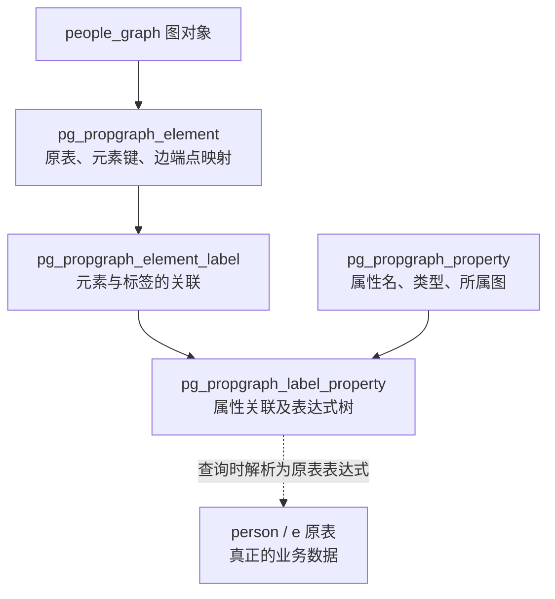
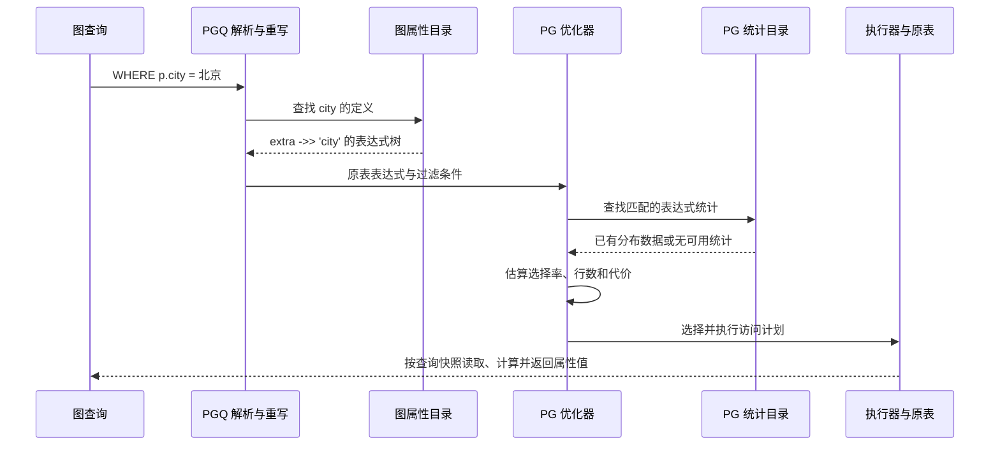

# 图属性与统计信息关键设计及源码解读

本文围绕 SQL/PGQ 的顶点和边属性，说明四件事：属性值在哪里、属性定义如何保存、图查询如何读取属性、优化器如何取得统计信息。最后说明这些原生机制与我们新增的多跳图统计、Apache AGE 的关系。

核心结论：**数据在原表，图目录保存映射；属性引用重写为原表列或表达式后，复用 PostgreSQL 的统计估算机制。图结构统计另行维护，不替代属性统计，也不要求安装 AGE。**

## 1 版本与阅读范围

属性目录与统计机制核对于 2026-10-20；2026-10-21 已刷新第 7.3～7.4 节的图 B-tree 准入和正式内核入口，包含当前未提交增量：

| 对象 | 路径与版本 |
|---|---|
| PostgreSQL 图内核 | `.worktrees/pg19-graph-core/postgres19`，HEAD `5d3d3c1d29af20946b238a4bbde2c38bebeefd77` |
| 上游基线 | `7873db5369b967dd53984df34fd800003410d04f`，PostgreSQL 19beta2 |
| AGE 适配 | `.worktrees/pg19-graph-core/apache-age-pg19-port`，HEAD `01f2d3694235baefb21d66acb6634404744d5782` |

上述路径均相对 `/home/qiumc/data/code/cpp`。正文源码行号对应本次版本，后续改动应优先按函数名定位。

**版本限制：本文的 SQL/PGQ 是本地保留的 19beta2 实现。上游 PostgreSQL 19 Beta 4 已撤回 SQL/PGQ，不能把本文写成后续 PG19 发行版默认具备的能力。** 参见 [Beta 4 发布说明](https://www.postgresql.org/about/news/postgresql-19-beta-4-released-3386/)。

本文是设计与源码说明，SQL 是配套验证示例，不是新增的运行测试报告。总体多跳设计见[详细设计第 8 章](<../02. PostgreSQL19原生多跳图执行与AGE适配详细设计.md>)；JSONB 和 AGE 表达式统计的既有实验见[复杂数据类型统计信息调研](../PostgreSQL19_复杂数据类型统计信息与优化器使用机制调研.md)。

## 2 先看原表和原始数据

### 2.1 点表与边表

以下对象供独立实验 schema 使用，不要直接在现有性能基准表上执行建表语句。

```sql
CREATE SCHEMA graph_property_demo;
SET search_path = graph_property_demo, public;

CREATE TABLE person (
    id    bigint PRIMARY KEY,
    name  text,
    age   integer,
    extra jsonb
);

CREATE TABLE e (
    id         bigint PRIMARY KEY,
    src        bigint NOT NULL REFERENCES person(id),
    dst        bigint NOT NULL REFERENCES person(id),
    properties jsonb
);

INSERT INTO person VALUES
    (1, '张三', 30, '{"city":"北京","level":"gold"}'),
    (2, '李四', 17, '{"city":"上海","level":"silver"}'),
    (3, '王五', 42, '{"city":"北京","level":"silver"}'),
    (4, '赵六', 24, '{"city":"深圳","level":"gold"}');

INSERT INTO e VALUES
    (101, 1, 2, '{"type":"friend"}'),
    (102, 1, 3, '{"type":"friend"}'),
    (103, 2, 4, '{"type":"follow"}');
```

点表实际只有四列：

| id | name | age | extra |
|---:|---|---:|---|
| 1 | 张三 | 30 | `{"city":"北京","level":"gold"}` |
| 2 | 李四 | 17 | `{"city":"上海","level":"silver"}` |
| 3 | 王五 | 42 | `{"city":"北京","level":"silver"}` |
| 4 | 赵六 | 24 | `{"city":"深圳","level":"gold"}` |

边表中的三条边是 `1 → 2`、`1 → 3`、`2 → 4`，边 ID 分别为 101、102、103。`properties` 是这个示例自行命名的 JSONB 列，不是 SQL/PGQ 强制要求的字段。

### 2.2 在原表上声明图

```sql
CREATE PROPERTY GRAPH people_graph
VERTEX TABLES (
    person KEY (id) LABEL person
    PROPERTIES (
        id,
        name,
        age,
        age >= 18 AS adult,
        extra ->> 'city' AS city,
        extra AS details
    )
)
EDGE TABLES (
    e KEY (id)
    SOURCE KEY (src) REFERENCES person (id)
    DESTINATION KEY (dst) REFERENCES person (id)
    LABEL knows
    PROPERTIES (id, properties ->> 'type' AS kind)
);
```

这里分开声明了两类信息：

| 定义 | 解决的问题 |
|---|---|
| `KEY`、`SOURCE KEY`、`DESTINATION KEY` | 哪些列标识图元素，边连接哪两个顶点 |
| `LABEL`、`PROPERTIES` | 查询可以使用哪些标签、属性名，属性值由什么表达式产生 |

`PROPERTIES` 是定义属性映射的语法，**不是数据类型，也不会自动新增一个存放全部属性的列**。执行上述 DDL 后，`person` 仍是原来的四列；没有新增 `adult`、`city` 或 `details` 物理列。

对于顶点 1：

| 图属性 | 类型 | 来源 | 值 |
|---|---|---|---|
| `p.id` | bigint | `person.id` | 1 |
| `p.name` | text | `person.name` | 张三 |
| `p.age` | integer | `person.age` | 30 |
| `p.adult` | boolean | `person.age >= 18` | true |
| `p.city` | text | `person.extra ->> 'city'` | 北京 |
| `p.details` | jsonb | `person.extra` | 原 JSONB 对象 |

创建图只登记结构，不复制这些业务数据。这个行为与定义视图类似，见本地基线的 [CREATE PROPERTY GRAPH 说明](../../.worktrees/pg19-graph-core/postgres19/doc/src/sgml/ref/create_property_graph.sgml)。

## 3 属性定义在系统目录中如何保存

### 3.1 数据值和表达式定义分开放



这里的箭头表达目录关联或处理关系，不是数据页地址跳转。

两个最关键的属性目录是：

| 目录 | 关键字段 | 直白解释 |
|---|---|---|
| `pg_propgraph_property` | `oid` | 这项属性定义的内部标识，不是顶点 ID |
| 同上 | `pgppgid` | 属性属于哪个图 |
| 同上 | `pgpname` | 属性名，如 `city` |
| 同上 | `pgptypid`、`pgptypmod`、`pgpcollation` | 属性结果的类型、类型修饰和排序规则 |
| `pg_propgraph_label_property` | `plppropid` | 对应哪项属性定义 |
| 同上 | `plpellabelid` | 对应哪个“元素—标签”关联 |
| 同上 | `plpexpr` | 计算属性值的表达式树，类型为 `pg_node_tree` |

例如 `city` 的 `plpexpr` 表示 `extra ->> 'city'` 的内部表达式，**不是 `"北京"`，也不是所有人的城市列表**。

同一图内同名属性共用属性定义，要求类型等保持一致；不同元素上的取值表达式通过各自的关联记录保存。单看 `person` 标签有六项属性映射，但不能推广成“一个图永远只有六条属性目录记录”。源码结构见 [pg_propgraph_property.h](../../.worktrees/pg19-graph-core/postgres19/src/include/catalog/pg_propgraph_property.h)、[pg_propgraph_label_property.h](../../.worktrees/pg19-graph-core/postgres19/src/include/catalog/pg_propgraph_label_property.h)。

### 3.2 创建时的关键源码

入口是 [propgraphcmds.c](../../.worktrees/pg19-graph-core/postgres19/src/backend/commands/propgraphcmds.c)：

```text
CreatePropGraph()                         L104
  └─ 建立图元素、标签和关联
      └─ insert_property_records()       L823
          ├─ 将属性列表转换为 TargetEntry 列表
          └─ 每项调用 insert_property_record()  L917
              ├─ 取得表达式类型，创建或检查属性定义
              ├─ 将表达式序列化，写入标签属性目录
              └─ 注册对原表列、函数等对象的依赖
```

第一个关键点是 L899：属性按普通表达式分析，而不是转换为 JSONB。

```c
tp = transformTargetList(pstate, proplist, EXPR_KIND_PROPGRAPH_PROPERTY);
```

第二个关键点是 L1021：存入的是表达式的序列化形式。

```c
values[Anum_pg_propgraph_label_property_plpexpr - 1] =
    CStringGetTextDatum(nodeToString(expr));
```

因此，`age`、`age >= 18`、`extra ->> 'city'`、`extra` 可以分别产生 integer、boolean、text、jsonb 属性。复杂表达式需要 `AS 属性名`，并受属性表达式上下文的限制，不能把子查询、聚合、窗口函数等任意 SQL 都放进去。

`PROPERTIES ALL COLUMNS` 则在创建时枚举原表列，为各列构造属性定义；它不是一种新的存储布局。

## 4 查询如何从图属性走到原表和统计信息

### 4.1 同一个查询的图写法与关系含义

```sql
SELECT *
FROM GRAPH_TABLE (
    people_graph
    MATCH (p IS person WHERE p.city = '北京')
    COLUMNS (
        p.id AS id,
        p.name AS name,
        p.age AS age,
        p.adult AS adult,
        p.city AS city
    )
);
```

对于这里的单表、单标签模式，其关系含义是：

```sql
SELECT id, name, age,
       age >= 18 AS adult,
       extra ->> 'city' AS city
FROM person
WHERE extra ->> 'city' = '北京';
```

由示例数据可推导出结果为顶点 1 和 3。这是语义展开说明，不是声称重写器会输出这段 SQL 文本。

有边的模式还会根据 `SOURCE KEY`、`DESTINATION KEY` 构造端点连接条件。例如：

```sql
SELECT *
FROM GRAPH_TABLE (
    people_graph
    MATCH (a IS person)-[r IS knows WHERE r.kind = 'friend']->(b IS person)
    COLUMNS (a.id AS src, b.id AS dst)
);
```

其中边属性条件会成为 `e.properties ->> 'type' = 'friend'`。查询的图形写法不会使这个表达式脱离普通 SQL 的统计机制。

### 4.2 属性替换的关键源码

解析阶段，[parse_graphtable.c](../../.worktrees/pg19-graph-core/postgres19/src/backend/parser/parse_graphtable.c) 的 `transformGraphTablePropertyRef()`（L79）把属性引用表示为 `GraphPropertyRef`，其中保留变量、属性及类型信息。

重写阶段，[rewriteGraphTable.c](../../.worktrees/pg19-graph-core/postgres19/src/backend/rewrite/rewriteGraphTable.c) 的 `replace_property_refs_mutator()`（L1287）查找对应目录记录，核心动作是 L1356 附近：

```c
n = stringToNode(TextDatumGetCString(
    SysCacheGetAttrNotNull(PROPGRAPHLABELPROP, tup,
                          Anum_pg_propgraph_label_property_plpexpr)));
ChangeVarNodes(n, 1, mapping_factor->factorpos + 1, 0);
```

直白地说：

1. 从目录取出“这个属性应该怎么算”。
2. 恢复表达式树。
3. 把表达式中的原表变量编号改成当前查询对应的关系编号。
4. 用它替换 `p.city`，后续优化器看到的是 `extra ->> 'city'`。

`rewriteGraphTable()`（L117）把图表引用改为关系子查询。我们的分支另有图程序信息供专用路线使用；不能由此理解为所有查询最终必须执行普通 JOIN，也不能理解为专用路线支持了全部属性表达式。

### 4.3 查询时的统计消费时序



**统计信息用于规划估算，业务属性值在执行时读取。** 优化器不会通过统计直方图返回真实查询结果，也不会为了估算这个谓词先扫描所有顶点。

## 5 属性统计如何收集和使用

### 5.1 三类属性对应不同统计对象

| 图属性或条件 | 重写后的主要表达式 | 统计来源与限制 |
|---|---|---|
| `p.age >= 18` | `person.age >= 18` | 普通列统计，可使用年龄分布 |
| `p.adult` 作为真假过滤 | `person.age >= 18` | 对这个简单定义，可沿普通比较条件使用年龄统计，不必因为有别名就重建一份 |
| `p.city = '北京'` | `person.extra ->> 'city' = '北京'` | 为提取表达式建立统计；整列 `extra` 的统计不是城市分布 |
| `r.kind = 'friend'` | `e.properties ->> 'type' = 'friend'` | 同样需要匹配提取表达式的统计 |
| 整个 `p.details` 的比较 | 整个 `person.extra` 的比较 | 可能使用整列 JSONB 统计，取决于操作符估算器；不是自动分析内部所有键 |

普通 `ANALYZE` 不会自动发现每个 JSONB 键并为其建立路径级统计。JSONB 类型未注册专用 `typanalyze`，见 [pg_type.dat](../../.worktrees/pg19-graph-core/postgres19/src/include/catalog/pg_type.dat) 中 `jsonb` 定义；既有实测详见[复杂类型调研第 2 章](../PostgreSQL19_复杂数据类型统计信息与优化器使用机制调研.md)。

### 5.2 建立热点属性统计

```sql
CREATE STATISTICS person_city_stats
ON (extra ->> 'city')
FROM person;

CREATE STATISTICS e_type_stats
ON (properties ->> 'type')
FROM e;

ANALYZE person;
ANALYZE e;
```

`CREATE STATISTICS` 登记要收集的表达式，`ANALYZE` 才收集并更新分布数据。单表达式统计不需要顺带创建索引，也不提供索引访问能力。参见 [CREATE STATISTICS](https://www.postgresql.org/docs/19/sql-createstatistics.html)。

目录分工如下：

| 对象 | 保存内容 |
|---|---|
| `pg_statistic` | 普通列统计，以及表达式索引的统计等 |
| `pg_statistic_ext.stxexprs` | 用户声明的统计表达式树 |
| `pg_statistic_ext_data.stxdexpr` | 这些表达式各自的单变量统计数据 |
| `pg_stats` | 便于查看普通列等统计的视图 |
| `pg_stats_ext_exprs` | 便于查看扩展统计中各表达式分布的视图 |

注意两套“表达式定义”用途不同：`plpexpr` 决定**图属性怎么算**，`stxexprs` 决定**哪些表达式需要收集统计**。创建前者不会自动创建后者。

### 5.3 收集链路的关键源码

```text
CREATE STATISTICS
  ├─ transformStatsStmt()             parse_utilcmd.c L3157
  └─ CreateStatistics()              statscmds.c L64
      └─ 保存统计对象及 stxexprs

ANALYZE person
  └─ do_analyze_rel()                analyze.c L306
      ├─ 获取样本，计算普通列和相关索引表达式统计
      ├─ update_attstats()           写入 pg_statistic
      └─ BuildRelationExtStatistics()  extended_stats.c L112
          ├─ 查找已声明的扩展统计对象
          ├─ 在样本上计算表达式及其分布
          └─ statext_store()        L808，写入 pg_statistic_ext_data
```

`BuildRelationExtStatistics()` 的 `STATS_EXT_EXPRESSIONS` 分支调用 `compute_expr_stats()` 和 `serialize_expr_stats()`。其产物按表达式顺序保存在 `stxdexpr` 中，而不是存回图属性目录。源码见 [analyze.c](../../.worktrees/pg19-graph-core/postgres19/src/backend/commands/analyze.c)、[extended_stats.c](../../.worktrees/pg19-graph-core/postgres19/src/backend/statistics/extended_stats.c)。

### 5.4 消费链路的关键源码

[selfuncs.c](../../.worktrees/pg19-graph-core/postgres19/src/backend/utils/adt/selfuncs.c) 中：

| 入口 | 核心动作 |
|---|---|
| `eqsel()` L300、`var_eq_const()` L368 | 等值条件估算，可利用 MCV，即最常见值及其频率 |
| `examine_variable()` L5651 | 分辨普通列、复杂表达式，查找可用统计 |
| `examine_simple_variable()` L6047 | 普通列按关系 OID、列号、继承口径查 `pg_statistic` |
| `examine_variable()` L5893 起 | 无已匹配索引表达式统计时，查找匹配的扩展表达式统计 |

表达式统计的关键匹配动作：

```c
if (equal(node, expr))
{
    vardata->statsTuple =
        statext_expressions_load(info->statOid, rte->inh, pos);
}
```

这是内部表达式树匹配，不是比较 SQL 字符串，也不是根据 `city` 这个属性名去猜原表列。随后 [extended_stats.c](../../.worktrees/pg19-graph-core/postgres19/src/backend/statistics/extended_stats.c) 的 `statext_expressions_load()`（L2453）从 `stxdexpr` 中取出对应项，交给普通估算器使用。

匹配还不等于无条件消费：必须有已收集的数据、相容的继承口径、适用的选择率估算器，并满足权限和统计安全检查。没有可用统计时使用相应的默认估算，而不是忽略过滤条件。

例如 `extra ->> 'city'`、`extra #>> '{city}'` 和额外包装函数后的表达式，不能仅因结果看起来相同就认为必然命中同一份统计。

### 5.5 属性统计不能替代多跳结构统计

即使已知“北京用户占一半”和“friend 边占三分之二”，也不能据此知道：

- 北京用户是否恰好连接很多边。
- 连续多跳后，有多少路径到达同一个顶点。
- 去重终点数是多少，完整路径条数又是多少。
- 邻接访问需要多少目录查找、页访问和回表。

单表达式统计可以参与适用的普通等值 JOIN 估算；不能因此推导多变量扩展统计已经解决跨表、跨跳的联合分布。相关源码机制与既有实测边界见[复杂类型调研第 2.7 节](../PostgreSQL19_复杂数据类型统计信息与优化器使用机制调研.md)。

## 6 将属性放入 JSONB 后会发生什么

### 6.1 原表本身保存 JSONB

可以把动态属性物理存入 JSONB，同时保持顶点键为独立的有类型列：

```sql
CREATE TABLE person_jsonb (
    id    bigint PRIMARY KEY,
    attrs jsonb
);

CREATE PROPERTY GRAPH people_jsonb_graph
VERTEX TABLES (
    person_jsonb KEY (id) LABEL person
    PROPERTIES (
        id,
        attrs,
        attrs ->> 'city' AS city
    )
);

CREATE STATISTICS person_jsonb_city_stats
ON (attrs ->> 'city')
FROM person_jsonb;

ANALYZE person_jsonb;
```

此时 `attrs` 确实是原表的一列。`p.city` 和 `p.attrs ->> 'city'` 在这个定义下展开为相同的底层提取表达式，具备复用同一表达式统计的基础。

只声明 `PROPERTIES (attrs)` 也能表达顶点属性，但 JSONB 内部的 `name`、`age` 不会自动变成独立图属性：要写 `p.attrs ->> 'name'`，不能直接写 `p.name`。`->>` 返回 text，数值比较还需正确转换类型并约束数据格式。

### 6.2 多个原表列在图属性表达式中打包

另一种写法没有改变原表结构：

```sql
CREATE PROPERTY GRAPH people_packed_graph
VERTEX TABLES (
    person KEY (id) LABEL person
    PROPERTIES (
        jsonb_build_object(
            'id', id,
            'name', name,
            'age', age,
            'adult', age >= 18,
            'city', extra ->> 'city',
            'details', extra
        ) AS attrs
    )
);
```

此时只有一个图属性 `attrs`。目录保存的是 `jsonb_build_object(...)` 表达式，查询需要该值时计算，不会把 `person` 的四个列搬进新 JSONB 列。

如果过滤条件是：

```sql
(p.attrs ->> 'age')::integer >= 18
```

重写后，左侧是“构造 JSONB → 提取 age → 转 integer”的组合表达式，**不能直接认定它会使用 `person.age` 的列统计**。当前机制按表达式树匹配，并不会因为 JSON 键也叫 `age` 就自动还原为原列。

同样，`CREATE STATISTICS ... ON (extra ->> 'city')` 不应被视为一定覆盖“先构造完整 JSONB，再提取 city”的表达式。应检查最终表达式及统计匹配，或让过滤条件直接使用单独映射的标量属性。

### 6.3 推荐的建模方式

| 需求 | 建议 |
|---|---|
| 顶点和边的身份、连接键 | 保留独立有类型列，便于约束、连接和索引 |
| 经常过滤、连接、排序的属性 | 优先暴露为明确标量属性；JSONB 热点键统一提取表达式并声明统计 |
| 灵活、较少用于过滤的属性 | 可以保留为 JSONB 属性 |
| 接口要求返回一个 JSON 对象 | 可以在最终投影时打包，不必把所有内部过滤也改成打包后提取 |

“用 JSONB 表达属性”和“用什么结构访问邻居”是两个维度。JSONB 不会自动创建 graph_adj，也不会使普通 B-tree 变成 AGE 内存图。

## 7 我们新增的图统计以及 AGE 的边界

### 7.1 四种信息各司其职

| 信息 | 所属模块 | 内容 | 是否依赖 AGE |
|---|---|---|---|
| 图属性定义 | 19beta2 SQL/PGQ 目录 | 标签、属性名、类型、原表表达式 | 否 |
| 属性值分布 | PG 列统计和表达式统计 | MCV、不同值数量、直方图、空值比例等 | 否 |
| 多跳与访问工作量 | 我们新增的公共图统计 | 度数、frontier、bindings、重复到达、访问和回表工作量等 | 否 |
| AGE 图缓存诊断 | AGE 自身函数 | 已加载顶点/边数量、某点入度/出度等 | 是，但不是前两项的前置条件 |

因此，“图属性统计与 AGE 没关系”的准确说法是：**PGQ 原表属性统计的创建、收集和消费不依赖 AGE；AGE 自己的底层表也可以复用 PG 统计机制。**

AGE 原生属性列是 `agtype`，不是 JSONB。为 Cypher 属性访问建立表达式统计时，应匹配 AGE 转换后的访问函数及类型，不能把 `properties ->> 'type'` 的 JSONB 示例原样当作 AGE 的通用方案。既有实验见[复杂类型调研第 3 章](../PostgreSQL19_复杂数据类型统计信息与优化器使用机制调研.md)。

### 7.2 新增图统计的实现位置

我们新增独立目录，保持普通 `ANALYZE`、PG 属性统计和 AGE 原有入口的语义：

| 源码 | 关键职责 |
|---|---|
| [graph_stats.h](../../.worktrees/pg19-graph-core/postgres19/src/include/statistics/graph_stats.h) | 指标 ID、统计状态、估计可信度、图/方向/角色/版本作用域 |
| [pg_graph_statistic.h](../../.worktrees/pg19-graph-core/postgres19/src/include/catalog/pg_graph_statistic.h) | 图统计对象、作用域、依赖及当前发布代际 |
| [pg_graph_statistic_data.h](../../.worktrees/pg19-graph-core/postgres19/src/include/catalog/pg_graph_statistic_data.h) | 各指标、profile key、元数据、版本化数据载荷 |
| [graph_stats_collect.c](../../.worktrees/pg19-graph-core/postgres19/src/backend/statistics/graph_stats_collect.c) | `pg_graph_statistic_collect()`，显式、有预算的单跳采集 |
| [graph_stats_path_collect.c](../../.worktrees/pg19-graph-core/postgres19/src/backend/statistics/graph_stats_path_collect.c) | `pg_graph_statistic_collect_path()`，路径工作量采集 |
| [graph_stats_store.c](../../.worktrees/pg19-graph-core/postgres19/src/backend/statistics/graph_stats_store.c) | 创建、编码、发布、依赖校验和读取接口 |
| [graphstats.c](../../.worktrees/pg19-graph-core/postgres19/src/backend/optimizer/path/graphstats.c) | `GgcLoadGraphPathStatistics()`，规划期有界加载和有效性检查 |
| [costgraph.c](../../.worktrees/pg19-graph-core/postgres19/src/backend/optimizer/path/costgraph.c) | 将工作量和单位成本组合为 GraphPath 估算 |

`graph_stats.h` 末尾明确规定：采集是显式入口，初期仅 superuser；消费匹配角色和安全作用域；不在 `ANALYZE`、pgstat、逐边 DML 或某前端专属统计模块中挂入全图采集。

这里的“不改 pgstat”不等于完全不读取其信息：代码可以读取已有变更计数来辅助判断陈旧度，但不把图分布写入这些监控计数器，也不将它们作为 MVCC 正确性的替代。

### 7.3 缺图统计时怎样复用 PG 统计

[graph_pgq.c](../../.worktrees/pg19-graph-core/postgres19/src/backend/executor/graph_pgq.c) 的 `pgq_fallback_estimates()` 复用普通列统计（原测试模块代码已迁入内核）：

```text
边表行数 / src 的 NDV
    → 估计每个有出边端点的平均扇出

dst 的 NDV
    → 为去重终点数量提供保守的域规模参考

首跳已证明由起点条件蕴含的边过滤行数
    → 改进首跳扇出估算
```

NDV 是不同值数量。比如 10 万边、5 万个不同 `src`，可以得到约 2 的平均扇出参考；它不包含未出现在边表中的孤立顶点，也不描述热点、跨跳相关性或某个具体起点的度数。

`costgraph.c` 区分 `next_bindings` 和 `next_endpoints`：前者是路径绑定数量，后者用于端点集合。两者不能混用。NDV 估计也不能证明结果唯一，不能凭它直接删除 `DISTINCT`。

### 7.4 当前专用图路线的属性能力限制

必须区分“PGQ 可以表达”与“当前 GraphExpandFixed 快路径可以执行”。

同一个 [graph_pgq.c](../../.worktrees/pg19-graph-core/postgres19/src/backend/executor/graph_pgq.c) 中，`pgq_program_contract()` 检查固定 WALK、键类型、权限、RLS、输出和过滤条件。M2 已准入受支持的点/边局部安全条件、typed 属性输出和跨变量条件；M3 已准入 B-tree 的 OUT、IN、无向匹配。局部条件在同一快照的真实点边元组上求值；跨变量条件在完整绑定后求值，不能因此丢掉路径重数。

因此，边属性过滤不再是图 B-tree 的一概拒绝项，但仍须通过表达式、同源映射、bigint 身份键等准入检查；**本节不能据此保证任意图模式和表达式可执行，也不能把 B-tree 扩展套给 adj/AGE**。不满足资格时，强制 hint 报错；适用的原生关系路线仍保留。属性延迟读取可能增加扫描和回表，不是免费投影或新的统计来源。

对应检查入口为 `route_graph_join_search()` 及其调用的准入函数。SQL/PGQ 已由内核初始化注册，不需要 `LOAD 'test_graph_core'`；自然选路 `enable_graph_btree` 默认 off，不能等同于生产默认全面选优。具体实现、正负例和边界见[组合设计第 9～14 节](设计/图Btree与关系算子组合执行设计.md)。

### 7.5 AGE 的统计函数不是公共图 CBO 统计

[age_global_graph.c](../../.worktrees/pg19-graph-core/apache-age-pg19-port/src/backend/utils/adt/age_global_graph.c) 中：

- `age_vertex_stats()`（L1583）从内存图邻接取得指定点的自环、入度、出度。
- `age_graph_stats()`（L1701）返回已加载顶点和边的数量等信息；该入口还会先移除对应上下文再装载，以显示装载问题。

这些接口不是 `ANALYZE` 的替代，也不等于自动向我们的 `pg_graph_statistic*` 发布可供 CBO 使用的多跳分布。公共执行器对接 AGE 内存邻接是另一项访问能力，不能与属性统计混为一谈。

## 8 按这个顺序读源码

以下顺序串起“定义 → 查询 → 统计”的最短阅读路径：

| 顺序 | 文件和位置 | 要回答的问题 |
|---:|---|---|
| 1 | [gram.y](../../.worktrees/pg19-graph-core/postgres19/src/backend/parser/gram.y)，`element_table_properties` L9631 | `PROPERTIES` 接受什么语法 |
| 2 | [propgraphcmds.c](../../.worktrees/pg19-graph-core/postgres19/src/backend/commands/propgraphcmds.c)，L823、L917 | 每个属性怎样转换为表达式并写目录 |
| 3 | [pg_propgraph_label_property.h](../../.worktrees/pg19-graph-core/postgres19/src/include/catalog/pg_propgraph_label_property.h)，L29 | 存的是表达式还是业务值 |
| 4 | [parse_graphtable.c](../../.worktrees/pg19-graph-core/postgres19/src/backend/parser/parse_graphtable.c)，L79 | `p.city` 如何成为属性引用节点 |
| 5 | [rewriteGraphTable.c](../../.worktrees/pg19-graph-core/postgres19/src/backend/rewrite/rewriteGraphTable.c)，L1287 | 如何替换回原表表达式 |
| 6 | [statscmds.c](../../.worktrees/pg19-graph-core/postgres19/src/backend/commands/statscmds.c)，L64、L528 | `CREATE STATISTICS` 如何登记表达式 |
| 7 | [analyze.c](../../.worktrees/pg19-graph-core/postgres19/src/backend/commands/analyze.c)，L606、L624 | 列统计和扩展统计如何分别更新 |
| 8 | [extended_stats.c](../../.worktrees/pg19-graph-core/postgres19/src/backend/statistics/extended_stats.c)，L112、L808 | 表达式分布如何计算和保存 |
| 9 | [selfuncs.c](../../.worktrees/pg19-graph-core/postgres19/src/backend/utils/adt/selfuncs.c)，L5651、L5893、L6047 | 查询如何匹配并读取统计 |
| 10 | [graph_pgq.c](../../.worktrees/pg19-graph-core/postgres19/src/backend/executor/graph_pgq.c)，`pgq_program_contract()`、`pgq_fallback_estimates()` | 我们的快路径准入和统计回退到哪里为止 |

上述属性目录写入、普通 `ANALYZE` 和表达式统计消费机制在本地 `7873db5` 基线中已存在；新增公共图统计不能被算作这些原生能力的来源。

## 9 配套验证与排查

### 9.1 查看图属性映射

在创建了第 2 节对象的本地 SQL/PGQ 实例中：

```sql
SET search_path = graph_property_demo, public;

SELECT el.pgealias AS element_alias,
       p.pgpname AS property_name,
       format_type(p.pgptypid, p.pgptypmod) AS property_type,
       pg_get_expr(lp.plpexpr, el.pgerelid) AS source_expression
FROM pg_catalog.pg_propgraph_property AS p
JOIN pg_catalog.pg_propgraph_label_property AS lp
  ON lp.plppropid = p.oid
JOIN pg_catalog.pg_propgraph_element_label AS ell
  ON ell.oid = lp.plpellabelid
JOIN pg_catalog.pg_propgraph_element AS el
  ON el.oid = ell.pgelelid
WHERE p.pgppgid = 'people_graph'::regclass
ORDER BY element_alias, property_name;
```

检查重点：`city` 的来源应该是提取表达式，`adult` 应该是年龄比较表达式，而不是业务数据值。

### 9.2 查看已有统计

```sql
SELECT attname, null_frac, n_distinct,
       most_common_vals, most_common_freqs, histogram_bounds
FROM pg_catalog.pg_stats
WHERE schemaname = 'graph_property_demo'
  AND tablename = 'person';

SELECT statistics_name, expr, null_frac, n_distinct,
       most_common_vals, most_common_freqs, histogram_bounds
FROM pg_catalog.pg_stats_ext_exprs
WHERE schemaname = 'graph_property_demo'
  AND statistics_name IN ('person_city_stats', 'e_type_stats')
ORDER BY statistics_name;
```

`pg_stats_ext_exprs` 展示表达式、MCV、频率等，并有权限可见性限制，见[视图说明](https://www.postgresql.org/docs/19/view-pg-stats-ext-exprs.html)。没有看到记录时，先检查对象、`ANALYZE` 和权限，不直接断言 PGQ 不支持属性统计。

### 9.3 查看展开表达式与估算

```sql
EXPLAIN (ANALYZE, VERBOSE, TIMING OFF, FORMAT TEXT)
SELECT *
FROM GRAPH_TABLE (
    people_graph
    MATCH (p IS person WHERE p.city = '北京')
    COLUMNS (p.id AS id, p.name AS name)
);
```

本例使用新会话、`enable_graph_btree=off` 且不加图 hint，先验证原生关系化链路。现在是否加载 `test_graph_core` 不再决定正式入口可用性。检查计划中的实际表达式、估算 `rows` 与实际行数，不要求四行小表一定展示明显的估算变化或使用索引。

若要验证统计收益，应在独立数据上构造明确的倾斜分布，保持 SQL、数据和索引不变，只比较创建并收集表达式统计前后。只增加统计而不增加索引，可能改善估算但不改变扫描方式，这不是统计失效。

排查顺序是：

1. 图属性映射是否正确，重写后究竟是什么表达式。
2. 统计定义是否匹配该表达式，数据是否已收集。
3. 操作符估算器、权限和继承口径是否允许消费。
4. 若使用专用图路线，查询是否通过当前语义准入。
5. 若误差来自多跳重复到达或热点度数，应检查图结构统计，而不是继续给同一个 JSONB 属性提高统计目标。

最终应把三件事分清：**属性映射保证读对数据；属性统计帮助估准过滤；多跳统计帮助估准遍历。AGE 不是这三者的统一前置依赖。**
