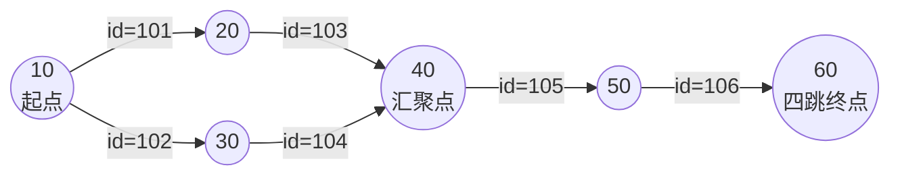
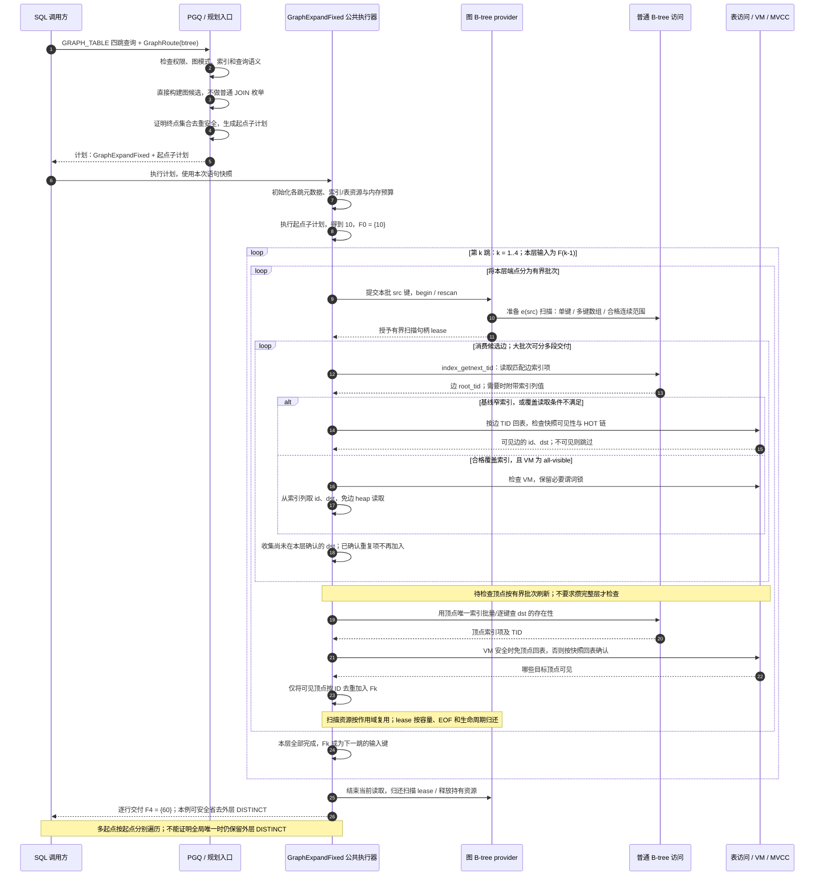

# 多跳图执行：主要测试场景

## 1. 我们当前汇报采用的四类场景

每个场景均为10万条边、固定十跳，查询去重后的终点。这里的“重复”指遍历过程中重复到达，不是边ID重复。

| 场景 | 数据与访问特点 | 返回行数 | 主要验证什么 |
|---|---|---:|---|
| 平行边重复遍历（原称“高汇聚”） | 多个位置在相同两点间创建10条不同ID的边；形成100万条路径组合，逐层去重后只处理64条边候选 | 1 | 逐层去重减少重复展开的收益 |
| 无重复单链 | 每跳只有一个邻居，十跳展开10条边 | 1 | 小工作量下的执行固定开销 |
| 无重复连续键树 | 十跳展开910条边，待访问端点键较集中 | 100 | 无重复遍历时的批量访问收益 |
| 无重复稀疏键树 | 十跳同样展开910条边，待访问端点键更分散 | 100 | 分散索引定位下的执行性能 |

- **路线对比**：relational、图B-tree、graph_adj；无重复三例另测“公共执行器＋AGE内存邻接”和AGE VLE。
- **规划测试**：上述场景分别记录规划时间和纯执行时间。
- **AGE成本测试**：无重复三例分别测首次完整执行、同事务热态查询及内存开销。

PGQ路线使用同一查询，仅切换hint或AGE开关；AGE VLE使用经等价验证的Cypher。无重复三例中的DISTINCT实际删除0行。

依据：[GraphRoute三路hint使用与性能.md §2.43](../执行包/golden/G1-080/GraphRoute三路hint使用与性能.md#243-原汇报四场景复测与历史前后对比2026-10-24)。2026-10-24 使用当前安装重测；§2.20 保留2026-10-06原表的历史结果。

数据关系：四类不是同一份数据；无重复三例使用各自的表。连续键树与稀疏键树的连接结构相同，只对顶点ID及边的起终点键做一一映射；单链的连接结构不同。

## 2. 按数据特征与测试目标对齐：论文与我们的提升

**2026-10-25更新：最新完整同期对照见§2.5；下方§2.1～§2.4保留此前历史比较和归因过程。恢复优化仍在进行。**

**我们的数据已更新为2026-10-24实测。** 下表采用§2.43对应的四场景复测：均为10万边、十跳，结果正确性、实际路线和该轮计时环境检查通过。前后对比见后面的两张表，“前”是2026-10-06历史结果，“后”是本次当前版本结果。随后进行的旧版／新版同期归因另见§2.4，不能把历史差值直接算成代码退化。

- **Graph Story**：*The Graph Story of the SAP HANA Database*，BTW 2013，参考§6.1～6.2、表1／3、图7／8。[原论文](https://subs.emis.de/LNI/Proceedings/Proceedings214/403.pdf)
- **GRAPHITE**：*GRAPHITE: An Extensible Graph Traversal Framework for Relational Database Management Systems*，按2014年arXiv v1预印本核对，参考§2、§7、表1及图13。[原论文](https://arxiv.org/html/1412.6477v1)

**按“数据有什么特点、要验证什么能力”归类，不以数据规模、具体数据集或业务名称是否一致作为对齐条件。** 下表是我们的归类判断，不是论文原有分类。备注区分“数据特征与目标相近”“仅目标相近”和“本轮未覆盖”，不再因为数据集不同就一律写成未测。

**表内所有倍率统一为各自环境内的“relational耗时 ÷ 图路线耗时”。** Graph Story采用论文的等价SQL基线；GRAPHITE采用图13的 **RDBMS-INDEX（源顶点列有辅助索引的关系型自连接）**，不把无索引JOIN、Neo4j、LS或不聚簇FI混作分母。GRAPHITE数字为图中同一数据集、同一跳数两条曲线的读数估算，不是作者公开的原始计时。除最后一行明确标注的**规划时间**外，均讨论执行收益；同一行表示可以对照收益方向，不表示可以直接按倍率判定哪套系统更快。

| 场景 | 论文名称 | 论文提升说明（相对relational） | 我们提升说明（相对relational） | 备注 |
|---|---|---|---|---|
| 多跳只取终点集合，存在重复到达：检验能否减少关系中间结果和重复展开 | [Graph Story](https://subs.emis.de/LNI/Proceedings/Proceedings214/403.pdf) | 较大跳数下WIPE／等价SQL **平均约30×、最高46×**；这是图遍历整体收益，不是单独的去重消融结果 | 平行边重复遍历：图B-tree **4043.27×**；adj **4044.17×**；公共执行器＋AGE未测 | **集合遍历目标相近。** 论文采用一般网络图，我们用平行边放大重复到达；论文未量化与我们相同的重复程度，因此不能把倍率差解释为实现优劣 |
| 低扇出、小访问集合：检验能否只访问少量相关邻居，降低每跳固定开销 | [GRAPHITE](https://arxiv.org/html/1412.6477v1#S7.F13) | 道路网CR的11／19／27／35跳示例：**FI相对有索引JOIN约4.8～20.5×**① | 无重复单链：图B-tree **8.40×**；adj **7.69×**；公共执行器＋AGE热态 **15.04×** | **数据特征与目标相近。** 道路网低度数但可分叉、有环；单链更简单。跳数已分别标明，不能当作同一查询规模的直接PK |
| 多分支、批量多跳：检验一批端点的定位和邻居读取效率 | [GRAPHITE](https://arxiv.org/html/1412.6477v1#S7.F13) | 专利图PA的4～6跳：**FI相对有索引JOIN约13～20×**① | 无重复连续键树：图B-tree **5.40×**；adj **1.96×**；公共执行器＋AGE热态 **9.93×** | **遍历目标相近。** 我们前两层分叉，后续每层100个端点，对比第二条单链每层1个端点；不是每个点都有100个邻居。倍率仍是图执行整体收益，论文未单独控制连续键或重复遍历，不能归因于批处理一个因素 |
| 邻接访问分散、定位成本较高：检验稀疏ID键下的性能 | [GRAPHITE](https://arxiv.org/html/1412.6477v1#S7.F13) | **未单列稀疏ID键场景的relational倍率**；不以不聚簇FI的数据替代 | 无重复稀疏键树：图B-tree **2.27×**；adj **1.89×**；公共执行器＋AGE热态 **16.00×** | **论文未单列这一控制变量。** 物理非聚簇不等于ID稀疏；一般图的JOIN对照不能证明稀疏化本身的收益 |
| 扇出大、访问集合快速扩张：检验大范围遍历及算法选择 | [GRAPHITE](https://arxiv.org/html/1412.6477v1#S7.F13) | Orkut第4跳：**LS相对有索引JOIN约2.5×**；LiveJournal第5跳：**LS约9.2×**① | 当前四类未覆盖持续大幅扩张的访问集合，没有对应倍率 | **本轮未覆盖这一数据特征。** 这里是LS对JOIN，不是FI的成绩。我们的树仅前两层扩张，后续每层约100个端点；平行边例去重后每层只有1个端点 |
| 只有1～2跳：检验图执行在短查询上能否抵消固定开销 | [Graph Story](https://subs.emis.de/LNI/Proceedings/Proceedings214/403.pdf) | WIPE／等价SQL **1.03～1.24×** | 当前汇报固定十跳，没有本轮1～2跳倍率 | **本轮未覆盖短跳目标。** 单链虽然访问量小，但仍有十跳，不能用它冒充1～2跳结果 |
| 多跳叠加业务约束：层级查找、属性过滤或关系交集 | [Graph Story](https://subs.emis.de/LNI/Proceedings/Proceedings214/403.pdf) | 三个业务查询中WIPE／各自等价SQL **约4～20×** | 当前四类未覆盖这组复合查询目标，没有对应倍率 | **本轮未覆盖复合目标。** 4～20×是三个查询的组级范围，不是每一种过滤或交集都保证达到 |
| 【规划】多跳展开成多表JOIN：检验能否减少关系计划枚举 | Graph Story、GRAPHITE | 两篇没有给出可直接引用的独立规划加速比 | 四类十跳中：图B-tree **595.03～1546.33×**；adj **1485.62～1808.60×**；公共执行器＋AGE **1604.83～1767.19×** | **我们有独立规划结果，论文未单列。** 这里不是执行倍率；我们使用强制图路线，不代表自然CBO已达同样收益 |

① **GRAPHITE读数口径。** 核对PDF第11页图13图例及坐标轴后，从原SVG曲线坐标按对数轴换算，分别取同跳数的 `RDBMS-INDEX / FI` 或 `RDBMS-INDEX / LS`。道路网四点约4.8／11.4／10.7／20.5×，专利图三点约13.0／20.2／17.6×；主表范围只概括这些示例，**不是全论文的平均、最大值或所有跳数的保证**。关系JOIN同样使用HANA列存及与图算法相同的数据布局。逐点时间、坐标和来源摘要见[读数记录](附件/GRAPHITE图13关系型对照读数.json)，复算用[读取脚本](附件/读取GRAPHITE图13关系型对照.py)。[原图13](https://arxiv.org/html/1412.6477v1#S7.F13)

**移出主表的非relational结果：** 聚簇FI相对不聚簇FI平均约3.5×、FI相对LS最高约100×，仅用于解释优化机制，不计入主表的relational提升。[§7 Runtime Analysis](https://arxiv.org/html/1412.6477v1)

我们的倍率采用[本次复测与独立复算](../执行包/evidence/runs/20261024T131542.935870Z-G1-080-report-chapter2-retest/summary.json)，先计算同轮倍率、再取轮间中位数；不一定等于两个总体耗时中位数直接相除。本表只列图B-tree、adj、**公共执行器＋AGE内存邻接**三条图路线；AGE VLE及详细计时见[性能报告§2.43](../执行包/golden/G1-080/GraphRoute三路hint使用与性能.md#243-原汇报四场景复测与历史前后对比2026-10-24)。AGE组合倍率是同事务热态；本次单链／连续／稀疏首次完整执行的中位数分别为 **60.060／54.179／54.590 ms**，包含事务内邻接构建，不是短事务只查一次的收益。

### 2.1 正确性与前后比较口径

**先验证结果，再接受性能数据。** 本次逐项确认：四套原数据、SQL正文、索引及统计信息与历史输入一致；各路线的完整返回值一致，并核对实际执行计划。无重复树还验证了AGE副本的全部顶点、边及属性与原表一致；不是只比较返回行数。

- 平行边／单链／连续键树／稀疏键树分别返回 **1／1／100／100行**。
- 合格计时分别为 **6/6、8/18、6/6、5/6轮**；所有合格轮都纳入，污染轮整轮剔除。独立复算253,712条原始热态计时，AGE首次执行9/9次合格。
- **前＝2026-10-06原表；后＝2026-10-24当前版本。** 当前PG为`e040226`加既有未提交修改，安装二进制`ead5ab89`；本次未改产品代码、未重新编译当前产品。前后的种子、查询及测试参数相同；这两张历史对比表未使用旧版同期重测值，后续同期验证另见§2.4。

**结论：相对原表，本次已测图路线的热态执行耗时全部更高，观察到约3.47%～20.99%的不利变化。** 单链相对relational的倍率虽然略升，它自身仍慢约3.5%～4.7%，因为relational由0.239250增至0.261250 ms（+9.20%）。不能将倍率上升写成图路线自身变快。

这是**跨日期实测值的前后比较**，不能把差值全归因于代码。后续已完成两组旧、新二进制交错测试和执行指令归因，结论见§2.4。本节不拿历史差值覆盖另一套测试中B-tree工作区复用的同期收益。

### 2.2 纯执行时间：原表与本次对比

“耗时变化”按`本次耗时中位数 / 原耗时中位数 - 1`计算；“相对relational”是各自当期的配对倍率。平行边＋AGE未测，仍不补造数据。

| 场景 | 路线 | 原耗时 ms | 本次耗时 ms | 耗时变化（本次/原） | 原相对 relational | 本次相对 relational |
|---|---|---:|---:|---|---:|---:|
| 平行边重复遍历 | 图 B-tree | 0.043250 | 0.052250 | 变慢 20.81% | 5420.04× | 4043.27× |
| 平行边重复遍历 | adj | 0.049875 | 0.052250 | 变慢 4.76% | 4696.14× | 4044.17× |
| 无重复单链 | 图 B-tree | 0.029250 | 0.030625 | 变慢 4.70% | 8.18× | 8.40× |
| 无重复单链 | adj | 0.032375 | 0.033500 | 变慢 3.47% | 7.09× | 7.69× |
| 无重复单链 | 公共执行器＋AGE 热态 | 0.016250 | 0.017000 | 变慢 4.62% | 14.80× | 15.04× |
| 无重复连续键树 | 图 B-tree | 0.277250 | 0.304375 | 变慢 9.78% | 5.88× | 5.40× |
| 无重复连续键树 | adj | 0.729000 | 0.852125 | 变慢 16.89% | 2.28× | 1.96× |
| 无重复连续键树 | 公共执行器＋AGE 热态 | 0.141500 | 0.168500 | 变慢 19.08% | 10.91× | 9.93× |
| 无重复稀疏键树 | 图 B-tree | 1.005500 | 1.212000 | 变慢 20.54% | 2.37× | 2.27× |
| 无重复稀疏键树 | adj | 1.202750 | 1.455250 | 变慢 20.99% | 2.06× | 1.89× |
| 无重复稀疏键树 | 公共执行器＋AGE 热态 | 0.155000 | 0.172000 | 变慢 10.97% | 16.14× | 16.00× |

### 2.3 规划时间：原表与本次对比

规划与执行分开计时，以下倍率不计入执行加速。使用强制hint、GEQO关闭；当前图B-tree计划记录8个图候选。这组数据不代表自然AUTO选优耗时。

| 场景 | 路线 | 原耗时 ms | 本次耗时 ms | 耗时变化（本次/原） | 原相对 relational | 本次相对 relational |
|---|---|---:|---:|---|---:|---:|
| 平行边重复遍历 | 图 B-tree | 0.228500 | 0.773000 | 变慢 238.29% | 1893.15× | 595.03× |
| 平行边重复遍历 | adj | 0.229250 | 0.253250 | 变慢 10.47% | 1893.28× | 1808.60× |
| 无重复单链 | 图 B-tree | 0.224250 | 0.280500 | 变慢 25.08% | 1818.79× | 1546.33× |
| 无重复单链 | adj | 0.224000 | 0.246500 | 变慢 10.04% | 1884.74× | 1749.48× |
| 无重复单链 | 公共执行器＋AGE 热态 | 0.219250 | 0.244750 | 变慢 11.63% | 1899.36× | 1767.19× |
| 无重复连续键树 | 图 B-tree | 0.233500 | 0.308000 | 变慢 31.91% | 1721.78× | 1346.34× |
| 无重复连续键树 | adj | 0.237500 | 0.272500 | 变慢 14.74% | 1696.81× | 1549.91× |
| 无重复连续键树 | 公共执行器＋AGE 热态 | 0.226500 | 0.262250 | 变慢 15.78% | 1755.59× | 1604.83× |
| 无重复稀疏键树 | 图 B-tree | 0.248500 | 0.340000 | 变慢 36.82% | 1571.12× | 1275.04× |
| 无重复稀疏键树 | adj | 0.249500 | 0.293000 | 变慢 17.43% | 1591.69× | 1485.62× |
| 无重复稀疏键树 | 公共执行器＋AGE 热态 | 0.227500 | 0.260500 | 变慢 14.51% | 1747.32× | 1636.01× |

### 2.4 为什么新数据较慢：已确认的原因

**不是AUTO选错计划。** 这些查询都使用强制hint，实际计划的`Graph Route Forced: true`已逐项核对。新版B-tree在图路线内部比较8个起点／展开顺序候选，增加了规划工作；它不是关系／图路线之间的AUTO选择，也不能用来解释纯执行时间增加。

旧源码与当前产品的执行阶段指令对照如下。完整查询结果已另行逐值验证；这里的百分比是**CPU指令量变化，不是耗时变化**。

| 场景／路线 | 执行指令增加 | 已定位的主要额外工作 |
|---|---:|---|
| 单链／图B-tree | +4.06% | 计划解码校验、阶段元数据解析等启动工作 |
| 连续键树／图B-tree | +4.28% | 端点哈希与节点查找占净增指令约52% |
| 稀疏键树／图B-tree | +1.47% | 端点哈希与节点查找占净增指令约55% |
| 平行边／图B-tree | +3.61% | 启动检查、内存统计等固定开销 |
| 连续键树／公共执行器＋AGE | +15.53% | 端点哈希与节点查找占净增指令约53%；原执行工作较少，同类开销占比更明显 |
| 稀疏键树／adj | +5.12% | 新增的元数据注册调用子树占净增指令约77%，发生在邻接读取热路径中 |

**已证实新版增加了一些执行工作，但没有证明上表历史耗时的全部涨幅都来自代码。** 两组同期测试共52,128条计时，结果和计划检查通过；系统换页／主缺页干扰导致四例都未满足预设的跨启动计时要求，因此不发布新的同期退化百分比。数据库后端记录的主缺页为0，也不能据此忽略主机层干扰。

有依据的后续方向是：先减少热路径中的重复provider注册，再降低端点哈希的初始化、插入和查找开销；保留首次ABI检查、MVCC、权限、索引代际检查和内存上限。本轮仅完成归因，未修改产品代码。

详细源码位置、原始指令及计时证据见[性能报告§2.44](../执行包/golden/G1-080/GraphRoute三路hint使用与性能.md#244-原四场景变慢的同期核对与执行工作归因2026-10-24)、[本轮汇总](../执行包/evidence/runs/20261024T142307.535262Z-G1-080-report-slowdown-diagnosis/summary.json)。旧版使用10月6日同提交源码的O2重建二进制，不是10月6日原ELF；没有把不同二进制冒充字节相同。

### 2.5 恢复优化中的最新同期对照与验收边界（2026-10-25）

> 后续版本说明：本节倍率属于19379恢复版。审查修复后当前安装为065407/49827567，详见[验收报告§35](图Btree组合执行M0-M6验收报告.md#35-重新审查后的修复与验收2026-10-25)。本轮19379→中间d92固定配对共26064样本结果一致，但有效启动不足；当时未取得最终4982合格时延；后续已完成本版复测，最新见下方§2.6（简表）/§2.46（完整性能报告），原历史表保留。


**本轮四个场景的图B-tree自身执行耗时均恢复到低于旧版，结果校验和计时协议全部通过。** 前＝10月6日已提交源码的O2重建版`d4f00bd1`，后＝040045配套构建`19379fe5`；不是10月6日原ELF，也不是c99质量基线。原四套100,000边、十跳、SQL正文、索引、统计及设置保持一致，完整返回值分别1、100、100、1行。全部强制hint，沿用原表已开启的批量/整数比较设置；AGE组合为同事务热态。

040644六次独立启动、交换端口角色、旋转并镜像路线顺序，26,064条计时和24份B-tree计划由041923独立复算通过。四例完整结果/元数据一致，24份计划均完成8个候选预算位置且无限时中止。单链/连续/稀疏/平行边干净轮17/16/15/16，纳入推断轮17/15/15/16，合格启动6/5/6/6；四例全部满足双角色门。污染轮和不利样本全部保留。

下表配对变化先在每个启动内计算比值，再跨启动取中位数，不一定等于两个耗时中位数相除；相对relational也由同期配对计算。**自身耗时恢复，不等于相对relational的倍率必然上升。**

纯执行：

| 场景 | 路线 | 前 ms | 后 ms | 配对耗时变化 | 前相对 relational | 后相对 relational |
|---|---|---:|---:|---:|---:|---:|
| 无重复单链 | 图 B-tree | 0.029500 | 0.028250 | -5.13% | 3.74× | 4.14× |
| 无重复单链 | adj | 0.035000 | 0.030750 | -12.76% | 3.32× | 3.82× |
| 无重复单链 | 公共执行器＋AGE 热态 | 0.017000 | 0.015875 | -7.41% | 6.74× | 7.51× |
| 无重复连续键树 | 图 B-tree | 0.321000 | 0.301500 | -5.30% | 4.69× | 4.88× |
| 无重复连续键树 | adj | 0.791000 | 0.745000 | -3.36% | 1.85× | 1.95× |
| 无重复连续键树 | 公共执行器＋AGE 热态 | 0.164000 | 0.129000 | -21.40% | 8.94× | 11.52× |
| 无重复稀疏键树 | 图 B-tree | 1.086500 | 1.043125 | -5.85% | 2.20× | 2.30× |
| 无重复稀疏键树 | adj | 1.239750 | 1.186875 | -2.17% | 1.98× | 1.98× |
| 无重复稀疏键树 | 公共执行器＋AGE 热态 | 0.163750 | 0.135750 | -13.55% | 14.41× | 17.98× |
| 平行边重复遍历 | 图 B-tree | 0.046000 | 0.041500 | -8.28% | 4963.43× | 4771.92× |
| 平行边重复遍历 | adj | 0.050750 | 0.048500 | -4.94% | 4490.06× | 4079.15× |

规划（与执行分开）：

| 场景 | 路线 | 前 ms | 后 ms | 配对耗时变化 | 前相对 relational | 后相对 relational |
|---|---|---:|---:|---:|---:|---:|
| 无重复单链 | 图 B-tree | 0.235250 | 0.217500 | -8.07% | 1655.38× | 1812.74× |
| 无重复单链 | adj | 0.238000 | 0.217500 | -6.74% | 1646.89× | 1801.42× |
| 无重复单链 | 公共执行器＋AGE 热态 | 0.234000 | 0.215000 | -8.00% | 1694.65× | 1830.41× |
| 无重复连续键树 | 图 B-tree | 0.250000 | 0.228000 | -8.55% | 1617.35× | 1733.43× |
| 无重复连续键树 | adj | 0.249500 | 0.228000 | -6.82% | 1617.34× | 1707.45× |
| 无重复连续键树 | 公共执行器＋AGE 热态 | 0.239000 | 0.221500 | -7.11% | 1660.77× | 1779.55× |
| 无重复稀疏键树 | 图 B-tree | 0.261500 | 0.244250 | -5.24% | 1546.42× | 1641.18× |
| 无重复稀疏键树 | adj | 0.256125 | 0.242625 | -5.48% | 1566.88× | 1674.18× |
| 无重复稀疏键树 | 公共执行器＋AGE 热态 | 0.243625 | 0.223375 | -7.74% | 1639.17× | 1785.23× |
| 平行边重复遍历 | 图 B-tree | 0.239750 | 0.227250 | -4.71% | 1822.46× | 1942.77× |
| 平行边重复遍历 | adj | 0.237750 | 0.222125 | -7.24% | 1851.38× | 1983.68× |

图B-tree执行配对变化及探索95%区间：无重复单链 -5.13%（-7.76%～-3.51%）；无重复连续键树 -5.30%（-11.27%～-0.51%）；无重复稀疏键树 -5.85%（-8.26%～-3.22%）；平行边重复遍历 -8.28%（-12.10%～-4.72%）。四项区间上界均低于零，结论限于本轮原四套基准、既定热态和强制路线。adj连续/稀疏执行点估计虽改善，区间仍跨零，未签其严格零退化；独立AGE的原始结果仍单列保存，不与公共执行器＋AGE混称。

**平行边倍率为何仍低一些：** 图B-tree自身执行减少8.28%，relational自身减少12.22%，所以前后相对倍率为4963.43×→4771.92×；这是同版relational分母变化，并非图B-tree本轮变慢。最新版六份关系计划去除计时后完全相同，行数、循环数、缓冲命中均一致。前一版da的035014独立采样显示关系执行指令差异仅+0.00017%，未发现减少关系运算的证据；该采样不冒称当前19379指令对照，真实CPU周期改善的全部原因尚未因果定位。不能故意降低relational性能来恢复倍率。

本轮代码减少两个已验证的索引查找热点：同一读锁内部页按有序键复用精确pivot下界；已准入的单列bigint叶页直接执行固定类型二分比较，NULL元组仍走原生比较。保留pin/锁/右移修正、MVCC、权限、SSI、预算和原搜索候选数。CASSERT分别与原生内部页查找、关闭快速比较的原生叶页查找逐次对照。没有改SQL、创建新索引或缩减返回结果。

040541/040644原始指令复算40份热dump通过，四例相对旧源码基线执行指令−11.64%/−0.72%/−9.83%/−9.10%；稀疏9,790,060→8,827,696条。这是机制证据，耗时使用上表独立无采样结果，不把前轮+0.64%与本轮−5.85%的跨轮差额全部归因于单次修改。

验证包括图27/PG245/AGE43、原四例完整结果、批访问/覆盖专项、040327组合CASSERT/资源/360次并发统计规划，以及040538的134项多层索引专项（极值键、1/7/32/128批次、删除/VACUUM、REINDEX、缓存计划、死NULL和两种NULL排序）。完整四组合仍180939；当前C八文件/B一文件增量分别通过正反应用检查与组合验证，未冒称重跑全部四组合。AUTO、DML严格零退化及生产门不因本轮性能恢复而签收。

前一版033731/da987457的合格表已备份到035251优化记录；025559/cfd和023032/0e7旧表及全部原始数据保留。当前四例图B-tree自身执行恢复这一目标已完成；平行边相对倍率仍低于前值，不能写成所有相对倍率均恢复。

证据：[最新计时](../执行包/evidence/runs/20261025T040644.525660Z-G1-080-report-paired-reuse-performance/summary.json)、[独立复算](../执行包/evidence/runs/20261025T041923.706611Z-G1-080-report-paired-audit/summary.json)、[叶页优化与验证](../执行包/evidence/runs/20261025T035251.035191Z-G1-080-leaf-compare-optimization/progress.json)、[组合断言](../执行包/evidence/runs/20261025T040327.603217Z-G1-080-planner-assert-incremental/summary.json)、[134项专项](../执行包/evidence/runs/20261025T040538.788332Z-G1-080-locked-route-assert/summary.json)、[原始指令复算](../执行包/evidence/runs/20261025T040644.074608Z-G1-080-report-profile-attribution/summary.json)、[关系计划核对](../执行包/evidence/runs/20261025T035251.035191Z-G1-080-leaf-compare-optimization/relational-plan-audit.json)。


### 2.6 审查修复后的最终版复测（2026-10-25）

前＝审查修复前19379，后＝最终4982；原四套100000边/十跳、相同SQL、索引与统计。均强制路线，返回值逐值一致。不是10月6日历史对比，也不是AUTO。

固定六启动、端口互换、三镜像轮，共26064条样本；073645独立审计通过。单链/连续/稀疏/汇聚合格启动4/4/4/5，其中连续为端口角色3:1，未满足各至少2个，仍不得签收。其他三例满足门槛。

| 场景 | 路线 | 前执行 ms | 后执行 ms | 配对耗时变化 | 前相对 relational | 后相对 relational |
|---|---|---:|---:|---:|---:|---:|
| 无重复单链 | 图 B-tree | 0.028875 | 0.029375 | -0.02% | 4.25× | 4.17× |
| 无重复单链 | adj | 0.029750 | 0.031500 | +4.47% | 3.99× | 3.91× |
| 无重复单链 | 公共执行器＋AGE 热态 | 0.016125 | 0.016250 | +1.61% | 7.79× | 7.66× |
| 无重复连续键树 | 图 B-tree | — | — | 计时门未过 | — | — |
| 无重复连续键树 | adj | — | — | 计时门未过 | — | — |
| 无重复连续键树 | 公共执行器＋AGE 热态 | — | — | 计时门未过 | — | — |
| 无重复稀疏键树 | 图 B-tree | 1.076875 | 1.063250 | -4.25% | 2.33× | 2.40× |
| 无重复稀疏键树 | adj | 1.255750 | 1.180500 | -3.70% | 2.03× | 2.07× |
| 无重复稀疏键树 | 公共执行器＋AGE 热态 | 0.126375 | 0.134000 | +6.08% | 19.62× | 18.81× |
| 平行边高汇聚 | 图 B-tree | 0.041500 | 0.043000 | +1.78% | 4986.45× | 4781.01× |
| 平行边高汇聚 | adj | 0.047500 | 0.048250 | +0.00% | 4430.78× | 4183.84× |

| 场景 | B-tree前规划 ms | 后规划 ms | 配对耗时变化 | 前相对 relational | 后相对 relational |
|---|---:|---:|---:|---:|---:|
| 无重复单链 | 0.217250 | 0.226125 | +4.41% | 1800.64× | 1764.00× |
| 无重复连续键树 | — | — | 计时门未过 | — | — |
| 无重复稀疏键树 | 0.244625 | 0.250625 | +2.03% | 1667.73× | 1628.54× |
| 平行边高汇聚 | 0.230000 | 0.234000 | +1.75% | 1939.00× | 1904.06× |

B-tree纯执行探索95%区间：单链−0.77%～+3.51%，稀疏−8.45%～+4.90%，汇聚−0.60%～+6.77%；均跨零，没有稳定退化证据，但不等于严格零退化证明。单链规划+4.41%（+2.78%～+4.56%），约9微秒；adj单链执行+4.47%（+3.13%～+6.67%），约1.75微秒，保留为不利信号。稀疏adj执行−3.70%（−5.28%～−2.36%）；公共执行器＋AGE的单链/稀疏变化区间均跨零。

表中配对变化和相对relational倍率先在每次启动内计算、再跨启动取中位数，不能用两个毫秒中位数直接代替。不能拿无效连续键窗口的数字填表，也不追加轮次凑通过。

新增三跳高扇出LIMIT专项（8192边，不是原10万边）：LIMIT1/10/100相对**旧图B-tree**快89.79/55.33/13.40×；相对**本版relational**仅1.06/1.24/1.08×，LIMIT1区间跨1。完整结果与六启动计时通过，证明避免前缀全物化有效，不是普遍快relational几十倍。

细节及未闭环项见[验收报告§36](图Btree组合执行M0-M6验收报告.md#36-审查修复后的最终性能复测与分层提交2026-10-25)。当前PG已新增公共/B-tree/adj三提交，AGE一提交，安装仍49827567；未重编、未push。

## 3. 如何解读这个对齐

**可以对应起来的方向是：多跳集合查询、低扇出局部访问、有分支的邻接扩展。** 我们用平行边、单链、连续／稀疏键树拆解这些问题；论文用一般网络图验证整体图执行能力。无需同一数据集，仍可以比较“哪种工作负载受益、验证了什么”，但不能把不同条件的整体倍率当成同一因素的净贡献；连续／稀疏ID这个单独变量，论文没有对应的控制实验。

- **重复程度只影响解释，不取消场景对应。** 自然汇聚与平行边都可造成重复到达；我们的100万路径→64候选更偏向放大该收益的用例，不能据此说比论文实现更快。
- **低扇出与稀疏键分开。** 前者指邻居少，对应单链／低度数图；后者指ID分散，对应访问局部性问题。
- **仍保留查询语义边界。** GRAPHITE主实验返回“第k轮首次发现的顶点”，我们返回“恰好k跳的终点”。在本表无重复树上可一致，一般图上可能不同；因此按相似目标对应，不宣称结果语义全面相同。[GRAPHITE §2及§7](https://arxiv.org/html/1412.6477v1)

2026-10-24已重测并刷新我们自己的四类场景，保留原表数据供前后对比；论文读数未改，也没有运行论文数据集复现。历史集合语义探针另见[既有评估§76～77](../执行包/golden/G1-080/图Btree四跳100行性能与10倍可行性评估.md)。

## 4. 图 B-tree 的执行时序

按当前实现核对：2026-10-09。

一句话：**一个 `GraphExpandFixed` 算子控制全部跳数；每层把当前顶点的 ID 交给普通 B-tree 查出边，确认边和目标顶点可见后，形成下一层顶点集合。不是每跳一层 Nested Loop，也不是下一跳免查 B-tree。**

以下对应当前 `pgq-integrated`、`GraphRoute(btree)`、`enable_graph_age_adjacency=off` 的固定 OUT WALK 终点集合路径。图中批量、范围及覆盖读取均有准入条件，不代表所有查询都启用；完整路径/bag 输出不套用这里的逐层去重。

### 4.1 先看原表和查询

教学例子是一张人员关系图，包含下面两张原表，共 6 个顶点、6 条边；顶点表示人员，有向边表示“关注”关系。

顶点表 `std_v`：每行是一名人员。`id bigint` 是顶点主键；`name text`、`age integer`、`city text` 是业务属性，顶点并不是只有一个编号。

| id | name（姓名） | age（年龄） | city（城市） |
|---:|---|---:|---|
| 10 | 张伟 | 32 | 北京 |
| 20 | 李娜 | 29 | 上海 |
| 30 | 王强 | 35 | 广州 |
| 40 | 赵敏 | 30 | 杭州 |
| 50 | 陈晨 | 28 | 深圳 |
| 60 | 周宁 | 33 | 成都 |

本节仍查询“四跳后有哪些不同的人员 ID”，不按姓名、年龄或城市过滤，也不返回这些属性。因此后面的时序图仍聚焦邻接查找、顶点可见性与去重；**表中有业务属性，不等于本查询必须读取并交付这些属性**。这些示例属性不改变图的连接关系，也不代表新增了属性查询的性能测试。

边表 `e`：每行表示一条有向边，`id` 是边主键；`src`、`dst` 分别对应顶点表的起点、终点 `id`。两张表的 ID 都是逻辑标识，**不是 TID**。

| 边 id | src | dst |
|---:|---:|---:|
| 101 | 10 | 20 |
| 102 | 10 | 30 |
| 103 | 20 | 40 |
| 104 | 30 | 40 |
| 105 | 40 | 50 |
| 106 | 50 | 60 |

上表对应的**原始有向图**如下：为突出连接关系，圆圈内只标顶点 ID（姓名等属性见顶点表），箭头上的 `id` 是边 ID；画的是数据连接关系，不是索引页或物理地址。



从 `10` 出发，有 `10→20→40→50→60`、`10→30→40→50→60` 两条四跳路径，但终点都是 `60`。它们在第 2 跳汇聚到同一个 `40`，之后共用边 `105、106`；图中只有 **6 个顶点、6 条边，没有平行边**。逐层去重后，第 3 跳只需展开一次 `40`。这是四跳教学图，不是前文 10 万边平行边测试的数据全图。

顶点有 `std_v(id)` 唯一 B-tree，边的基线索引为普通 `e(src)` B-tree，**不覆盖 `id/dst`**。假设属性图 `std_g` 已将这两张表映射为 `std_v` 顶点标签、`e` 边标签，查询四跳后的不同终点：

```sql
LOAD 'test_graph_core';
SET enable_graph_age_adjacency = off;

/*+ GraphRoute(btree) */
SELECT DISTINCT v
FROM GRAPH_TABLE(std_g
  MATCH (v0 IS std_v WHERE v0.id = 10)
    -[e1 IS e]->(v1 IS std_v)
    -[e2 IS e]->(v2 IS std_v)
    -[e3 IS e]->(v3 IS std_v)
    -[e4 IS e]->(v4 IS std_v)
  COLUMNS (v4.id AS v)
);
```

这是解释流程的示例，不是本次新增实测；原有十跳性能记录不变。此例最终返回 `60`，两条路径汇聚到同一个终点。

### 4.2 从规划到执行的时序图

图中“普通 B-tree”泳道包含**边索引和顶点索引两个不同索引**，每条消息注明用途；“表访问”包含 heap 与可见性映射（VM）。箭头表达同步调用/返回，不表示后台并行任务。起点子计划内部的普通访问细节省略。



这里画的是当前准入路径的 **lease 快路径**：provider 建立/管理扫描，公共执行器借用有界扫描句柄，直接调用普通索引接口读取候选并做 MVCC 处理。不是 provider 绕过 PG 自己读取磁盘；不满足快路径条件时仍有公共批访问层的候选交付与回表路径。

### 4.3 把四次循环展开，就能看清下一跳查什么

`Fk` 表示“恰好走 k 跳后，本起点可达且可见的不同顶点 ID”，是执行器内存集合，不是索引页或下一跳的物理地址。

| 跳数 | 本层交给边 B-tree 的 src 键 | 找到的边 id | 可见边给出的 dst | 检查顶点后形成下一层 |
|---|---|---|---|---|
| 第 1 跳 | `{10}` | `101、102` | `20、30` | `F1={20,30}` |
| 第 2 跳 | `{20,30}` | `103、104` | `40、40` | `F2={40}`，只保留一个 40 |
| 第 3 跳 | `{40}` | `105` | `50` | `F3={50}`，不为两条前缀重复查出边 |
| 第 4 跳 | `{50}` | `106` | `60` | `F4={60}` |

需要特别分清：

- **每一跳都需要边 B-tree。** 批量数组、连续范围和内部页路由复用减少重复定位/调用；不等于每个端点必然独立从根走一遍，也不等于第 2 跳以后不再访问 B-tree。边索引同键的相邻条目可顺序读取，heap 是否局部则是另一件事。
- **边 TID 不是下一跳地址。** 它用于找到当前边的 heap 记录；拿到 `dst=40` 后，下一跳仍以 `src=40` 查边索引。这里没有 graph_adj 的邻接稳定引用直达。
- **边可见，不代表目标顶点一定可见。** 顶点有独立的索引/VM/必要回表检查；没有相应可见顶点的边不能把该端点放入可继续遍历的集合。VM 未满足时不能为性能跳过 MVCC。
- **去重只限同一起点、同一深度。** 不是全局 visited；有环时，顶点可以在后续深度再次出现，保证 exact-k WALK 语义。多起点不能直接沿用“单起点最终集合已唯一”的结论。
- **索引/heap 页都通过 PG buffer manager 访问。** 缓冲池未命中时仍需加载；“热态”不是这套算法的正确性前提。内存、候选和中断检查贯穿执行，不因图中省略而取消。

源码核对入口（PG HEAD `5d3d3c1`，本节只补文档、未改执行代码）：

| 环节 | 代码入口 |
|---|---|
| 独立图规划、终点集合准入、全局唯一证明、CustomScan 接入 | [test_graph_fixed.c](../../../.worktrees/pg19-graph-core/postgres19/src/test/modules/test_graph_core/test_graph_fixed.c)：`route_graph_join_search`、`pgq_maybe_enable_endpoint_set`、`graph_upper_paths`、`begin_test_fixed`、`exec_test_fixed` |
| 分层循环、批次读取、MVCC、顶点检查、集合输出 | [graph_fixed.c](../../../.worktrees/pg19-graph-core/postgres19/src/backend/executor/graph_fixed.c)：`endpoint_set_next`、`factor_start_batch`、`read_direct_rows`、`consume_endpoint_key`、`flush_pending_vertices` |
| 普通 B-tree 扫描及 lease、数组/连续范围选择 | [graph_btree_provider.c](../../../.worktrees/pg19-graph-core/postgres19/src/backend/executor/graph_btree_provider.c)：`prime_scan`、`btree_begin_lease`、`btree_finish_lease`、`GgcBtreeSetRangeProbe` |

## 5. 图 B-tree 相对 relational 的有效优化：哪些已证明，哪些不能单独归因

核对口径：2026-10-09，当前 PG 主线 `5d3d3c1`。以下区分**整条图路线相对 relational 的收益**与**单项优化开/关的增量收益**；后者的分母是旧图版本或同版本关闭配置，不冒充 relational。relational 允许普通 JOIN/Memoize，不等于强制 Nested Loop。这里只整理既有证据，没有新增测试。

### 5.1 已有正式相对 relational 结果的优化方向

| 优化方向 | 已测传统关系路线的行为 | 图 B-tree 改变了什么 | 当前已验证的相对 relational 收益 |
|---|---|---|---|
| 图区域独立规划 | 十跳展开的 21 个关系参与普通 JOIN 计划搜索 | 强制图 hint 直接构建图候选，不先做普通 JOIN 枚举；仍保留解析、权限和准入检查 | 四场景**规划加速 1571.12～1893.15×**；这是 GEQO off 等本轮配置下的 Planning Time，不计入执行收益，也不是默认自然 CBO 结论 |
| 安全集合语义下逐层去重 | 平行边例先展开 100 万条完整路径，最后对终点去重；Memoize 不等于消除所有重复中间行 | 同一起点、同一深度只保留不同端点，避免重复展开后续路径；合计处理 64 条边候选 | 平行边例**纯执行加速 5420.04×**。计数直接支持“减少重复工作”的解释，但这是整条路线的倍率，不是单次 B-tree 查找的倍率；不能套到必须返回全部路径的查询 |
| 无重复场景的执行组织优化（组合） | 普通关系计划逐行处理连接及中间结果 | 公共执行器组织多跳，结合已启用的批访问、范围/路由等优化，降低访问与中间处理开销；没有靠去重减少有效边数 | 单链 **8.18×**、连续键树 **5.88×**、稀疏键树 **2.37×**。这是组合效果；不能把全部收益归给“批量扫描”或“扫描对象复用”某一项 |

依据：[性能报告 §2.20](../执行包/golden/G1-080/GraphRoute三路hint使用与性能.md)。均为同场景、同原表和 SQL、只切换路线的十跳热态结果，使用窄索引；规划与执行分开统计，倍率按同期配对轮计算。

### 5.2 对上述执行优势有具体工作量或单项对照证据的机制

下表列出已经实现并合入的机制。**“单项有效”不等于该项单独就能产生上表的整体倍率，也不等于所有数据分布都更快。** 历史报告中的“未合入”描述属于当时快照，当前合入状态以 §2.19 和现主线为准。

| 机制 | 相比传统逐行/逐路径处理，具体少做什么 | 既有证据及能得出的结论 | 当前启用边界 |
|---|---|---|---|
| 逐层去重（避免重复遍历） | 对每个起点、每个深度维护独立端点集合；同层重复到达一个可见顶点，只保留一次，下一层只展开一次。例如两条路径到达 `40` 后，后续 `40→50→60` 不再按两条前缀重复展开 | §2.20 平行边例：relational 展开 **100 万条完整路径**后去重；图路线逐层去重，合计只处理 **64 条边候选**，最终均返回 1 行。该场景图 B-tree 相对 relational 纯执行 **5420.04×** 是整条路线的收益，不是单独去重开/关的隔离倍率 | 仅在准入检查证明终点集合语义安全时启用，不能套到完整路径/bag 输出；去重只限同一起点、同一深度，不是全局 visited，后续深度可再次到达同一顶点；多起点仍需必要的全局 DISTINCT |
| 本层端点组批＋目标顶点批查 | 将多个图端点合成一个 `SK_SEARCHARRAY` 请求，减少逐外层行重设扫描参数和重复访问；目标顶点也批量检查 | §2.6 跟踪：811 个源端点组织为 **106 次多键扫描＋1 次单点扫描**，910 个目标顶点检查组织为 **37 次批查**，shared hit **4356→1205**，结果与遍历量不变。**工作量减少有证据；早期隔离计时干净轮不足，不能将约 1.99× 诊断值写成正式单项收益** | `edge_probe_batch` / `vertex_probe_batch` 默认 on，仅合格终点集合路径；依托 PG 已有数组扫描能力，不宣称原生 B-tree 不支持批量 |
| 连续键批次转范围扫描 | 对已证明连续的 `{10,11,12}` 用闭区间扫描，减少数组键推进等开销；有缺口则不转换 | §2.9 连续键例：在同版本线性校验基线上，边/顶点范围均开启相对关闭约 **1.18×**；包含线性校验的整版相对旧图 **1.27×**。单链/稀疏组合曾回退，**只证明连续键条件下有效** | `edge_range_probe` / `vertex_range_probe` 默认 off；只有逐个相差 1 的合格批次才用 |
| 复用内部页查找位置 | 当前扫描保存各树层上次的“页号＋槽位”；重新锁页校验后，从旧位置附近探查并缩小二分范围，减少页内比较 | §2.12 稀疏例：内部页比较 **14125→9036，减少 36.03%**；同二进制 on/off 纯执行约 **1.077×**。根部下探和叶页读取不变，**不能说省掉了树高访问**；单链/连续键未触发该定位路径 | `btree_seek_hint` 默认 off；扫描私有提示约 128B，rescan 清空，不缓存页面/结果或跨事务复用 |
| 批量共享底层内部页路由 | 在已锁住的同一个底层内部页中，为本批多个键算出叶页位置；后续命中时减少从根重复下降 | §2.13 稀疏例计数：边/顶点根页访问 **811/911→10/11**，shared hit **4356→2655**；同二进制**仅开路由**相对关闭纯执行约 **1.10×**。叶层比较不变；另加 bigint 比较的组合约 1.17×，**不能全算成路由的贡献** | `btree_batch_route` 默认 off；最多 128 条键到叶页的路由，rescan 清空，仍检查锁、分裂修正及可见性；不是 graph_adj 稳定引用 |

**逐层去重与组批是两件事：前者减少重复请求及其后续遍历，后者把仍需执行的多个请求放在一起处理。** 去重的实现入口见 §4 的 `endpoint_set_next()`、`consume_endpoint_key()` 和 `flush_pending_vertices()`。

表中列出的开关均以 `test_graph_core.` 为前缀；逐层去重由查询语义准入决定，不能用开关绕过语义证明。默认 on/off 不等于当前会话值；正式回归使用显式的 128/128 批量及优化开关配置，不是全默认配置。各项历史实验来自不同阶段，**倍率不能相加或相乘**，也不能拿某轮旧图耗时与另一轮 relational 耗时拼比值。单项证据详见[性能报告 §2.6、§2.9、§2.12、§2.13](../执行包/golden/G1-080/GraphRoute三路hint使用与性能.md)，当前集成验收及逐层去重场景见该文 §2.19～§2.20。

### 5.3 不能作为相对普通 relational 的独有优势

| 容易误归因的机制 | 经代码核对后的结论 |
|---|---|
| 复用 `IndexScanDesc` 扫描对象 | **普通 Nested Loop＋Index Scan 本来就会复用。** 换外层行通常是更新参数并 `index_rescan()`，不是反复创建/销毁对象。不能用这一点解释我们的独有加速；应比较重扫次数和每次重扫的实际工作 |
| 使用数组扫描、B-tree 顺序读取同键条目 | PG 原生 B-tree 已有这些能力。新增价值在于公共图执行器主动把本层不同端点组批并消费结果，不是发明了数组扫描，也不是“传统 B-tree 只能随机逐条读” |
| 覆盖索引＋VM 免回表 | relational 的 Index Only Scan 也能受益。覆盖索引能力已合入，但不是图独有优势；本次 §2.20 的正式主表仍用窄边索引，不能将成绩归因于覆盖索引 |
| 使用一个图算子，减少多层 JOIN 节点交付 | 是实现差异，也是合理的开销来源，但**现有证据未把纯节点调用开销从其他优化中单独隔离**；只能计入组合效果，不能单列一个确定倍率 |

普通扫描对象复用的直接代码依据：[IndexNext：仅空描述符时创建](../../../.worktrees/pg19-graph-core/postgres19/src/backend/executor/nodeIndexscan.c)中的 `IndexNext()`，以及同文件的 `ExecReScanIndexScan()`；内部页两项优化分别在 [nbtsearch.c](../../../.worktrees/pg19-graph-core/postgres19/src/backend/access/nbtree/nbtsearch.c) 的 `_bt_binsrch_hint()` 与 `_bt_graph_routes()`。

**汇报结论：最确定的大收益是减少规划枚举和重复遍历；无重复场景的优势来自多项执行优化组合。内部页位置复用与路由复用有独立的稀疏场景收益证据，但扫描对象复用不是独有优势。以上均不是普通 SQL/DML 全面非劣化或生产准入的证明。**
